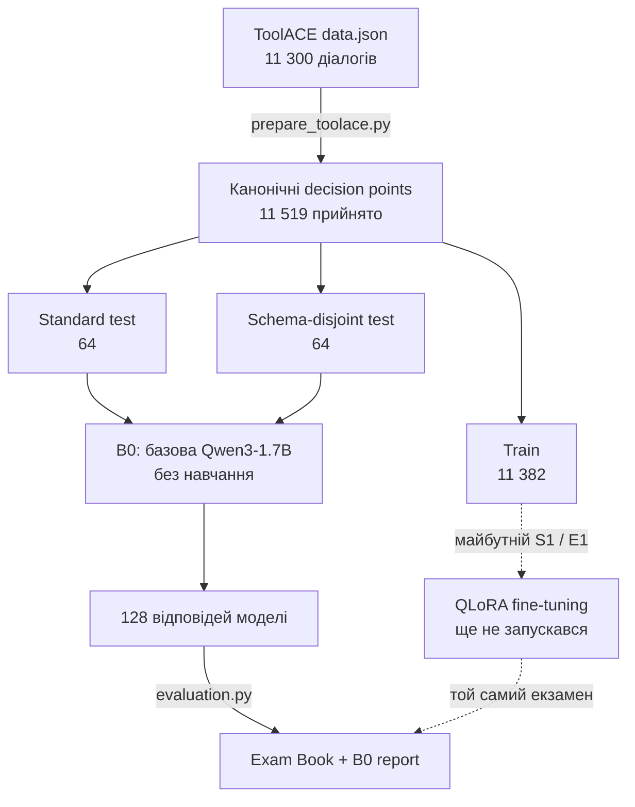

# EXP-001 — B0 Exam Book

Це видиме представлення базового екзамену **до fine-tuning**. Воно показує не загальну «якість моделі», а вузьку здатність: отримавши запит користувача та набір tool schemas, вибрати потрібні інструменти, сформувати аргументи або не викликати нічого.

## Карта експерименту



## Що де лежить

- [`README.md`](../../README.md) — дослідницьке питання та межі EXP-001.
- [`prepare_toolace.py`](../../src/fine_tuning_lab/prepare_toolace.py) — перевіряє ToolACE, перетворює діалоги на decision points і створює splits.
- [`splits.py`](../../src/fine_tuning_lab/splits.py) — формує train, standard test і schema-disjoint test.
- [`b0.py`](../../src/fine_tuning_lab/b0.py) — збирає prompt і запускає базову модель на 128 завданнях.
- [`evaluation.py`](../../src/fine_tuning_lab/evaluation.py) — парсить відповіді та рахує результати.
- [`exam_book.py`](../../src/fine_tuning_lab/exam_book.py) — генерує цей читабельний документ.
- [`b0_manifest.json`](b0_manifest.json) — фіксує модель, dataset revision, кількість і хеш екзаменаційних завдань.
- [`b0_report.json`](b0_report.json) — компактний машинний підсумок B0.

Повні машинні джерела залишаються локальними, але більше не є єдиним способом побачити екзамен:

- `~/.cache/small-model-fine-tuning-lab/exp-001/toolace/b0_decisions.jsonl` — 128 вхідних завдань;
- `~/.cache/small-model-fine-tuning-lab/exp-001/b0/b0_results.jsonl` — 128 фактичних відповідей моделі.

## Як оцінюється одне завдання

Для кожного завдання модель отримує однакову інструкцію: вибрати потрібні інструменти, повернути лише bracket-style виклики `[tool_name(argument=value)]` у правильному порядку або коротко пояснити, що жоден інструмент не підходить. Thinking вимкнено префілом `<think></think>`, генерація детермінована (`temperature=0`, максимум 256 нових токенів).

1. Модель отримує цю інструкцію, попередній контекст діалогу та список доступних tool schemas.
2. Вона повертає bracket-style виклик або звичайний текст, якщо інструмент не потрібен.
3. Парсер перетворює відповідь на канонічне routing-рішення `{"calls": [...]}`.
4. Повний збіг означає, що кількість, порядок, назви інструментів і всі аргументи збігаються з еталоном.

## Підсумок

- **Усього:** 128 завдань
- **Standard test:** 64
- **Schema-disjoint test:** 64
- **Відповідь вдалося розібрати:** 81/128
- **Правильний вибір інструментів:** 66/128
- **Повний збіг:** 53/128

Нижче наведені **всі 128 завдань**, а не вибрана демонстраційна підмножина.

---

## Завдання 001 — ✅ PASS — повний збіг

- **Decision ID:** `6bda777c88d21e5a204703c1ee45597a8fa4f734:405:1`
- **Split:** `standard`
- **Клас:** `single_call`

### Контекст, який отримала модель

```text
USER: Hey, can you tell me what's the website of TechCrunch? Always keep forgetting these technological addresses.
```

### Доступні інструменти

- `Format Number(phone: string, required)` — Returns a phone number in a standardized format.
- `getCompanyWebsite(name: string, required)` — Retrieves the website URL of a company based on its name
- `Get Domain Details(ext: string, required, nom: string, required)` — Retrieve details of a domain, allowing for API-based search of available content on [DOMAINE.nc](https://www.domaine.nc/whos).
- `/v1/serialSearch(serial_number: string, required)` — Searches for trademark information by serial number and returns detailed attributes about the trademark.
- `Kassbet API()` — Fetches games from the Kassbet platform
- `Pipeline Management(aclEntries: string, creatorKey: string, description: string, fields: string, name: string, orgWide: string, owner: string, stageOrder: string, stages: string)` — The Pipeline Management API allows users to manage business processes, specifically pipelines, within the Streak CRM for Gmail tool.

### Еталонне routing-рішення

```json
{
  "calls": [
    {
      "arguments": {
        "name": "TechCrunch"
      },
      "name": "getCompanyWebsite"
    }
  ]
}
```

Оригінальна відповідь ToolACE:

```text
[getCompanyWebsite(name="TechCrunch")]
```

### Фактична відповідь базової моделі

```text
[getCompanyWebsite(name="TechCrunch")]
```

Рішення після парсингу:

```json
{
  "calls": [
    {
      "arguments": {
        "name": "TechCrunch"
      },
      "name": "getCompanyWebsite"
    }
  ]
}
```

### Вердикт

- **Результат:** PASS — повний збіг
- **Відповідь можна розібрати:** так
- **Вибір інструментів збігається:** так
- **Повна структура збігається:** так

## Завдання 002 — ✅ PASS — повний збіг

- **Decision ID:** `6bda777c88d21e5a204703c1ee45597a8fa4f734:7158:1`
- **Split:** `standard`
- **Клас:** `single_call`

### Контекст, який отримала модель

```text
USER: Could you check the search volume for the keyword "blockchain technology"?
```

### Доступні інструменти

- `getKeywordSearchVolume(keyword: string, required)` — Retrieve the search volume for a specific keyword
- `getSearchEngineMarketingData(campaign_id: string, required, end_date: string, required, start_date: string, required)` — Retrieve search engine marketing data for a specific time period
- `runSEM(ad_format: string, ad_schedule: string, budget: number, required, keywords: string, required, target_audience: string, target_location: string)` — Run a search engine marketing campaign

### Еталонне routing-рішення

```json
{
  "calls": [
    {
      "arguments": {
        "keyword": "blockchain technology"
      },
      "name": "getKeywordSearchVolume"
    }
  ]
}
```

Оригінальна відповідь ToolACE:

```text
[getKeywordSearchVolume(keyword="blockchain technology")]
```

### Фактична відповідь базової моделі

```text
[getKeywordSearchVolume(keyword="blockchain technology")]
```

Рішення після парсингу:

```json
{
  "calls": [
    {
      "arguments": {
        "keyword": "blockchain technology"
      },
      "name": "getKeywordSearchVolume"
    }
  ]
}
```

### Вердикт

- **Результат:** PASS — повний збіг
- **Відповідь можна розібрати:** так
- **Вибір інструментів збігається:** так
- **Повна структура збігається:** так

## Завдання 003 — ✅ PASS — повний збіг

- **Decision ID:** `6bda777c88d21e5a204703c1ee45597a8fa4f734:313:5`
- **Split:** `standard`
- **Клас:** `no_call`

### Контекст, який отримала модель

```text
USER: Could you please verify if the Makani number 2871442438 is valid for my address in Dubai?

ASSISTANT: [IsValidMakani(makaniNo="2871442438")]

TOOL: [{"name": "IsValidMakani", "results": {"isValid": true, "error": null}}]

ASSISTANT: Great news! The Makani number "2871442438" that you provided is valid for the specified entrance in Dubai. If you need any more assistance, feel free to ask.

USER: Is it possible to use the same verification process for my London address?
```

### Доступні інструменти

- `IsValidMakani(makaniNo: string, required)` — Verifies if a given Makani Number is valid for a specific entrance in Dubai.
- `Get Address by UDPRN(udprn: string, required)` — Retrieves information about a specific UK postal address based on the Unique Delivery Point Reference Number (UDPRN).
- `Nearby Places - ArcGIS(lat: number, required, lng: number, required, radius: number, type: string)` — Returns nearby places sorted by distance from the origin coordinates in ascending order. Only type values from **/v2/types (ArcGIS)** are valid. Maximum returned places is 50.
- `Find Addresses By Postcode(postcode: string, required)` — The Find Addresses By Postcode API retrieves a list of addresses for a given UK postcode.
- `Pharmacies de Garde in New Caledonia(location: string, required)` — Retrieve a list of pharmacies in New Caledonia that are open during night hours (de garde).
- `State by id(code: string, required, fields: string, lang: string)` — Retrieve information about a state, province, or department by its ISO 3166-2 code.

### Еталонне routing-рішення

```json
{
  "calls": []
}
```

Оригінальна відповідь ToolACE:

```text
I'm sorry, but the Makani number verification process is specific to Dubai locations. For verifying addresses in London, we require more specific details like the Unique Delivery Point Reference Number (UDPRN), or at least the postcode for the address. Both methods are different from the Makani verification process. Could you please provide either the UDPRN or the postcode for the London address you want to verify?
```

### Фактична відповідь базової моделі

```text
Yes, the verification process for Makani numbers in Dubai can be applied to addresses in London as well. However, it is important to note that Makani numbers are typically associated with Dubai's specific infrastructure and may not be valid for addresses in London. If you have a Makani number for a London address, it is recommended to check with the relevant authorities or services in London for validation.

If you have a specific Makani number for a London address, please provide it, and I can verify it for you.
```

Рішення після парсингу:

```json
{
  "calls": []
}
```

### Вердикт

- **Результат:** PASS — повний збіг
- **Відповідь можна розібрати:** так
- **Вибір інструментів збігається:** так
- **Повна структура збігається:** так

## Завдання 004 — ✅ PASS — повний збіг

- **Decision ID:** `6bda777c88d21e5a204703c1ee45597a8fa4f734:4587:1`
- **Split:** `standard`
- **Клас:** `multi_call`

### Контекст, який отримала модель

```text
USER: I need to find adapted physical education programs for different disabilities and age ranges in Los Angeles. Specifically, I'm looking for:
1. Programs for children aged 5-10 with autism.
2. Programs for teenagers aged 11-18 with visual impairments.
3. Programs for children aged 5-10 with hearing impairments.
4. Programs for teenagers aged 11-18 with autism.

Can you help me find these programs?
```

### Доступні інструменти

- `getAdaptedPEProgram(age_range: string, disability_type: string, required, location: string)` — Retrieve an adapted physical education program for individuals with disabilities
- `getAdaptedPEInformation(grade_level: string, location: string, required)` — Retrieve information about adapted physical education

### Еталонне routing-рішення

```json
{
  "calls": [
    {
      "arguments": {
        "age_range": "5-10 years",
        "disability_type": "autism",
        "location": "Los Angeles"
      },
      "name": "getAdaptedPEProgram"
    },
    {
      "arguments": {
        "age_range": "11-18 years",
        "disability_type": "visual impairment",
        "location": "Los Angeles"
      },
      "name": "getAdaptedPEProgram"
    },
    {
      "arguments": {
        "age_range": "5-10 years",
        "disability_type": "hearing impairment",
        "location": "Los Angeles"
      },
      "name": "getAdaptedPEProgram"
    },
    {
      "arguments": {
        "age_range": "11-18 years",
        "disability_type": "autism",
        "location": "Los Angeles"
      },
      "name": "getAdaptedPEProgram"
    }
  ]
}
```

Оригінальна відповідь ToolACE:

```text
[getAdaptedPEProgram(disability_type="autism", age_range="5-10 years", location="Los Angeles"), getAdaptedPEProgram(disability_type="visual impairment", age_range="11-18 years", location="Los Angeles"), getAdaptedPEProgram(disability_type="hearing impairment", age_range="5-10 years", location="Los Angeles"), getAdaptedPEProgram(disability_type="autism", age_range="11-18 years", location="Los Angeles")]
```

### Фактична відповідь базової моделі

```text
[getAdaptedPEProgram(age_range="5-10 years", disability_type="autism", location="Los Angeles"), getAdaptedPEProgram(age_range="11-18 years", disability_type="visual impairment", location="Los Angeles"), getAdaptedPEProgram(age_range="5-10 years", disability_type="hearing impairment", location="Los Angeles"), getAdaptedPEProgram(age_range="11-18 years", disability_type="autism", location="Los Angeles")]
```

Рішення після парсингу:

```json
{
  "calls": [
    {
      "arguments": {
        "age_range": "5-10 years",
        "disability_type": "autism",
        "location": "Los Angeles"
      },
      "name": "getAdaptedPEProgram"
    },
    {
      "arguments": {
        "age_range": "11-18 years",
        "disability_type": "visual impairment",
        "location": "Los Angeles"
      },
      "name": "getAdaptedPEProgram"
    },
    {
      "arguments": {
        "age_range": "5-10 years",
        "disability_type": "hearing impairment",
        "location": "Los Angeles"
      },
      "name": "getAdaptedPEProgram"
    },
    {
      "arguments": {
        "age_range": "11-18 years",
        "disability_type": "autism",
        "location": "Los Angeles"
      },
      "name": "getAdaptedPEProgram"
    }
  ]
}
```

### Вердикт

- **Результат:** PASS — повний збіг
- **Відповідь можна розібрати:** так
- **Вибір інструментів збігається:** так
- **Повна структура збігається:** так

## Завдання 005 — ❌ FAIL — відповідь не вдалося розібрати: malformed_call_target (unbalanced delimiters)

- **Decision ID:** `6bda777c88d21e5a204703c1ee45597a8fa4f734:4761:1`
- **Split:** `standard`
- **Клас:** `multi_call`

### Контекст, який отримала модель

```text
USER: Hi, I would like to check the balance of my Optimism account with the address 0x6AbC1caFc8737635AeE14b4e8f87c66ef377f6C8 on the mainnet. Also, could you get me the data for the event with the ticker symbol 'DEMO24'?
```

### Доступні інструменти

- `GetEvent(event_ticker: string, required)` — Retrieve detailed information about a specific event by its ticker symbol.
- `Get Optimism Account Balance(address: string, required, network: string)` — Retrieves the Optimism account balance for a specified address.

### Еталонне routing-рішення

```json
{
  "calls": [
    {
      "arguments": {
        "address": "0x6AbC1caFc8737635AeE14b4e8f87c66ef377f6C8",
        "network": "mainnet"
      },
      "name": "Get Optimism Account Balance"
    },
    {
      "arguments": {
        "event_ticker": "DEMO24"
      },
      "name": "GetEvent"
    }
  ]
}
```

Оригінальна відповідь ToolACE:

```text
[Get Optimism Account Balance(address="0x6AbC1caFc8737635AeE14b4e8f87c66ef377f6C8", network="mainnet"), GetEvent(event_ticker="DEMO24")]
```

### Фактична відповідь базової моделі

```text
[Get Optimism Account Balance(address="0x6AbC1caFc8737635AeE14b4e8f87c66ef377f6C8", network="mainnet")], [GetEvent(event_ticker="DEMO24")]
```

Рішення після парсингу:

```json
Not available because parsing failed.
```

### Вердикт

- **Результат:** FAIL — відповідь не вдалося розібрати: malformed_call_target (unbalanced delimiters)
- **Відповідь можна розібрати:** ні
- **Вибір інструментів збігається:** ні
- **Повна структура збігається:** ні

## Завдання 006 — ❌ FAIL — відповідь не вдалося розібрати: malformed_call_target (expected name(arguments))

- **Decision ID:** `6bda777c88d21e5a204703c1ee45597a8fa4f734:1344:1`
- **Split:** `standard`
- **Клас:** `single_call`

### Контекст, який отримала модель

```text
USER: Could you tell me who is ranked as the greatest Adult Alternative Artist of all time?
```

### Доступні інструменти

- `Greatest of All Time Adult Alternative Artists(count: integer, start: integer, required)` — Retrieve a list of the greatest Adult Alternative Artists of all time, as ranked by Billboard.
- `charts/list(category: string, required, page: integer, per_page: integer)` — Retrieve a list of available charts by cities, countries, and genres from Shazam
- `VkoorSound(duration: integer, required, instrument: string, required, note: string, required, volume: integer)` — VkoorSound API generates and processes music sounds
- `Greatest of All Time Hot 100 Songs(artist: string, end_string: string, required, start_string: string, required)` — Retrieve information about the Greatest of All Time Hot 100 Songs chart from Billboard.
- `Germany Songs API(week: string, required)` — Retrieves the Germany Songs chart data from Billboard API v2. The chart is weekly based and defaults to the last week if no week is supplied. If the week string is not Saturday, it defaults to the Saturday of that week.
- `France Songs(week: string, required)` — Retrieves the France Songs chart data. The chart is weekly based. If no week is supplied, it defaults to the last week. If the week string is not a Saturday, it defaults to the Saturday of that week.

### Еталонне routing-рішення

```json
{
  "calls": [
    {
      "arguments": {
        "start": 0
      },
      "name": "Greatest of All Time Adult Alternative Artists"
    }
  ]
}
```

Оригінальна відповідь ToolACE:

```text
[Greatest of All Time Adult Alternative Artists(start=0)]
```

### Фактична відповідь базової моделі

```text
[Greatest of All Time Adult Alternative Artists]
```

Рішення після парсингу:

```json
Not available because parsing failed.
```

### Вердикт

- **Результат:** FAIL — відповідь не вдалося розібрати: malformed_call_target (expected name(arguments))
- **Відповідь можна розібрати:** ні
- **Вибір інструментів збігається:** ні
- **Повна структура збігається:** ні

## Завдання 007 — ❌ FAIL — відповідь не вдалося розібрати: malformed_call_target (unbalanced delimiters)

- **Decision ID:** `6bda777c88d21e5a204703c1ee45597a8fa4f734:8356:1`
- **Split:** `standard`
- **Клас:** `no_call`

### Контекст, який отримала модель

```text
USER: Can you check if noise cancellation is available?
```

### Доступні інструменти

- `headset.feature_availability(feature: string, required, regions: array, required)` — Checks the availability of specific features in gaming headsets across different regions.

### Еталонне routing-рішення

```json
{
  "calls": []
}
```

Оригінальна відповідь ToolACE:

```text
The function "headset.feature_availability" can check the availability of noise cancellation, but it lacks the required "regions" parameter. Please provide the list of regions you want to check the feature's availability in.
```

### Фактична відповідь базової моделі

```text
[I need to check the availability of noise cancellation in gaming headsets across different regions.]

[headset.feature_availability(feature="noise_cancellation", regions=["North America", "Europe", "Asia", "South America", "Australia"])]
```

Рішення після парсингу:

```json
Not available because parsing failed.
```

### Вердикт

- **Результат:** FAIL — відповідь не вдалося розібрати: malformed_call_target (unbalanced delimiters)
- **Відповідь можна розібрати:** ні
- **Вибір інструментів збігається:** ні
- **Повна структура збігається:** ні

## Завдання 008 — ✅ PASS — повний збіг

- **Decision ID:** `6bda777c88d21e5a204703c1ee45597a8fa4f734:313:7`
- **Split:** `standard`
- **Клас:** `no_call`

### Контекст, який отримала модель

```text
USER: Could you please verify if the Makani number 2871442438 is valid for my address in Dubai?

ASSISTANT: [IsValidMakani(makaniNo="2871442438")]

TOOL: [{"name": "IsValidMakani", "results": {"isValid": true, "error": null}}]

ASSISTANT: Great news! The Makani number "2871442438" that you provided is valid for the specified entrance in Dubai. If you need any more assistance, feel free to ask.

USER: Is it possible to use the same verification process for my London address?

ASSISTANT: I'm sorry, but the Makani number verification process is specific to Dubai locations. For verifying addresses in London, we require more specific details like the Unique Delivery Point Reference Number (UDPRN), or at least the postcode for the address. Both methods are different from the Makani verification process. Could you please provide either the UDPRN or the postcode for the London address you want to verify?

USER: You know, it's funny how different these two cities are! Dubai with its artificial islands and skyscraper-filled skyline, and London with its vintage architecture and the magical feeling around every corner! Living in these two places is like living in two different worlds!
```

### Доступні інструменти

- `IsValidMakani(makaniNo: string, required)` — Verifies if a given Makani Number is valid for a specific entrance in Dubai.
- `Get Address by UDPRN(udprn: string, required)` — Retrieves information about a specific UK postal address based on the Unique Delivery Point Reference Number (UDPRN).
- `Nearby Places - ArcGIS(lat: number, required, lng: number, required, radius: number, type: string)` — Returns nearby places sorted by distance from the origin coordinates in ascending order. Only type values from **/v2/types (ArcGIS)** are valid. Maximum returned places is 50.
- `Find Addresses By Postcode(postcode: string, required)` — The Find Addresses By Postcode API retrieves a list of addresses for a given UK postcode.
- `Pharmacies de Garde in New Caledonia(location: string, required)` — Retrieve a list of pharmacies in New Caledonia that are open during night hours (de garde).
- `State by id(code: string, required, fields: string, lang: string)` — Retrieve information about a state, province, or department by its ISO 3166-2 code.

### Еталонне routing-рішення

```json
{
  "calls": []
}
```

Оригінальна відповідь ToolACE:

```text
Indeed, both Dubai and London offer unique cultural experiences and environments. Dubai is known for its modern architecture, luxurious shopping, and lively nightlife, while London is rich in history, filled with landmarks such as the Tower of London, Buckingham Palace, and the British Museum. Although they have very different backdrops, both cities are cosmopolitan hubs that attract people from all over the world. Do you need help with anything else today?
```

### Фактична відповідь базової моделі

```text
I'm sorry, but I can't verify Makani numbers for London addresses. For verification, you would need to provide the Unique Delivery Point Reference Number (UDPRN) or the postcode for the London address you want to verify. Let me know if you'd like assistance with that!
```

Рішення після парсингу:

```json
{
  "calls": []
}
```

### Вердикт

- **Результат:** PASS — повний збіг
- **Відповідь можна розібрати:** так
- **Вибір інструментів збігається:** так
- **Повна структура збігається:** так

## Завдання 009 — ❌ FAIL — неправильний інструмент, кількість викликів або порядок

- **Decision ID:** `6bda777c88d21e5a204703c1ee45597a8fa4f734:6866:1`
- **Split:** `standard`
- **Клас:** `no_call`

### Контекст, який отримала модель

```text
USER: Can you show me the list of movies releasing soon?
```

### Доступні інструменти

- `Get Movie Images by ID(movieid: string, required)` — Retrieve movie images, including title, ID, poster, and fanart, based on a valid Movie ID.
- `Get Upcoming Movies(page: integer, required)` — Retrieve a list of upcoming movies with their title, year, and ID.
- `Get Movie Details(movie_id: integer, required)` — Retrieve detailed information about a movie by its ID

### Еталонне routing-рішення

```json
{
  "calls": []
}
```

Оригінальна відповідь ToolACE:

```text
The query does not provide enough information to call the function "Get Upcoming Movies."

The required argument "page" (The page number for pagination) is missing. To call this function, I need to know the page number you would like to retrieve.
```

### Фактична відповідь базової моделі

```text
[Get Upcoming Movies (page=1)]
```

Рішення після парсингу:

```json
{
  "calls": [
    {
      "arguments": {
        "page": 1
      },
      "name": "Get Upcoming Movies"
    }
  ]
}
```

### Вердикт

- **Результат:** FAIL — неправильний інструмент, кількість викликів або порядок
- **Відповідь можна розібрати:** так
- **Вибір інструментів збігається:** ні
- **Повна структура збігається:** ні

## Завдання 010 — ❌ FAIL — відповідь не вдалося розібрати: malformed_call_target (unbalanced call list)

- **Decision ID:** `6bda777c88d21e5a204703c1ee45597a8fa4f734:174:1`
- **Split:** `standard`
- **Клас:** `single_call`

### Контекст, який отримала модель

```text
USER: Could you generate some relevant hashtags for my latest TikTok video? The topic is cooking.
```

### Доступні інструменти

- `TikTok Hashtag Generator(keyword: string, required)` — Generates a list of relevant hashtags for a given keyword, optimized for TikTok.
- `Get User Posts(maxid: ['string', 'null'], username: string, required)` — Retrieve a list of posts from a specific user on Instagram
- `Highfive Item(gfk: string, required, type: string, required)` — This API is used to highfive an item on the Geeklist platform.
- `Get Instagram Post Details(shortcode: string, required)` — Retrieve detailed information about an Instagram post by its shortcode.
- `Get User Feed(country: string, limit: integer, max_cursor: integer, sec_uid: string, username: string, required)` — Retrieve the user's video posts, including metadata, statistics, and direct URLs to the videos.
- `Get Emoji Category List()` — Retrieve a list of emoji categories from the funny_emojis tool.

### Еталонне routing-рішення

```json
{
  "calls": [
    {
      "arguments": {
        "keyword": "cooking"
      },
      "name": "TikTok Hashtag Generator"
    }
  ]
}
```

Оригінальна відповідь ToolACE:

```text
[TikTok Hashtag Generator(keyword="cooking")]
```

### Фактична відповідь базової моделі

```text
[Tool Call]TikTok Hashtag Generator (keyword="cooking")
```

Рішення після парсингу:

```json
Not available because parsing failed.
```

### Вердикт

- **Результат:** FAIL — відповідь не вдалося розібрати: malformed_call_target (unbalanced call list)
- **Відповідь можна розібрати:** ні
- **Вибір інструментів збігається:** ні
- **Повна структура збігається:** ні

## Завдання 011 — ✅ PASS — повний збіг

- **Decision ID:** `6bda777c88d21e5a204703c1ee45597a8fa4f734:7503:1`
- **Split:** `standard`
- **Клас:** `no_call`

### Контекст, який отримала модель

```text
USER: I'd like to know the Belgium Songs chart for the last three weeks, could you help me out?
```

### Доступні інструменти

- `Get IP Addresses()` — Retrieves the host (server) and remote (client) IP addresses.
- `search(limit: integer, locale: string, offset: integer, term: string, required)` — Search for songs and artists based on a given term

### Еталонне routing-рішення

```json
{
  "calls": []
}
```

Оригінальна відповідь ToolACE:

```text
The given list of functions does not include a function for retrieving song charts or historical data for a specific region. Therefore, it's not possible to fulfill this request with the provided functions.
```

### Фактична відповідь базової моделі

```text
I don't have the capability to access real-time or specific chart data for the last three weeks, as I cannot access external databases or streaming platforms' charts. You might want to check official music charts websites or streaming platforms like Spotify, Apple Music, or Billboard for the most accurate and up-to-date information.
```

Рішення після парсингу:

```json
{
  "calls": []
}
```

### Вердикт

- **Результат:** PASS — повний збіг
- **Відповідь можна розібрати:** так
- **Вибір інструментів збігається:** так
- **Повна структура збігається:** так

## Завдання 012 — ❌ FAIL — відповідь не вдалося розібрати: malformed_call_target (unbalanced delimiters)

- **Decision ID:** `6bda777c88d21e5a204703c1ee45597a8fa4f734:305:7`
- **Split:** `standard`
- **Клас:** `single_call`

### Контекст, який отримала модель

```text
USER: Can I have the current UEFA country rankings for this Fоotball season, let's say for Champions League?

ASSISTANT: Could you please confirm if the season "2026-2027" is the one you're referring to for the UEFA country rankings, or is there another specific season you had in mind?

USER: Yes, the 2026-2027 season is correct for the UEFA country rankings. Thank you for clarifying.

ASSISTANT: [FootballUEFACountryRankings(season="2026-2027", league="Champions League")]

TOOL: [{"name": "FootballUEFACountryRankings", "results": {"rankings": [{"country": "Spain", "ranking": 1, "points": 1320, "matches_played": 54}, {"country": "England", "ranking": 2, "points": 1280, "matches_played": 52}, {"country": "Germany", "ranking": 3, "points": 1205, "matches_played": 56}, {"country": "Italy", "ranking": 4, "points": 1150, "matches_played": 50}, {"country": "France", "ranking": 5, "points": 1100, "matches_played": 48}]}}]

ASSISTANT: Here are the current UEFA country rankings for the 2026-2027 football season in the Champions League:

1. Spain:
   - Ranking: 1
   - Points: 1320
   - Matches Played: 54
2. England:
   - Ranking: 2
   - Points: 1280
   - Matches Played: 52
3. Germany:
   - Ranking: 3
   - Points: 1205
   - Matches Played: 56
4. Italy:
   - Ranking: 4
   - Points: 1150
   - Matches Played: 50
5. France:
   - Ranking: 5
   - Points: 1100
   - Matches Played: 48

Please let me know if you need further information or have other queries.

USER: Could you also provide information on the major club competitions in football? I'm curious about the different leagues and their significance.
```

### Доступні інструменти

- `Get Club Competitions(locale: string, required)` — Retrieve a list of club competitions from the Transfermarkt database
- `statistic/list-most-valuable-team(domain: string, required)` — Retrieve a list of the most valuable teams in a specific domain.
- `Get Matches by Team(team: string, required)` — Retrieve a list of matches played by a specific team in the Indian Premier League (IPL)
- `FootballUEFACountryRankings(league: string, season: string, required)` — Get the current UEFA country rankings of Football teams, including their ranking, points, and matches played.
- `Ideal Weight Calculator(gender: string, required, height: number, required)` — Calculates ideal weight scores for a given individual based on four different well-known equations: Hamwi, Devine, Miller, and Robinson.
- `Get MLB Teams()` — Retrieve a list of Major League Baseball teams, including their cities, names, abbreviations, and IDs.

### Еталонне routing-рішення

```json
{
  "calls": [
    {
      "arguments": {
        "locale": "DE"
      },
      "name": "Get Club Competitions"
    }
  ]
}
```

Оригінальна відповідь ToolACE:

```text
[Get Club Competitions(locale="DE")]
```

### Фактична відповідь базової моделі

```text
[Idea: The user is asking for information on major club competitions in football and their significance. The available tool "Get Club Competitions" is designed to retrieve such information. However, the tool requires a locale parameter, which is not provided. The user has not specified a locale, so the default is "DE" (German).]

[Get Club Competitions(locale="DE")]
```

Рішення після парсингу:

```json
Not available because parsing failed.
```

### Вердикт

- **Результат:** FAIL — відповідь не вдалося розібрати: malformed_call_target (unbalanced delimiters)
- **Відповідь можна розібрати:** ні
- **Вибір інструментів збігається:** ні
- **Повна структура збігається:** ні

## Завдання 013 — ❌ FAIL — неправильний інструмент, кількість викликів або порядок

- **Decision ID:** `6bda777c88d21e5a204703c1ee45597a8fa4f734:6778:1`
- **Split:** `standard`
- **Клас:** `single_call`

### Контекст, який отримала модель

```text
USER: Can you let the finance team know that I'll submit the quarterly budget report by Monday?
```

### Доступні інструменти

- `sendInternalMessage(message: string, required)` — Send a message to internal team members
- `sendInternalCommunication(message: string, required, priority: string, recipients: string)` — Send internal communication to employees

### Еталонне routing-рішення

```json
{
  "calls": [
    {
      "arguments": {
        "message": "I'll submit the quarterly budget report by Monday."
      },
      "name": "sendInternalMessage"
    }
  ]
}
```

Оригінальна відповідь ToolACE:

```text
[sendInternalMessage(message="I'll submit the quarterly budget report by Monday.")]
```

### Фактична відповідь базової моделі

```text
[sendInternalCommunication(message="I'll submit the quarterly budget report by Monday.", priority="high", recipients="finance team")]
```

Рішення після парсингу:

```json
{
  "calls": [
    {
      "arguments": {
        "message": "I'll submit the quarterly budget report by Monday.",
        "priority": "high",
        "recipients": "finance team"
      },
      "name": "sendInternalCommunication"
    }
  ]
}
```

### Вердикт

- **Результат:** FAIL — неправильний інструмент, кількість викликів або порядок
- **Відповідь можна розібрати:** так
- **Вибір інструментів збігається:** ні
- **Повна структура збігається:** ні

## Завдання 014 — ✅ PASS — повний збіг

- **Decision ID:** `6bda777c88d21e5a204703c1ee45597a8fa4f734:7127:1`
- **Split:** `standard`
- **Клас:** `no_call`

### Контекст, який отримала модель

```text
USER: I'm considering buying a new car and I'm interested in a specific trim level. Could you provide me with detailed information about the trim ID 456?
```

### Доступні інструменти

- `Get Airport Coordinates(countryIATAcode: string, required, location: string, required)` — Returns the latitude and longitude coordinates for a location within a country
- `Vehicle Attribute Options(attribute: string, required)` — Returns all available options for a given vehicle attribute.
- `Get Train Data by MRT Train Number(train_no: string, required)` — Retrieves train data by MRT (Mass Rapid Transit) train number.

### Еталонне routing-рішення

```json
{
  "calls": []
}
```

Оригінальна відповідь ToolACE:

```text
None of the functions provided can be used to directly retrieve detailed information about a specific trim level ID. You would need a function that specifically handles vehicle trim details, which is not available in the given list of functions.
```

### Фактична відповідь базової моделі

```text
The available tools do not include a tool that can retrieve information about a specific trim ID. Therefore, I cannot provide detailed information about the trim ID 456.
```

Рішення після парсингу:

```json
{
  "calls": []
}
```

### Вердикт

- **Результат:** PASS — повний збіг
- **Відповідь можна розібрати:** так
- **Вибір інструментів збігається:** так
- **Повна структура збігається:** так

## Завдання 015 — ❌ FAIL — відповідь не вдалося розібрати: malformed_call_target (unsupported literal ["https://api.example1.com/data", "https://api.example2.com/info", "https://api.)

- **Decision ID:** `6bda777c88d21e5a204703c1ee45597a8fa4f734:7872:1`
- **Split:** `standard`
- **Клас:** `single_call`

### Контекст, який отримала модель

```text
USER: I need to load data from three different sources: "https://api.example1.com/data", "https://api.example2.com/info", and "https://api.example3.com/stats". I want to filter this data to only include entries where the 'status' field equals 'active'. Can you do this now?
```

### Доступні інструменти

- `advancedDataLoader(filters: array, required, requestTime: string, sources: array, required)` — Loads data asynchronously from multiple sources and aggregates results based on user-defined filters.
- `fetchDataWithTimestamp(endpoint: string, required, params: object, timestamp: string)` — This API retrieves data from a specified endpoint and includes a timestamp to ensure data freshness.

### Еталонне routing-рішення

```json
{
  "calls": [
    {
      "arguments": {
        "filters": [
          {
            "field": "status",
            "filterType": "equals",
            "value": "active"
          }
        ],
        "requestTime": "2023/09/30 15:00",
        "sources": [
          "https://api.example1.com/data",
          "https://api.example2.com/info",
          "https://api.example3.com/stats"
        ]
      },
      "name": "advancedDataLoader"
    }
  ]
}
```

Оригінальна відповідь ToolACE:

```text
[advancedDataLoader(sources=["https://api.example1.com/data", "https://api.example2.com/info", "https://api.example3.com/stats"], filters=[{"field": "status", "value": "active", "filterType": "equals"}], requestTime="2023/09/30 15:00")]
```

### Фактична відповідь базової моделі

```text
[advancedDataLoader(sources=["https://api.example1.com/data", "https://api.example2.com/info", "https://api.example3.com/stats", filters=[{"field": "status", "filterType": "equals", "value": "active"}]])]
```

Рішення після парсингу:

```json
Not available because parsing failed.
```

### Вердикт

- **Результат:** FAIL — відповідь не вдалося розібрати: malformed_call_target (unsupported literal ["https://api.example1.com/data", "https://api.example2.com/info", "https://api.)
- **Відповідь можна розібрати:** ні
- **Вибір інструментів збігається:** ні
- **Повна структура збігається:** ні

## Завдання 016 — ✅ PASS — повний збіг

- **Decision ID:** `6bda777c88d21e5a204703c1ee45597a8fa4f734:9370:1`
- **Split:** `standard`
- **Клас:** `no_call`

### Контекст, який отримала модель

```text
USER: I'm planning to set up an online store and would like to know what categories and sub-categories are available on ecombr.com. Could you help list them for me?
```

### Доступні інструменти

- `getProductByCategory(category: string, required)` — Retrieves a list of products that belong to a specific category.
- `Get Shipping Order(count: integer, country: string, currency: string, id: string, required, locale: string)` — Retrieve information about a specific shipping order from Aliexpress.

### Еталонне routing-рішення

```json
{
  "calls": []
}
```

Оригінальна відповідь ToolACE:

```text
The question lacks the specific parameters and required functions to list categories and sub-categories available on ecombr.com. There is no function provided in the list that retrieves such information directly. Therefore, it is not possible to fulfill this request with the given functions and parameters.
```

### Фактична відповідь базової моделі

```text
I don't have access to the internal database or the specific category structure of ecombr.com. To retrieve the categories and sub-categories, you would need to use the `getProductByCategory` tool, but this tool requires a specific category name as a parameter. Please provide a specific category name, and I can help you retrieve the relevant information.
```

Рішення після парсингу:

```json
{
  "calls": []
}
```

### Вердикт

- **Результат:** PASS — повний збіг
- **Відповідь можна розібрати:** так
- **Вибір інструментів збігається:** так
- **Повна структура збігається:** так

## Завдання 017 — ❌ FAIL — відповідь не вдалося розібрати: malformed_call_target (unbalanced delimiters)

- **Decision ID:** `6bda777c88d21e5a204703c1ee45597a8fa4f734:2853:1`
- **Split:** `standard`
- **Клас:** `multi_call`

### Контекст, який отримала модель

```text
USER: Can you help me find the addresses for these coordinates: 40.7128, -74.0060; 34.0522, -118.2437; and 51.5074, -0.1278?
```

### Доступні інструменти

- `Get Location by IP(ip: string, required)` — Retrieves the geographical information (location) associated with a given IP address.
- `localitiesAutocomplete(components: string, data: string, extended: string, input: string, required, language: string, types: string)` — Autocomplete on worldwide suggestions for a for text-based geographic searches. It can match on full words as well as substrings. You can therefore send queries as the user types, to provide on-the-fly city names, postal codes or suburb name suggestions.
- `Geocode(address: string, required)` — This API allows you to lookup locations in Tanzania by providing an address query parameter. It returns the latitude, longitude, and city name of the location.
- `Forward Reverse Geocoding by Google Maps API(query: string, required)` — This API performs forward and reverse geocoding using Google Maps API. It converts a location's coordinates to a human-readable address and vice versa.

### Еталонне routing-рішення

```json
{
  "calls": [
    {
      "arguments": {
        "query": "40.7128, -74.0060"
      },
      "name": "Forward Reverse Geocoding by Google Maps API"
    },
    {
      "arguments": {
        "query": "34.0522, -118.2437"
      },
      "name": "Forward Reverse Geocoding by Google Maps API"
    },
    {
      "arguments": {
        "query": "51.5074, -0.1278"
      },
      "name": "Forward Reverse Geocoding by Google Maps API"
    }
  ]
}
```

Оригінальна відповідь ToolACE:

```text
[Forward Reverse Geocoding by Google Maps API(query="40.7128, -74.0060"), Forward Reverse Geocoding by Google Maps API(query="34.0522, -118.2437"), Forward Reverse Geocoding by Google Maps API(query="51.5074, -0.1278")]
```

### Фактична відповідь базової моделі

```text
[Forward Reverse Geocoding by Google Maps API(query=40.7128,-74.0060)] [Forward Reverse Geocoding by Google Maps API(query=34.0522,-118.2437)] [Forward Reverse Geocoding by Google Maps API(query=51.5074,-0.1278)]
```

Рішення після парсингу:

```json
Not available because parsing failed.
```

### Вердикт

- **Результат:** FAIL — відповідь не вдалося розібрати: malformed_call_target (unbalanced delimiters)
- **Відповідь можна розібрати:** ні
- **Вибір інструментів збігається:** ні
- **Повна структура збігається:** ні

## Завдання 018 — ✅ PASS — повний збіг

- **Decision ID:** `6bda777c88d21e5a204703c1ee45597a8fa4f734:155:1`
- **Split:** `standard`
- **Клас:** `single_call`

### Контекст, який отримала модель

```text
USER: Hey, I'm looking to stay current on Azure services. Could you fetch the latest news on that topic for me?
```

### Доступні інструменти

- `GetPowerBINews(page: integer, required)` — Retrieve news related to Power BI.
- `SingleOffer(singleav: string, required)` — API that retrieves information for a single offer from Avito
- `Domain WHOIS Lookup API(domain_name: string, required)` — Retrieves WHOIS information for a given domain name.
- `GetNews(page: integer, required)` — Retrieve Azure news articles

### Еталонне routing-рішення

```json
{
  "calls": [
    {
      "arguments": {
        "page": 1
      },
      "name": "GetNews"
    }
  ]
}
```

Оригінальна відповідь ToolACE:

```text
[GetNews(page=1)]
```

### Фактична відповідь базової моделі

```text
[GetNews(page=1)]
```

Рішення після парсингу:

```json
{
  "calls": [
    {
      "arguments": {
        "page": 1
      },
      "name": "GetNews"
    }
  ]
}
```

### Вердикт

- **Результат:** PASS — повний збіг
- **Відповідь можна розібрати:** так
- **Вибір інструментів збігається:** так
- **Повна структура збігається:** так

## Завдання 019 — ❌ FAIL — неправильний інструмент, кількість викликів або порядок

- **Decision ID:** `6bda777c88d21e5a204703c1ee45597a8fa4f734:7558:1`
- **Split:** `standard`
- **Клас:** `no_call`

### Контекст, який отримала модель

```text
USER: Could you provide the 30-day climate forecast for Tokyo, Japan?
```

### Доступні інструменти

- `Complete Weather API(country: string, latitude: string, required, longitude: string, required)` — Get current weather conditions, hourly forecast, daily forecast, and alerts for a given location.
- `Get Tides for a Station(id: string, required, string: string)` — Retrieves tide information for a given station ID in local times.

### Еталонне routing-рішення

```json
{
  "calls": []
}
```

Оригінальна відповідь ToolACE:

```text
The available functions do not provide a 30-day climate forecast. The closest function, "Complete Weather API," can provide current weather conditions, hourly forecasts, daily forecasts, and alerts, but it does not specify a 30-day forecast capability. Additional information or a different function specifically designed for long-term climate forecasts would be needed.
```

### Фактична відповідь базової моделі

```text
[Complete Weather API(latitude="35.1642", longitude="136.8085")]
```

Рішення після парсингу:

```json
{
  "calls": [
    {
      "arguments": {
        "latitude": "35.1642",
        "longitude": "136.8085"
      },
      "name": "Complete Weather API"
    }
  ]
}
```

### Вердикт

- **Результат:** FAIL — неправильний інструмент, кількість викликів або порядок
- **Відповідь можна розібрати:** так
- **Вибір інструментів збігається:** ні
- **Повна структура збігається:** ні

## Завдання 020 — ❌ FAIL — інструмент вибрано правильно, але аргументи не збігаються

- **Decision ID:** `6bda777c88d21e5a204703c1ee45597a8fa4f734:7154:1`
- **Split:** `standard`
- **Клас:** `single_call`

### Контекст, який отримала модель

```text
USER: Role definition:
 Inquirer: A user who raises an inquiry.
 Response assistant: Communicates with the inquirer and provides answers and solutions.

 Historical dialog data is as follows:
Inquirer: I am currently researching eco-tourism trends. Could you help me find the most talked about eco-tourism topics on social media in the Caribbean region?
Response assistant: To proceed, could you specify a particular area within the Caribbean or should I use a central point for the entire Caribbean region? Also, would you like to limit the number of results, or focus on the most recent or top tweets?
Inquirer: How do you track these eco-tourism trends? It's fascinating to think about how all this data is gathered and analyzed.
Response assistant: Social media platforms like Twitter are rich sources of real-time public opinion and trends. Here’s a general outline of how eco-tourism trends can be tracked and analyzed using data from social media:

1. **Data Collection**: Using APIs (Application Programming Interfaces) like the "Geo Search API", data can be collected from social media platforms. These APIs allow researchers to gather data based on specific keywords (e.g., "eco-tourism") and geolocations (e.g., coordinates for the Caribbean).

2. **Data Filtering**: The collected data is filtered to remove irrelevant posts or noise. This ensures that the analysis focuses on the most pertinent information related to eco-tourism.

3. **Natural Language Processing (NLP)**: Techniques such as sentiment analysis, topic modeling, and keyword extraction help in interpreting the textual data. NLP can determine the context and sentiment of a post, classify the content, and identify key themes and topics.

4. **Trend Analysis**: By examining the frequency and pattern of mentions over time, analysts can identify trending topics within eco-tourism. They can see what aspects are gaining popularity or sparking debate.

5. **Visualization**: Data visualization tools can be used to create graphical representations of trends, such as heat maps, time series plots, or word clouds. These visualizations make it easier to communicate the insights to stakeholders or the general public.

6. **Insight Generation**: Finally, the analysis provides insights that can inform stakeholders in the tourism industry. This could range from identifying popular eco-tourism destinations to understanding public concerns about sustainability practices.

By using these methods, trends in eco-tourism can be tracked effectively, providing valuable insights that can help shape sustainable tourism practices and policies.
Inquirer: That's truly insightful! Knowing how these technologies can discern patterns and preferences helps in understanding public interest better. Can you handle similar searches regularly to keep abreast of emerging trends in eco-tourism?
Response assistant: Absolutely, maintaining regular monitoring of social media for trending topics in eco-tourism is not only possible but also beneficial for staying ahead of emerging trends and understanding shifts in public interest. Here’s how this can be managed effectively:

1. **Automated Tracking Tools**: You can set up automated tools or scripts using APIs like the "Geo Search API" to routinely fetch data based on specific keywords and geographic parameters. These tools can be scheduled to run at regular intervals—daily, weekly, or monthly—depending on your needs.

2. **Alert Systems**: Implement alert systems to notify stakeholders or analysts when there are spikes in discussion, new emerging topics, or shifts in sentiment. This helps in reacting quickly to new developments.

3. **Regular Reporting**: Establish a schedule for regular analysis and reporting. This could involve generating weekly or monthly reports that summarize key trends, notable discussions, and any changes in the public’s perception of eco-tourism.

4. **Feedback Integration**: Use insights gathered from trend analyses to refine search parameters and focus areas. As trends evolve, adjusting the parameters will help in capturing the most relevant and current data.

5. **Collaborative Review**: Regular review meetings with stakeholders can help in understanding the implications of the data and in making informed decisions based on the latest trends.

If you’re looking to set up such a system, I can assist in configuring the initial searches and help in establishing a routine for monitoring and analysis tailored to your specific requirements. This way, you can continuously keep track of the eco-tourism trends and adjust your strategies accordingly.
Inquirer: Given this ongoing interest and the data we've been tracking, could you now help find more detailed information on the regions these eco-tourism discussions are originating from, and possibly link to some recent articles or websites that discuss these eco-tourism initiatives in depth?
Response assistant: To effectively gather more detailed information on the regions generating eco-tourism discussions and find recent articles or websites on eco-tourism initiatives, we can use a two-step approach:

1. **Refine Geo Search for Specific Regions**: We can refine our search to be more region-specific within the Caribbean or extend to other areas showing increased eco-tourism discussions. This would involve identifying specific latitude and longitude coordinates and possibly adjusting search keywords to include localities or specific eco-tourism initiatives.

2. **Search for Related Articles**: Using web scraping tools, news APIs, or a manual search to gather articles and websites discussing these initiatives. For online content, we can find websites via search engines or databases that specialize in tourism and environmental content.

Considering the initial setup and your current needs, I can assist further by:

- Executing the "Geo Search API" with refined parameters to identify specific regions talking about eco-tourism.
- Using tools to retrieve articles and content on eco-tourism from these regions.

Would you like me to proceed with this detailed search? If so, do you have any specific regions within the Caribbean or elsewhere that you’re particularly interested in? Also, would you prefer a focus on recent discussions and content, or is there a broader timeframe you're considering? This information will help tailor the search accurately to your needs.
Inquirer: Yes, please proceed with the detailed search. Focus on the Greater Antilles for more specific geo-locations, and I'm interested in recent discussions and content from the past six months about eco-tourism initiatives there.

 Please continue your answer given the historical dialog. Your role is the Response assistant.
```

### Доступні інструменти

- `Geo Search API(language: string, latitude: string, limit: string, longitude: string, query: string, required, range: string, section: string)` — Search for tweets within a specific geographic area
- `Get Open Graph Protocol Metadata(oembed: boolean, url: string, required)` — Retrieve Open Graph Protocol metadata from a given URL
- `Get About Information(about: string, required)` — Retrieve information about the website
- `Region List()` — Returns a list of regions available by country code and name.

### Еталонне routing-рішення

```json
{
  "calls": [
    {
      "arguments": {
        "language": "English",
        "latitude": "18.1096",
        "limit": "50",
        "longitude": "-77.2975",
        "query": "eco-tourism",
        "range": "500",
        "section": "recent"
      },
      "name": "Geo Search API"
    }
  ]
}
```

Оригінальна відповідь ToolACE:

```text
[Geo Search API(query="eco-tourism", latitude="18.1096", longitude="-77.2975", range="500", limit="50", language="English", section="recent")]
```

### Фактична відповідь базової моделі

```text
[Geo Search API(latitude="18.4236", longitude="-61.0266", limit="10", range="10", query="eco-tourism", section="top")]
```

Рішення після парсингу:

```json
{
  "calls": [
    {
      "arguments": {
        "latitude": "18.4236",
        "longitude": "-61.0266",
        "limit": "10",
        "range": "10",
        "query": "eco-tourism",
        "section": "top"
      },
      "name": "Geo Search API"
    }
  ]
}
```

### Вердикт

- **Результат:** FAIL — інструмент вибрано правильно, але аргументи не збігаються
- **Відповідь можна розібрати:** так
- **Вибір інструментів збігається:** так
- **Повна структура збігається:** ні

## Завдання 021 — ❌ FAIL — відповідь не вдалося розібрати: malformed_call_target (unbalanced delimiters)

- **Decision ID:** `6bda777c88d21e5a204703c1ee45597a8fa4f734:7493:1`
- **Split:** `standard`
- **Клас:** `multi_call`

### Контекст, який отримала модель

```text
USER: Get the system names used by the Central Public Library, City College Library, and State University Library.
```

### Доступні інструменти

- `getLibrarySystemInfo(library_name: string, required)` — Retrieve information about a library's integrated library systems

### Еталонне routing-рішення

```json
{
  "calls": [
    {
      "arguments": {
        "library_name": "Central Public Library"
      },
      "name": "getLibrarySystemInfo"
    },
    {
      "arguments": {
        "library_name": "City College Library"
      },
      "name": "getLibrarySystemInfo"
    },
    {
      "arguments": {
        "library_name": "State University Library"
      },
      "name": "getLibrarySystemInfo"
    }
  ]
}
```

Оригінальна відповідь ToolACE:

```text
[getLibrarySystemInfo(library_name="Central Public Library"), getLibrarySystemInfo(library_name="City College Library"), getLibrarySystemInfo(library_name="State University Library")]
```

### Фактична відповідь базової моделі

```text
[getLibrarySystemInfo(library_name="Central Public Library")]
[getLibrarySystemInfo(library_name="City College Library")]
[getLibrarySystemInfo(library_name="State University Library")]
```

Рішення після парсингу:

```json
Not available because parsing failed.
```

### Вердикт

- **Результат:** FAIL — відповідь не вдалося розібрати: malformed_call_target (unbalanced delimiters)
- **Відповідь можна розібрати:** ні
- **Вибір інструментів збігається:** ні
- **Повна структура збігається:** ні

## Завдання 022 — ✅ PASS — повний збіг

- **Decision ID:** `6bda777c88d21e5a204703c1ee45597a8fa4f734:8860:1`
- **Split:** `standard`
- **Клас:** `multi_call`

### Контекст, який отримала модель

```text
USER: Can you analyze the trend in prices for Picasso's cubism paintings from the start of 2021 to the end of 2022? Also, do the same for Monet's impressionism works within the same timeframe.
```

### Доступні інструменти

- `paintingAnalytics.trendAnalysis(artist: string, required, genre: string, required, timeFrame: object, required)` — Analyzes trends in painting prices over time based on artist and genre.

### Еталонне routing-рішення

```json
{
  "calls": [
    {
      "arguments": {
        "artist": "Picasso",
        "genre": "cubism",
        "timeFrame": {
          "end_date": "2022-12-31 23:59",
          "start_date": "2021-01-01 00:00"
        }
      },
      "name": "paintingAnalytics.trendAnalysis"
    },
    {
      "arguments": {
        "artist": "Monet",
        "genre": "impressionism",
        "timeFrame": {
          "end_date": "2022-12-31 23:59",
          "start_date": "2021-01-01 00:00"
        }
      },
      "name": "paintingAnalytics.trendAnalysis"
    }
  ]
}
```

Оригінальна відповідь ToolACE:

```text
[paintingAnalytics.trendAnalysis(artist="Picasso", genre="cubism", timeFrame={"start_date": "2021-01-01 00:00", "end_date": "2022-12-31 23:59"}), paintingAnalytics.trendAnalysis(artist="Monet", genre="impressionism", timeFrame={"start_date": "2021-01-01 00:00", "end_date": "2022-12-31 23:59"})]
```

### Фактична відповідь базової моделі

```text
[paintingAnalytics.trendAnalysis(artist="Picasso", genre="cubism", timeFrame={"start_date":"2021-01-01 00:00", "end_date":"2022-12-31 23:59"}), paintingAnalytics.trendAnalysis(artist="Monet", genre="impressionism", timeFrame={"start_date":"2021-01-01 00:00", "end_date":"2022-12-31 23:59"})]
```

Рішення після парсингу:

```json
{
  "calls": [
    {
      "arguments": {
        "artist": "Picasso",
        "genre": "cubism",
        "timeFrame": {
          "start_date": "2021-01-01 00:00",
          "end_date": "2022-12-31 23:59"
        }
      },
      "name": "paintingAnalytics.trendAnalysis"
    },
    {
      "arguments": {
        "artist": "Monet",
        "genre": "impressionism",
        "timeFrame": {
          "start_date": "2021-01-01 00:00",
          "end_date": "2022-12-31 23:59"
        }
      },
      "name": "paintingAnalytics.trendAnalysis"
    }
  ]
}
```

### Вердикт

- **Результат:** PASS — повний збіг
- **Відповідь можна розібрати:** так
- **Вибір інструментів збігається:** так
- **Повна структура збігається:** так

## Завдання 023 — ❌ FAIL — відповідь не вдалося розібрати: malformed_call_target (unsupported literal veiculo_tipo="carros")

- **Decision ID:** `6bda777c88d21e5a204703c1ee45597a8fa4f734:5233:1`
- **Split:** `standard`
- **Клас:** `single_call`

### Контекст, який отримала модель

```text
USER: I am looking to find more about motorcycle brands. Can you help me with that?
```

### Доступні інструменти

- `Consumer Name Search API(limit: integer, required, packages: string, required, query: string)` — Search for consumers in the Data Axle database
- `Get Dog Breeds by Fur Color(furColor__icontains: string, required)` — Retrieves a list of dog breeds that match the provided fur color.
- `Get Airplanes by Name(ordering: string, required)` — Retrieve a list of airplanes ordered by name in ascending order.
- `Reverse IP API(ip: string, required, page: number)` — Returns a list of domain names associated with a given IP address.
- `Get Vehicle Brands(veiculo_tipo: string, required)` — Retrieves a list of car brands for a given vehicle type.
- `Get Motorcycle Specifications by ID(article: integer, required)` — Retrieves the specifications of a motorcycle by its unique ID

### Еталонне routing-рішення

```json
{
  "calls": [
    {
      "arguments": {
        "veiculo_tipo": "motos"
      },
      "name": "Get Vehicle Brands"
    }
  ]
}
```

Оригінальна відповідь ToolACE:

```text
[Get Vehicle Brands(veiculo_tipo="motos")]
```

### Фактична відповідь базової моделі

```text
[Get Vehicle Brands(parameters=veiculo_tipo="carros")]
```

Рішення після парсингу:

```json
Not available because parsing failed.
```

### Вердикт

- **Результат:** FAIL — відповідь не вдалося розібрати: malformed_call_target (unsupported literal veiculo_tipo="carros")
- **Відповідь можна розібрати:** ні
- **Вибір інструментів збігається:** ні
- **Повна структура збігається:** ні

## Завдання 024 — ❌ FAIL — інструмент вибрано правильно, але аргументи не збігаються

- **Decision ID:** `6bda777c88d21e5a204703c1ee45597a8fa4f734:9876:1`
- **Split:** `standard`
- **Клас:** `single_call`

### Контекст, який отримала модель

```text
USER: Hey there, I'm in the mood to watch a movie but can't decide which one. Can you recommend a good film? Maybe something that's a thriller or mystery.
```

### Доступні інструменти

- `Movie Search API(searchtopic: string, required)` — Search for movies and returns a list of search results.
- `Get Posts()` — Retrieves a list of posts from the demo_project_v12 tool.
- `Get C99 Compiler Versions()` — Retrieves a list of available C99 compiler versions
- `Deprem(end_string: string, required, max_results: integer, start_string: string, required)` — Provides information about recent earthquakes in Turkey.
- `Tier1 Proxies(country: string, is_anonymous: boolean, latency: number, limit: number, ssl: boolean, type: string, required)` — Retrieve a list of tier 1 proxies with filters
- `Generate JavaScript Core(name: string, required)` — Generates the core JavaScript code for a project

### Еталонне routing-рішення

```json
{
  "calls": [
    {
      "arguments": {
        "searchtopic": "thriller or mystery"
      },
      "name": "Movie Search API"
    }
  ]
}
```

Оригінальна відповідь ToolACE:

```text
[Movie Search API(searchtopic="thriller or mystery")]
```

### Фактична відповідь базової моделі

```text
[Movie Search API(argument="thriller or mystery")]
```

Рішення після парсингу:

```json
{
  "calls": [
    {
      "arguments": {
        "argument": "thriller or mystery"
      },
      "name": "Movie Search API"
    }
  ]
}
```

### Вердикт

- **Результат:** FAIL — інструмент вибрано правильно, але аргументи не збігаються
- **Відповідь можна розібрати:** так
- **Вибір інструментів збігається:** так
- **Повна структура збігається:** ні

## Завдання 025 — ❌ FAIL — відповідь не вдалося розібрати: malformed_call_target (unbalanced delimiters)

- **Decision ID:** `6bda777c88d21e5a204703c1ee45597a8fa4f734:3637:1`
- **Split:** `standard`
- **Клас:** `multi_call`

### Контекст, який отримала модель

```text
USER: I'm looking to buy some electronics on Tmall. Could you help me search for laptops, smartphones, and tablets? Please provide the first page of results for each category.
```

### Доступні інструменти

- `Tmall Search by Keyword(keyword: string, required, page: number, required)` — Search for products on Tmall by keyword
- `Search(brand: string, category_id: string, country: string, max_price: number, min_price: number, page: string, query: string, required, sort_by: string)` — Search for products offers on Amazon.
- `Get Product Reviews(cat_id: string, color_id: string, comment_rank: number, country: string, currency: string, goods_id: string, required, goods_spu: string, is_picture: number, language: string, limit: number, page: number, size: string, sort: string)` — Retrieve a list of reviews related to a product
- `Aliexpress Item Detail 3(currency: string, itemId: number, required, locale: string, region: string)` — Retrieves detailed information about a specific Aliexpress product.
- `Get Ruby Web Scraping GitHub Repos(language: string, page: integer, query: string, required)` — Retrieve a list of GitHub repositories related to Ruby web scraping

### Еталонне routing-рішення

```json
{
  "calls": [
    {
      "arguments": {
        "keyword": "laptops",
        "page": 1.0
      },
      "name": "Tmall Search by Keyword"
    },
    {
      "arguments": {
        "keyword": "smartphones",
        "page": 1.0
      },
      "name": "Tmall Search by Keyword"
    },
    {
      "arguments": {
        "keyword": "tablets",
        "page": 1.0
      },
      "name": "Tmall Search by Keyword"
    }
  ]
}
```

Оригінальна відповідь ToolACE:

```text
[Tmall Search by Keyword(page=1.0, keyword="laptops"), Tmall Search by Keyword(page=1.0, keyword="smartphones"), Tmall Search by Keyword(page=1.0, keyword="tablets")]
```

### Фактична відповідь базової моделі

```text
[Tmall Search by Keyword(keyword="laptops", page=1)], [Tmall Search by Keyword(keyword="smartphones", page=1)], [Tmall Search by Keyword(keyword="tablets", page=1)]
```

Рішення після парсингу:

```json
Not available because parsing failed.
```

### Вердикт

- **Результат:** FAIL — відповідь не вдалося розібрати: malformed_call_target (unbalanced delimiters)
- **Відповідь можна розібрати:** ні
- **Вибір інструментів збігається:** ні
- **Повна структура збігається:** ні

## Завдання 026 — ✅ PASS — повний збіг

- **Decision ID:** `6bda777c88d21e5a204703c1ee45597a8fa4f734:4002:1`
- **Split:** `standard`
- **Клас:** `single_call`

### Контекст, який отримала модель

```text
USER: Hey, can you check if the number 137 is a prime number for me?
```

### Доступні інструменти

- `Traceroute API(domain: string, required, output: string, required)` — Determines the series of servers that data traverses from the ViewDNS server to the specified domain name or IP address.
- `Get Scala Versions(tool_version: string, required)` — Retrieve a list of available Scala versions
- `Pressure Unit Conversion(from: string, required, number: number, required, to: string, required)` — Converts pressure units from one unit to another.
- `Is Prime(number: integer, required)` — Checks if a given number is prime or not
- `countryList()` — Get a list of countries in Arabic and English

### Еталонне routing-рішення

```json
{
  "calls": [
    {
      "arguments": {
        "number": 137
      },
      "name": "Is Prime"
    }
  ]
}
```

Оригінальна відповідь ToolACE:

```text
[Is Prime(number=137)]
```

### Фактична відповідь базової моделі

```text
[Is Prime(number=137)]
```

Рішення після парсингу:

```json
{
  "calls": [
    {
      "arguments": {
        "number": 137
      },
      "name": "Is Prime"
    }
  ]
}
```

### Вердикт

- **Результат:** PASS — повний збіг
- **Відповідь можна розібрати:** так
- **Вибір інструментів збігається:** так
- **Повна структура збігається:** так

## Завдання 027 — ❌ FAIL — відповідь не вдалося розібрати: malformed_call_target (unbalanced delimiters)

- **Decision ID:** `6bda777c88d21e5a204703c1ee45597a8fa4f734:7238:1`
- **Split:** `standard`
- **Клас:** `multi_call`

### Контекст, який отримала модель

```text
USER: I need to update the lighting in my Unity scene and generate a new terrain for the same scene. The scene ID is "cityscape". For the lighting, I need two light sources: one Directional light with intensity 1.0 and color #FFFFFF at position (0, 10, 0), and one Point light with intensity 0.5 and color #FFAA00 at position (5, 5, 5). For the terrain, the size should be 100x100 units, the texture should be "grass", and the elevation points are (0, 0, 0), (50, 50, 10), (100, 100, 0).
```

### Доступні інструменти

- `unity.configure_lighting(light_sources: array, required, scene: string, required)` — Configures lighting settings for a Unity scene.
- `unity.generate_terrain(terrain_details: object)` — Generates a terrain in Unity based on specified parameters.

### Еталонне routing-рішення

```json
{
  "calls": [
    {
      "arguments": {
        "light_sources": [
          {
            "color": "#FFFFFF",
            "intensity": 1.0,
            "position": {
              "x": 0.0,
              "y": 10.0,
              "z": 0.0
            },
            "type": "directional"
          },
          {
            "color": "#FFAA00",
            "intensity": 0.5,
            "position": {
              "x": 5.0,
              "y": 5.0,
              "z": 5.0
            },
            "type": "point"
          }
        ],
        "scene": "cityscape"
      },
      "name": "unity.configure_lighting"
    },
    {
      "arguments": {
        "terrain_details": {
          "elevation": [
            {
              "point": {
                "elevation": 0.0,
                "x": 0.0,
                "y": 0.0
              }
            },
            {
              "point": {
                "elevation": 10.0,
                "x": 50.0,
                "y": 50.0
              }
            },
            {
              "point": {
                "elevation": 0.0,
                "x": 100.0,
                "y": 100.0
              }
            }
          ],
          "size": {
            "height": 100.0,
            "width": 100.0
          },
          "texture": "grass"
        }
      },
      "name": "unity.generate_terrain"
    }
  ]
}
```

Оригінальна відповідь ToolACE:

```text
[unity.configure_lighting(scene="cityscape", light_sources=[{"type": "Directional", "intensity": 1.0, "color": "#FFFFFF", "position": {"x": 0.0, "y": 10.0, "z": 0.0}}, {"type": "Point", "intensity": 0.5, "color": "#FFAA00", "position": {"x": 5.0, "y": 5.0, "z": 5.0}}]), unity.generate_terrain(terrain_details={"size": {"width": 100.0, "height": 100.0}, "texture": "grass", "elevation": [{"point": {"x": 0.0, "y": 0.0, "elevation": 0.0}}, {"point": {"x": 50.0, "y": 50.0, "elevation": 10.0}}, {"point": {"x": 100.0, "y": 100.0, "elevation": 0.0}}]})]
```

### Фактична відповідь базової моделі

```text
[unity.configure_lighting(scene="cityscape", light_sources=[{"type": "Directional", "intensity": 1.0, "color": "#FFFFFF", "position": {"x": 0, "y": 10, "z": 0}}, {"type": "Point", "intensity": 0.5, "color": "#FFAA00", "position": {"x": 5, "y": 5, "z": 5}}])], unity.generate_terrain(scene="cityscape", terrain_details={"elevation": [{"point": [{"elevation": 0, "x": 0, "y": 0}, {"elevation": 50, "x": 50, "y": 50}, {"elevation": 0, "x": 100, "y": 100}]}, {"size": {"height": 100, "width": 100}, "texture": "grass"}])]
```

Рішення після парсингу:

```json
Not available because parsing failed.
```

### Вердикт

- **Результат:** FAIL — відповідь не вдалося розібрати: malformed_call_target (unbalanced delimiters)
- **Відповідь можна розібрати:** ні
- **Вибір інструментів збігається:** ні
- **Повна структура збігається:** ні

## Завдання 028 — ❌ FAIL — відповідь не вдалося розібрати: malformed_call_target (unbalanced delimiters)

- **Decision ID:** `6bda777c88d21e5a204703c1ee45597a8fa4f734:6485:1`
- **Split:** `standard`
- **Клас:** `multi_call`

### Контекст, який отримала модель

```text
USER: I need to find contact details for a person named John Doe. Also, I'd like to download an attachment from a document with ID "doc123" and attachment ID "attach456". Lastly, could you provide a monthly demand forecast for the product with ID "prod789"?
```

### Доступні інструменти

- `Get All Tenants()` — This API returns a list of all tenants in the Business Software domain.
- `Get Customer Survey Response(sid: string, required)` — Retrieve a detailed response from a customer survey, including sentiment analysis for the third answer (a3), given a survey ID (sid).
- `Get Demand Forecast(data_source: string, product_id: string, required, time_frame: string, required)` — Returns a near-term demand forecast based on real-time data, automation, and machine learning algorithms.
- `Check WordPress Installation(url: string, required)` — Checks if a given URL is a WordPress installation and returns relevant information about the installation.
- `Get Manual Token List(network_id: string, required)` — Retrieve a list of manual tokens for ironwifi configuration
- `DownloadAttachment(attachmentId: string, required, documentId: string, required, onBehalfOf: string)` — Downloads an attachment from a document.
- `Search Person by Name(countryCode: string, q: string, required)` — Search for a person by name and returns a list of matching persons with additional information

### Еталонне routing-рішення

```json
{
  "calls": [
    {
      "arguments": {
        "q": "John Doe"
      },
      "name": "Search Person by Name"
    },
    {
      "arguments": {
        "attachmentId": "attach456",
        "documentId": "doc123"
      },
      "name": "DownloadAttachment"
    },
    {
      "arguments": {
        "product_id": "prod789",
        "time_frame": "monthly"
      },
      "name": "Get Demand Forecast"
    }
  ]
}
```

Оригінальна відповідь ToolACE:

```text
[Search Person by Name(q="John Doe"), DownloadAttachment(documentId="doc123", attachmentId="attach456"), Get Demand Forecast(product_id="prod789", time_frame="monthly")]
```

### Фактична відповідь базової моделі

```text
[Search Person by Name(q="John Doe")] [DownloadAttachment(attachmentId="attach456", documentId="doc123")] [Get Demand Forecast(product_id="prod789", time_frame="monthly")]
```

Рішення після парсингу:

```json
Not available because parsing failed.
```

### Вердикт

- **Результат:** FAIL — відповідь не вдалося розібрати: malformed_call_target (unbalanced delimiters)
- **Відповідь можна розібрати:** ні
- **Вибір інструментів збігається:** ні
- **Повна структура збігається:** ні

## Завдання 029 — ✅ PASS — повний збіг

- **Decision ID:** `6bda777c88d21e5a204703c1ee45597a8fa4f734:305:3`
- **Split:** `standard`
- **Клас:** `single_call`

### Контекст, який отримала модель

```text
USER: Can I have the current UEFA country rankings for this Fоotball season, let's say for Champions League?

ASSISTANT: Could you please confirm if the season "2026-2027" is the one you're referring to for the UEFA country rankings, or is there another specific season you had in mind?

USER: Yes, the 2026-2027 season is correct for the UEFA country rankings. Thank you for clarifying.
```

### Доступні інструменти

- `Get Club Competitions(locale: string, required)` — Retrieve a list of club competitions from the Transfermarkt database
- `statistic/list-most-valuable-team(domain: string, required)` — Retrieve a list of the most valuable teams in a specific domain.
- `Get Matches by Team(team: string, required)` — Retrieve a list of matches played by a specific team in the Indian Premier League (IPL)
- `FootballUEFACountryRankings(league: string, season: string, required)` — Get the current UEFA country rankings of Football teams, including their ranking, points, and matches played.
- `Ideal Weight Calculator(gender: string, required, height: number, required)` — Calculates ideal weight scores for a given individual based on four different well-known equations: Hamwi, Devine, Miller, and Robinson.
- `Get MLB Teams()` — Retrieve a list of Major League Baseball teams, including their cities, names, abbreviations, and IDs.

### Еталонне routing-рішення

```json
{
  "calls": [
    {
      "arguments": {
        "league": "Champions League",
        "season": "2026-2027"
      },
      "name": "FootballUEFACountryRankings"
    }
  ]
}
```

Оригінальна відповідь ToolACE:

```text
[FootballUEFACountryRankings(season="2026-2027", league="Champions League")]
```

### Фактична відповідь базової моделі

```text
[FootballUEFACountryRankings(season="2026-2027", league="Champions League")]
```

Рішення після парсингу:

```json
{
  "calls": [
    {
      "arguments": {
        "season": "2026-2027",
        "league": "Champions League"
      },
      "name": "FootballUEFACountryRankings"
    }
  ]
}
```

### Вердикт

- **Результат:** PASS — повний збіг
- **Відповідь можна розібрати:** так
- **Вибір інструментів збігається:** так
- **Повна структура збігається:** так

## Завдання 030 — ✅ PASS — повний збіг

- **Decision ID:** `6bda777c88d21e5a204703c1ee45597a8fa4f734:9283:1`
- **Split:** `standard`
- **Клас:** `single_call`

### Контекст, який отримала модель

```text
USER: Role definition:
 Inquirer: A user who raises an inquiry.
 Response assistant: Communicates with the inquirer and provides answers and solutions.

 Historical dialog data is as follows:
Inquirer: I heard there's a special broadcast on classic rock on FM today. Can you play that station for me?
Response assistant: Could you please specify the name or frequency of the classic rock station you're referring to?
Inquirer: Oh, it’s FM 98.5.

 Please continue your answer given the historical dialog. Your role is the Response assistant.
```

### Доступні інструменти

- `playRadio(station: string, required)` — Play a radio station

### Еталонне routing-рішення

```json
{
  "calls": [
    {
      "arguments": {
        "station": "FM 98.5"
      },
      "name": "playRadio"
    }
  ]
}
```

Оригінальна відповідь ToolACE:

```text
[playRadio(station="FM 98.5")]
```

### Фактична відповідь базової моделі

```text
[playRadio(station="FM 98.5")]
```

Рішення після парсингу:

```json
{
  "calls": [
    {
      "arguments": {
        "station": "FM 98.5"
      },
      "name": "playRadio"
    }
  ]
}
```

### Вердикт

- **Результат:** PASS — повний збіг
- **Відповідь можна розібрати:** так
- **Вибір інструментів збігається:** так
- **Повна структура збігається:** так

## Завдання 031 — ❌ FAIL — неправильний інструмент, кількість викликів або порядок

- **Decision ID:** `6bda777c88d21e5a204703c1ee45597a8fa4f734:1743:1`
- **Split:** `standard`
- **Клас:** `multi_call`

### Контекст, який отримала модель

```text
USER: Role definition:
 Inquirer: A user who raises an inquiry.
 Response assistant: Communicates with the inquirer and provides answers and solutions.

 Historical dialog data is as follows:
Inquirer: Hi, I am a sports enthusiast and I am planning to follow a few different events tomorrow. I need latest match details from Betcity for football, the events for Premier League tomorrow, match statistics for one of the matches as well. I also need the flag for Premier League and the teams participating in the Basketball tournament with ID 123. Finally, could you fetch me the last main events for MMA tournament with ID 456?
Response assistant: Could you provide the match ID for which you need the statistics? Meanwhile, I will gather the other information for you.
Inquirer: Sure, the match ID is 789.

 Please continue your answer given the historical dialog. Your role is the Response assistant.
```

### Доступні інструменти

- `Get Category Flag(flag: string, required)` — Retrieve the flag image of a specific category in PNG format.
- `Matches(league: string, sport: string, required, string_range: string)` — Retrieve the latest matches from Betcity
- `Daily Match List-Scheduled(string: string, required)` — Returns a list of scheduled matches for a given string.
- `TournamentLastMainEvents(page: number, tournamentId: number, required)` — Retrieve the last main events for a specified MMA tournament.
- `Match Statistics(matchId: number, required)` — Retrieve live match team statistics for a specific match.
- `FootballLeagueEventsByRound(round: number, required, seasonId: number, required, tournamentId: number, required)` — This operation allows you to retrieve events for a specified football league, season, and round.
- `Get Stage Logo(stage_id: integer, required)` — Retrieve the logo of a motorsport stage by stage ID
- `Get Tournament Teams(tournamentId: integer, required)` — Retrieve a list of teams participating in a specific basketball tournament.

### Еталонне routing-рішення

```json
{
  "calls": [
    {
      "arguments": {
        "sport": "football"
      },
      "name": "Matches"
    },
    {
      "arguments": {
        "string": "24/08/2024"
      },
      "name": "Daily Match List-Scheduled"
    },
    {
      "arguments": {
        "flag": "Premier League"
      },
      "name": "Get Category Flag"
    },
    {
      "arguments": {
        "tournamentId": 123
      },
      "name": "Get Tournament Teams"
    },
    {
      "arguments": {
        "tournamentId": 456
      },
      "name": "TournamentLastMainEvents"
    },
    {
      "arguments": {
        "matchId": 789
      },
      "name": "Match Statistics"
    }
  ]
}
```

Оригінальна відповідь ToolACE:

```text
[Matches(sport="football"), Daily Match List-Scheduled(string="24/08/2024"), Get Category Flag(flag="Premier League"), Get Tournament Teams(tournamentId=123), TournamentLastMainEvents(tournamentId=456), Match Statistics(matchId=789)]
```

### Фактична відповідь базової моделі

```text
[Match Statistics(matchId=789)]
```

Рішення після парсингу:

```json
{
  "calls": [
    {
      "arguments": {
        "matchId": 789
      },
      "name": "Match Statistics"
    }
  ]
}
```

### Вердикт

- **Результат:** FAIL — неправильний інструмент, кількість викликів або порядок
- **Відповідь можна розібрати:** так
- **Вибір інструментів збігається:** ні
- **Повна структура збігається:** ні

## Завдання 032 — ❌ FAIL — інструмент вибрано правильно, але аргументи не збігаються

- **Decision ID:** `6bda777c88d21e5a204703c1ee45597a8fa4f734:7165:1`
- **Split:** `standard`
- **Клас:** `multi_call`

### Контекст, який отримала модель

```text
USER: I need to schedule two recording sessions. The first one should be on Wednesday at 10 AM for 2 hours with a microphone and a mixer, involving an audio engineer named Jane Doe. The second one should be on Friday at 3 PM for 3 hours with a microphone, involving a producer named John Smith and an audio engineer named Sarah Brown.
```

### Доступні інструменти

- `audio.schedule_recording_session(session_details: object, required)` — Schedule a recording session with specific equipment and personnel.

### Еталонне routing-рішення

```json
{
  "calls": [
    {
      "arguments": {
        "session_details": {
          "date": "Wednesday",
          "duration": 2,
          "equipment": [
            "microphone",
            "mixer"
          ],
          "personnel": [
            {
              "name": "Jane Doe",
              "role": "audio engineer"
            }
          ],
          "time": "10:00"
        }
      },
      "name": "audio.schedule_recording_session"
    },
    {
      "arguments": {
        "session_details": {
          "date": "Friday",
          "duration": 3,
          "equipment": [
            "microphone"
          ],
          "personnel": [
            {
              "name": "John Smith",
              "role": "producer"
            },
            {
              "name": "Sarah Brown",
              "role": "audio engineer"
            }
          ],
          "time": "15:00"
        }
      },
      "name": "audio.schedule_recording_session"
    }
  ]
}
```

Оригінальна відповідь ToolACE:

```text
[audio.schedule_recording_session(session_details={"date": "Wednesday", "time": "10:00", "duration": 2, "equipment": ["microphone", "mixer"], "personnel": [{"role": "audio engineer", "name": "Jane Doe"}]}), audio.schedule_recording_session(session_details={"date": "Friday", "time": "15:00", "duration": 3, "equipment": ["microphone"], "personnel": [{"role": "producer", "name": "John Smith"}, {"role": "audio engineer", "name": "Sarah Brown"}]})]
```

### Фактична відповідь базової моделі

```text
[audio.schedule_recording_session(session_details={ "session_details": { "date": "Wednesday", "duration": 2, "equipment": ["microphone", "mixer"], "personnel": [ {"name": "Jane Doe", "role": "audio engineer"}, {"name": "John Smith", "role": "producer"} ], "time": "10 AM" } }), audio.schedule_recording_session(session_details={ "session_details": { "date": "Friday", "duration": 3, "equipment": ["microphone"], "personnel": [ {"name": "Sarah Brown", "role": "audio engineer"} ], "time": "3 PM" } })]
```

Рішення після парсингу:

```json
{
  "calls": [
    {
      "arguments": {
        "session_details": {
          "session_details": {
            "date": "Wednesday",
            "duration": 2,
            "equipment": [
              "microphone",
              "mixer"
            ],
            "personnel": [
              {
                "name": "Jane Doe",
                "role": "audio engineer"
              },
              {
                "name": "John Smith",
                "role": "producer"
              }
            ],
            "time": "10 AM"
          }
        }
      },
      "name": "audio.schedule_recording_session"
    },
    {
      "arguments": {
        "session_details": {
          "session_details": {
            "date": "Friday",
            "duration": 3,
            "equipment": [
              "microphone"
            ],
            "personnel": [
              {
                "name": "Sarah Brown",
                "role": "audio engineer"
              }
            ],
            "time": "3 PM"
          }
        }
      },
      "name": "audio.schedule_recording_session"
    }
  ]
}
```

### Вердикт

- **Результат:** FAIL — інструмент вибрано правильно, але аргументи не збігаються
- **Відповідь можна розібрати:** так
- **Вибір інструментів збігається:** так
- **Повна структура збігається:** ні

## Завдання 033 — ❌ FAIL — неправильний інструмент, кількість викликів або порядок

- **Decision ID:** `6bda777c88d21e5a204703c1ee45597a8fa4f734:305:1`
- **Split:** `standard`
- **Клас:** `no_call`

### Контекст, який отримала модель

```text
USER: Can I have the current UEFA country rankings for this Fоotball season, let's say for Champions League?
```

### Доступні інструменти

- `Get Club Competitions(locale: string, required)` — Retrieve a list of club competitions from the Transfermarkt database
- `statistic/list-most-valuable-team(domain: string, required)` — Retrieve a list of the most valuable teams in a specific domain.
- `Get Matches by Team(team: string, required)` — Retrieve a list of matches played by a specific team in the Indian Premier League (IPL)
- `FootballUEFACountryRankings(league: string, season: string, required)` — Get the current UEFA country rankings of Football teams, including their ranking, points, and matches played.
- `Ideal Weight Calculator(gender: string, required, height: number, required)` — Calculates ideal weight scores for a given individual based on four different well-known equations: Hamwi, Devine, Miller, and Robinson.
- `Get MLB Teams()` — Retrieve a list of Major League Baseball teams, including their cities, names, abbreviations, and IDs.

### Еталонне routing-рішення

```json
{
  "calls": []
}
```

Оригінальна відповідь ToolACE:

```text
Could you please confirm if the season "2026-2027" is the one you're referring to for the UEFA country rankings, or is there another specific season you had in mind?
```

### Фактична відповідь базової моделі

```text
[FootballUEFACountryRankings(season="2020-2021", league="Champions League")]
```

Рішення після парсингу:

```json
{
  "calls": [
    {
      "arguments": {
        "season": "2020-2021",
        "league": "Champions League"
      },
      "name": "FootballUEFACountryRankings"
    }
  ]
}
```

### Вердикт

- **Результат:** FAIL — неправильний інструмент, кількість викликів або порядок
- **Відповідь можна розібрати:** так
- **Вибір інструментів збігається:** ні
- **Повна структура збігається:** ні

## Завдання 034 — ✅ PASS — повний збіг

- **Decision ID:** `6bda777c88d21e5a204703c1ee45597a8fa4f734:1415:1`
- **Split:** `standard`
- **Клас:** `single_call`

### Контекст, який отримала модель

```text
USER: Could you help me pull out the latest cash flow data for the company Apple Inc? I believe their stock symbol is AAPL.
```

### Доступні інструменти

- `Get Company Cash Flow(symbol: string, required)` — Retrieve the latest cash flow data for a specific company.
- `Stocks List(country: string, exchange: string, format: string, symbol: string, type: string)` — This API call returns a list of available stock symbols from the Twelve Data API, upstringd daily.
- `Get Symbols From Exchange(exchange: string, required)` — Retrieve a list of symbols from a specified exchange for technical analysis.
- `Get Fear and Greed Index(symbol: string, required)` — Retrieve the current Fear and Greed Index, a market sentiment indicator that measures the sentiment of the market.
- `Retrieve Technical Analysis(identifier: string, required)` — Retrieves technical analysis scores for a given identifier, calculated multiple times a day.

### Еталонне routing-рішення

```json
{
  "calls": [
    {
      "arguments": {
        "symbol": "AAPL"
      },
      "name": "Get Company Cash Flow"
    }
  ]
}
```

Оригінальна відповідь ToolACE:

```text
[Get Company Cash Flow(symbol="AAPL")]
```

### Фактична відповідь базової моделі

```text
[Get Company Cash Flow(symbol="AAPL")]
```

Рішення після парсингу:

```json
{
  "calls": [
    {
      "arguments": {
        "symbol": "AAPL"
      },
      "name": "Get Company Cash Flow"
    }
  ]
}
```

### Вердикт

- **Результат:** PASS — повний збіг
- **Відповідь можна розібрати:** так
- **Вибір інструментів збігається:** так
- **Повна структура збігається:** так

## Завдання 035 — ❌ FAIL — відповідь не вдалося розібрати: malformed_call_target (unbalanced delimiters)

- **Decision ID:** `6bda777c88d21e5a204703c1ee45597a8fa4f734:7743:1`
- **Split:** `standard`
- **Клас:** `multi_call`

### Контекст, який отримала модель

```text
USER: I need two timers: one for 5 minutes and another for 10 minutes.
```

### Доступні інструменти

- `timer(duration: integer, required)` — Set a timer for a specified duration

### Еталонне routing-рішення

```json
{
  "calls": [
    {
      "arguments": {
        "duration": 300
      },
      "name": "timer"
    },
    {
      "arguments": {
        "duration": 600
      },
      "name": "timer"
    }
  ]
}
```

Оригінальна відповідь ToolACE:

```text
[timer(duration=300), timer(duration=600)]
```

### Фактична відповідь базової моделі

```text
[tool_name(argument=5)]
[tool_name(argument=10)]
```

Рішення після парсингу:

```json
Not available because parsing failed.
```

### Вердикт

- **Результат:** FAIL — відповідь не вдалося розібрати: malformed_call_target (unbalanced delimiters)
- **Відповідь можна розібрати:** ні
- **Вибір інструментів збігається:** ні
- **Повна структура збігається:** ні

## Завдання 036 — ✅ PASS — повний збіг

- **Decision ID:** `6bda777c88d21e5a204703c1ee45597a8fa4f734:155:5`
- **Split:** `standard`
- **Клас:** `no_call`

### Контекст, який отримала модель

```text
USER: Hey, I'm looking to stay current on Azure services. Could you fetch the latest news on that topic for me?

ASSISTANT: [GetNews(page=1)]

TOOL: [{"name": "GetNews", "results": {"news_articles": [{"title": "Azure announces new updates in data science utilities", "content": "Azure just reported that it's bringing some substantial updates to its data science utilities. The broader aim is to facilitate work for data scientists and developers...", "published_string": "2021-06-21 18:00:00"}, {"title": "Microsoft presents new Azure migration program", "content": "Microsoft is introducing its latest Azure migration program, designed to aid organizations in transferring their .NET and Windows Server applications to Azure...", "published_string": "2021-06-21 15:00:00"}]}}]

ASSISTANT: Great, here are the latest news articles on Azure services:

1. [Azure announces new updates in data science utilities](#)
   Content: Azure just reported that it's bringing some substantial updates to its data science utilities. The broader aim is to facilitate work for data scientists and developers...
   Published at: 2021-06-21 18:00:00

2. [Microsoft presents new Azure migration program](#)
   Content: Microsoft is introducing its latest Azure migration program, designed to aid organizations in transferring their .NET and Windows Server applications to Azure...
   Published at: 2021-06-21 15:00:00

Please note, the titles of the articles are links that you can click on to read more.

USER: Wowzers, these Azure updates are as fast and furious as a cheetah on a caffeine hit! I can barely keep up. Data science utilities today, who knows what tomorrow! But you know what, that's just the thrill of cloud services; it changes more frequently than fashion trends!
```

### Доступні інструменти

- `GetPowerBINews(page: integer, required)` — Retrieve news related to Power BI.
- `SingleOffer(singleav: string, required)` — API that retrieves information for a single offer from Avito
- `Domain WHOIS Lookup API(domain_name: string, required)` — Retrieves WHOIS information for a given domain name.
- `GetNews(page: integer, required)` — Retrieve Azure news articles

### Еталонне routing-рішення

```json
{
  "calls": []
}
```

Оригінальна відповідь ToolACE:

```text
I completely agree! The IT world, especially areas like cloud services, are constantly evolving at a rapid pace.
The updates can seem overwhelming at times, but they come with the exciting possibility of new features and improved services. Plus, they're designed to make things easier and more efficient for users in the long run.

Would you like me to fetch any more news or updates for you on Azure or any other topic?
```

### Фактична відповідь базової моделі

```text
You're absolutely right - the pace of innovation in cloud services, especially Azure, is nothing short of exhilarating. The rapid evolution of data science utilities, migration programs, and other services reflects the dynamic nature of the tech industry. As you've noted, it's like being in a high-stakes race where every corner brings a new challenge or opportunity.

If you'd like, I can help you stay even more current with the latest updates or provide insights on specific Azure services. Let me know how you'd like to proceed!
```

Рішення після парсингу:

```json
{
  "calls": []
}
```

### Вердикт

- **Результат:** PASS — повний збіг
- **Відповідь можна розібрати:** так
- **Вибір інструментів збігається:** так
- **Повна структура збігається:** так

## Завдання 037 — ✅ PASS — повний збіг

- **Decision ID:** `6bda777c88d21e5a204703c1ee45597a8fa4f734:155:7`
- **Split:** `standard`
- **Клас:** `single_call`

### Контекст, який отримала модель

```text
USER: Hey, I'm looking to stay current on Azure services. Could you fetch the latest news on that topic for me?

ASSISTANT: [GetNews(page=1)]

TOOL: [{"name": "GetNews", "results": {"news_articles": [{"title": "Azure announces new updates in data science utilities", "content": "Azure just reported that it's bringing some substantial updates to its data science utilities. The broader aim is to facilitate work for data scientists and developers...", "published_string": "2021-06-21 18:00:00"}, {"title": "Microsoft presents new Azure migration program", "content": "Microsoft is introducing its latest Azure migration program, designed to aid organizations in transferring their .NET and Windows Server applications to Azure...", "published_string": "2021-06-21 15:00:00"}]}}]

ASSISTANT: Great, here are the latest news articles on Azure services:

1. [Azure announces new updates in data science utilities](#)
   Content: Azure just reported that it's bringing some substantial updates to its data science utilities. The broader aim is to facilitate work for data scientists and developers...
   Published at: 2021-06-21 18:00:00

2. [Microsoft presents new Azure migration program](#)
   Content: Microsoft is introducing its latest Azure migration program, designed to aid organizations in transferring their .NET and Windows Server applications to Azure...
   Published at: 2021-06-21 15:00:00

Please note, the titles of the articles are links that you can click on to read more.

USER: Wowzers, these Azure updates are as fast and furious as a cheetah on a caffeine hit! I can barely keep up. Data science utilities today, who knows what tomorrow! But you know what, that's just the thrill of cloud services; it changes more frequently than fashion trends!

ASSISTANT: I completely agree! The IT world, especially areas like cloud services, are constantly evolving at a rapid pace.
The updates can seem overwhelming at times, but they come with the exciting possibility of new features and improved services. Plus, they're designed to make things easier and more efficient for users in the long run.

Would you like me to fetch any more news or updates for you on Azure or any other topic?

USER: Actually, I would be interested in knowing the recent developments in the Power BI landscape as well. Could you dig up the latest news for me, please?
```

### Доступні інструменти

- `GetPowerBINews(page: integer, required)` — Retrieve news related to Power BI.
- `SingleOffer(singleav: string, required)` — API that retrieves information for a single offer from Avito
- `Domain WHOIS Lookup API(domain_name: string, required)` — Retrieves WHOIS information for a given domain name.
- `GetNews(page: integer, required)` — Retrieve Azure news articles

### Еталонне routing-рішення

```json
{
  "calls": [
    {
      "arguments": {
        "page": 1
      },
      "name": "GetPowerBINews"
    }
  ]
}
```

Оригінальна відповідь ToolACE:

```text
[GetPowerBINews(page=1)]
```

### Фактична відповідь базової моделі

```text
[GetPowerBINews(page=1)]
```

Рішення після парсингу:

```json
{
  "calls": [
    {
      "arguments": {
        "page": 1
      },
      "name": "GetPowerBINews"
    }
  ]
}
```

### Вердикт

- **Результат:** PASS — повний збіг
- **Відповідь можна розібрати:** так
- **Вибір інструментів збігається:** так
- **Повна структура збігається:** так

## Завдання 038 — ❌ FAIL — відповідь не вдалося розібрати: malformed_call_target (unbalanced delimiters)

- **Decision ID:** `6bda777c88d21e5a204703c1ee45597a8fa4f734:9358:1`
- **Split:** `standard`
- **Клас:** `single_call`

### Контекст, який отримала модель

```text
USER: I have a project that requires creating a database schema based on a given entity-relationship model. The model is in JSON format, and I want to have options like using camel case for table and column names, including timestamp columns, and setting the date format to '%Y-%m-%d'. Can you help me generate the schema? Here's the model: {'entities': {'User': {'id': 'int', 'name': 'string', 'email': 'string'}, 'Post': {'id': 'int', 'title': 'string', 'content': 'text', 'userId': 'int'}}}.
```

### Доступні інструменти

- `DatabaseSchemaGenerator.generateSchema(model: string, required, options: object)` — Generates a database schema based on the provided entity-relationship model and returns the generated schema.

### Еталонне routing-рішення

```json
{
  "calls": [
    {
      "arguments": {
        "model": "{\"entities\":{\"User\":{\"id\":\"int\",\"name\":\"string\",\"email\":\"string\"},\"Post\":{\"id\":\"int\",\"title\":\"string\",\"content\":\"text\",\"userId\":\"int\"}}}",
        "options": {
          "dateFormat": "%Y-%m-%d",
          "includeTimestamps": true,
          "useCamelCase": true
        }
      },
      "name": "DatabaseSchemaGenerator.generateSchema"
    }
  ]
}
```

Оригінальна відповідь ToolACE:

```text
[DatabaseSchemaGenerator.generateSchema(model="{\"entities\":{\"User\":{\"id\":\"int\",\"name\":\"string\",\"email\":\"string\"},\"Post\":{\"id\":\"int\",\"title\":\"string\",\"content\":\"text\",\"userId\":\"int\"}}}", options={"useCamelCase": true, "includeTimestamps": true, "dateFormat": "%Y-%m-%d"})]
```

### Фактична відповідь базової моделі

```text
[DatabaseSchemaGenerator.generateSchema(model={'entities': {'User': {'id': 'int', 'name': 'string', 'email': 'string'}, 'Post': {'id': 'int', 'title': 'string', 'content': 'text', 'userId': 'int'}} options={ 'includeTimestamps': false, 'useCamelCase': true, 'dateFormat': '%Y-%m-%d' }])]
```

Рішення після парсингу:

```json
Not available because parsing failed.
```

### Вердикт

- **Результат:** FAIL — відповідь не вдалося розібрати: malformed_call_target (unbalanced delimiters)
- **Відповідь можна розібрати:** ні
- **Вибір інструментів збігається:** ні
- **Повна структура збігається:** ні

## Завдання 039 — ✅ PASS — повний збіг

- **Decision ID:** `6bda777c88d21e5a204703c1ee45597a8fa4f734:313:1`
- **Split:** `standard`
- **Клас:** `single_call`

### Контекст, який отримала модель

```text
USER: Could you please verify if the Makani number 2871442438 is valid for my address in Dubai?
```

### Доступні інструменти

- `IsValidMakani(makaniNo: string, required)` — Verifies if a given Makani Number is valid for a specific entrance in Dubai.
- `Get Address by UDPRN(udprn: string, required)` — Retrieves information about a specific UK postal address based on the Unique Delivery Point Reference Number (UDPRN).
- `Nearby Places - ArcGIS(lat: number, required, lng: number, required, radius: number, type: string)` — Returns nearby places sorted by distance from the origin coordinates in ascending order. Only type values from **/v2/types (ArcGIS)** are valid. Maximum returned places is 50.
- `Find Addresses By Postcode(postcode: string, required)` — The Find Addresses By Postcode API retrieves a list of addresses for a given UK postcode.
- `Pharmacies de Garde in New Caledonia(location: string, required)` — Retrieve a list of pharmacies in New Caledonia that are open during night hours (de garde).
- `State by id(code: string, required, fields: string, lang: string)` — Retrieve information about a state, province, or department by its ISO 3166-2 code.

### Еталонне routing-рішення

```json
{
  "calls": [
    {
      "arguments": {
        "makaniNo": "2871442438"
      },
      "name": "IsValidMakani"
    }
  ]
}
```

Оригінальна відповідь ToolACE:

```text
[IsValidMakani(makaniNo="2871442438")]
```

### Фактична відповідь базової моделі

```text
[IsValidMakani(makaniNo="2871442438")]
```

Рішення після парсингу:

```json
{
  "calls": [
    {
      "arguments": {
        "makaniNo": "2871442438"
      },
      "name": "IsValidMakani"
    }
  ]
}
```

### Вердикт

- **Результат:** PASS — повний збіг
- **Відповідь можна розібрати:** так
- **Вибір інструментів збігається:** так
- **Повна структура збігається:** так

## Завдання 040 — ✅ PASS — повний збіг

- **Decision ID:** `6bda777c88d21e5a204703c1ee45597a8fa4f734:5985:1`
- **Split:** `standard`
- **Клас:** `single_call`

### Контекст, який отримала модель

```text
USER: I need to convert a binary number to its decimal equivalent. The binary number is 1101101.
```

### Доступні інструменти

- `checkPalindrome(text: string, required)` — Check if a given string is a palindrome
- `retrieveSystemInfo(include_hardware: boolean, system_id: string, required)` — Retrieve detailed information about a computer system
- `encryptText(algorithm: string, required, text: string, required)` — Encrypt a given text using a specified encryption algorithm
- `calculateFlops(cpu_cores: integer, required, cpu_speed: number, required, cpu_type: string, required)` — Calculate the number of floating point operations per second of a computer system
- `convertBinaryToDecimal(binary_number: string, required)` — Convert a binary number to decimal

### Еталонне routing-рішення

```json
{
  "calls": [
    {
      "arguments": {
        "binary_number": "1101101"
      },
      "name": "convertBinaryToDecimal"
    }
  ]
}
```

Оригінальна відповідь ToolACE:

```text
[convertBinaryToDecimal(binary_number="1101101")]
```

### Фактична відповідь базової моделі

```text
[convertBinaryToDecimal(binary_number="1101101")]
```

Рішення після парсингу:

```json
{
  "calls": [
    {
      "arguments": {
        "binary_number": "1101101"
      },
      "name": "convertBinaryToDecimal"
    }
  ]
}
```

### Вердикт

- **Результат:** PASS — повний збіг
- **Відповідь можна розібрати:** так
- **Вибір інструментів збігається:** так
- **Повна структура збігається:** так

## Завдання 041 — ❌ FAIL — неправильний інструмент, кількість викликів або порядок

- **Decision ID:** `6bda777c88d21e5a204703c1ee45597a8fa4f734:3894:1`
- **Split:** `standard`
- **Клас:** `multi_call`

### Контекст, який отримала модель

```text
USER: Could you please retrieve the last three matches of rugby manager with ID 2021? I'm curious about their recent performance.
```

### Доступні інструменти

- `Get Premium Tips(category: string, sport: string, required)` — Retrieve a list of active premium tips for sports betting
- `Rugby Manager Last Matches(id: number, required, page: number)` — Retrieve the last matches of a rugby manager.
- `Get E-Sports Team Near Matches(id: number, required)` — Retrieve near matches for a specified E-Sports team.
- `Get Live Events for a Sport(locale: string, required, sport_id: number, required)` — Retrieves live events for a specific sport, upstringd every 5 seconds.

### Еталонне routing-рішення

```json
{
  "calls": [
    {
      "arguments": {
        "id": 2021,
        "page": 1
      },
      "name": "Rugby Manager Last Matches"
    },
    {
      "arguments": {
        "id": 2021,
        "page": 2
      },
      "name": "Rugby Manager Last Matches"
    },
    {
      "arguments": {
        "id": 2021,
        "page": 3
      },
      "name": "Rugby Manager Last Matches"
    }
  ]
}
```

Оригінальна відповідь ToolACE:

```text
[Rugby Manager Last Matches(id=2021, page=1), Rugby Manager Last Matches(id=2021, page=2), Rugby Manager Last Matches(id=2021, page=3)]
```

### Фактична відповідь базової моделі

```text
[Rugby Manager Last Matches(id=2021, page=1)]
```

Рішення після парсингу:

```json
{
  "calls": [
    {
      "arguments": {
        "id": 2021,
        "page": 1
      },
      "name": "Rugby Manager Last Matches"
    }
  ]
}
```

### Вердикт

- **Результат:** FAIL — неправильний інструмент, кількість викликів або порядок
- **Відповідь можна розібрати:** так
- **Вибір інструментів збігається:** ні
- **Повна структура збігається:** ні

## Завдання 042 — ✅ PASS — повний збіг

- **Decision ID:** `6bda777c88d21e5a204703c1ee45597a8fa4f734:6682:1`
- **Split:** `standard`
- **Клас:** `single_call`

### Контекст, який отримала модель

```text
USER: I am thinking of buying a new laptop. I want something good but my budget is between $500 and $800. Can you help me find one?
```

### Доступні інструменти

- `Search Range(query: string, required, range_1: string, required, range_2: string, required)` — Search for a query within a specified price range and return the results
- `Age Calculator(string: string, required, timezone: string)` — Calculates the age of an individual based on the provided string and optional timezone.
- `Quotes()` — Returns 5 random quotes.

### Еталонне routing-рішення

```json
{
  "calls": [
    {
      "arguments": {
        "query": "laptop",
        "range_1": "500",
        "range_2": "800"
      },
      "name": "Search Range"
    }
  ]
}
```

Оригінальна відповідь ToolACE:

```text
[Search Range(query="laptop", range_1="500", range_2="800")]
```

### Фактична відповідь базової моделі

```text
[Search Range(query="laptop", range_1="500", range_2="800")]
```

Рішення після парсингу:

```json
{
  "calls": [
    {
      "arguments": {
        "query": "laptop",
        "range_1": "500",
        "range_2": "800"
      },
      "name": "Search Range"
    }
  ]
}
```

### Вердикт

- **Результат:** PASS — повний збіг
- **Відповідь можна розібрати:** так
- **Вибір інструментів збігається:** так
- **Повна структура збігається:** так

## Завдання 043 — ✅ PASS — повний збіг

- **Decision ID:** `6bda777c88d21e5a204703c1ee45597a8fa4f734:8363:1`
- **Split:** `standard`
- **Клас:** `single_call`

### Контекст, який отримала модель

```text
USER: Could you check the options expiration dates for the ticker symbol 'AAPL'?
```

### Доступні інструменти

- `Options Expirations(ticker: string, required)` — This endpoint returns the expiration strings for a given stock ticker symbol.
- `Get Exchange Records(end_string: string, format: string, required, moeda: string, required, start_string: string)` — Retrieve exchange records for a specific period
- `Commodities News API(lang: string, required)` — Retrieve the latest commodities news from the finance domain.

### Еталонне routing-рішення

```json
{
  "calls": [
    {
      "arguments": {
        "ticker": "AAPL"
      },
      "name": "Options Expirations"
    }
  ]
}
```

Оригінальна відповідь ToolACE:

```text
[Options Expirations(ticker="AAPL")]
```

### Фактична відповідь базової моделі

```text
[Options Expirations(ticker='AAPL')]
```

Рішення після парсингу:

```json
{
  "calls": [
    {
      "arguments": {
        "ticker": "AAPL"
      },
      "name": "Options Expirations"
    }
  ]
}
```

### Вердикт

- **Результат:** PASS — повний збіг
- **Відповідь можна розібрати:** так
- **Вибір інструментів збігається:** так
- **Повна структура збігається:** так

## Завдання 044 — ❌ FAIL — інструмент вибрано правильно, але аргументи не збігаються

- **Decision ID:** `6bda777c88d21e5a204703c1ee45597a8fa4f734:5917:1`
- **Split:** `standard`
- **Клас:** `single_call`

### Контекст, який отримала модель

```text
USER: Role definition:
 Inquirer: A user who raises an inquiry.
 Response assistant: Communicates with the inquirer and provides answers and solutions.

 Historical dialog data is as follows:
Inquirer: I'm planning a solo trip to Paris on a budget of $2000. Can you provide me with travel tips and recommendations for accommodations?
Response assistant: Could you please specify your preferred type of accommodation for your solo trip to Paris? Options include hotel, hostel, or Airbnb.
Inquirer: I prefer Airbnb for accommodation.

 Please continue your answer given the historical dialog. Your role is the Response assistant.
```

### Доступні інструменти

- `getSoloTravelTips(accommodation: string, budget: number, destination: string, required, duration: integer, interests: string)` — Retrieve travel tips and recommendations for solo travelers

### Еталонне routing-рішення

```json
{
  "calls": [
    {
      "arguments": {
        "accommodation": "Airbnb",
        "budget": 2000.0,
        "destination": "Paris"
      },
      "name": "getSoloTravelTips"
    }
  ]
}
```

Оригінальна відповідь ToolACE:

```text
[getSoloTravelTips(destination="Paris", budget=2000.0, accommodation="Airbnb")]
```

### Фактична відповідь базової моделі

```text
[getSoloTravelTips(accommodation="Airbnb", budget=2000, destination="Paris", duration=7, interests="relaxation")]
```

Рішення після парсингу:

```json
{
  "calls": [
    {
      "arguments": {
        "accommodation": "Airbnb",
        "budget": 2000,
        "destination": "Paris",
        "duration": 7,
        "interests": "relaxation"
      },
      "name": "getSoloTravelTips"
    }
  ]
}
```

### Вердикт

- **Результат:** FAIL — інструмент вибрано правильно, але аргументи не збігаються
- **Відповідь можна розібрати:** так
- **Вибір інструментів збігається:** так
- **Повна структура збігається:** ні

## Завдання 045 — ❌ FAIL — неправильний інструмент, кількість викликів або порядок

- **Decision ID:** `6bda777c88d21e5a204703c1ee45597a8fa4f734:5880:1`
- **Split:** `standard`
- **Клас:** `no_call`

### Контекст, який отримала модель

```text
USER: Can you get the microbial samples from the forest area?
```

### Доступні інструменти

- `microbial_sampling(location: string, required, sample_details: array, sampling_time: string)` — Retrieve the microbial samples from a specific environmental location.
- `microbial_analysis(analysis_parameters: array, required, analysis_time: string, sample_id: string, required)` — Analyze the microbial samples for specific parameters.

### Еталонне routing-рішення

```json
{
  "calls": []
}
```

Оригінальна відповідь ToolACE:

```text
The function "microbial_sampling" can retrieve microbial samples from the forest area, but it also needs the "sampling_time" parameter. Can you please specify the time of the day for the sampling (Morning, Afternoon, or Evening)?
```

### Фактична відповідь базової моделі

```text
[microbial_sampling(location="forest area", sampling_time="Morning")]
```

Рішення після парсингу:

```json
{
  "calls": [
    {
      "arguments": {
        "location": "forest area",
        "sampling_time": "Morning"
      },
      "name": "microbial_sampling"
    }
  ]
}
```

### Вердикт

- **Результат:** FAIL — неправильний інструмент, кількість викликів або порядок
- **Відповідь можна розібрати:** так
- **Вибір інструментів збігається:** ні
- **Повна структура збігається:** ні

## Завдання 046 — ❌ FAIL — інструмент вибрано правильно, але аргументи не збігаються

- **Decision ID:** `6bda777c88d21e5a204703c1ee45597a8fa4f734:174:7`
- **Split:** `standard`
- **Клас:** `single_call`

### Контекст, який отримала модель

```text
USER: Could you generate some relevant hashtags for my latest TikTok video? The topic is cooking.

ASSISTANT: [TikTok Hashtag Generator(keyword="cooking")]

TOOL: [{"name": "TikTok Hashtag Generator", "results": {"hashtags": ["#cooking", "#food", "#recipe", "#homecooking", "#delicious", "#cookingtips", "#tasty", "#chef", "#mealprep", "#kitchen", "#yummy", "#foodlover", "#foodie", "#easyrecipes", "#cookwithme"]}}]

ASSISTANT: Here are some relevant hashtags for your latest TikTok video on cooking:

- #cooking
- #food
- #recipe
- #homecooking
- #delicious
- #cookingtips
- #tasty
- #chef
- #mealprep
- #kitchen
- #yummy
- #foodlover
- #foodie
- #easyrecipes
- #cookwithme

Feel free to use these hashtags to enhance the reach and engagement of your video!

USER: Amazing! I'm always on a quest for the most scrumptious hashtags, they garnish my videos so well! By the by, you strike me as a techy digital assistant but do you have any mouthwatering recipes up your code?

ASSISTANT: Yes, I can certainly help with a recipe! Here's a simple and delicious recipe for a classic dish:

**Spaghetti Aglio e Olio**

**Ingredients:**
- 400g spaghetti
- 1/2 cup extra-virgin olive oil
- 6 cloves garlic, thinly sliced
- 1 teaspoon red pepper flakes (adjust to taste)
- 1/4 cup fresh parsley, chopped
- Salt to taste
- Freshly grated Parmesan cheese (optional)

**Instructions:**
1. Bring a large pot of salted water to a boil. Add the spaghetti and cook until al dente according to the package instructions.
2. While the spaghetti is cooking, heat the olive oil in a large skillet over medium heat.
3. Add the garlic slices and red pepper flakes to the skillet. Cook, stirring frequently, until the garlic is golden brown and fragrant, about 2 minutes. Be careful not to burn the garlic.
4. Once the spaghetti is cooked, reserve 1 cup of pasta water and drain the rest.
5. Add the cooked spaghetti to the skillet with the garlic and oil. Toss to combine.
6. If the pasta seems dry, add a bit of the reserved pasta water until you reach the desired consistency.
7. Season with salt to taste and stir in the chopped parsley.
8. Serve immediately, topped with freshly grated Parmesan cheese if desired.

Enjoy your meal! Let me know if you'd like any more recipes or have other questions.

USER: That sounds pretty great, thanks. I'll film a video of me preparing this dish and share it on TikTok! Can you think of any fitting hashtags for my Spaghetti Aglio e Olio tutorial video before I post it?
```

### Доступні інструменти

- `TikTok Hashtag Generator(keyword: string, required)` — Generates a list of relevant hashtags for a given keyword, optimized for TikTok.
- `Get User Posts(maxid: ['string', 'null'], username: string, required)` — Retrieve a list of posts from a specific user on Instagram
- `Highfive Item(gfk: string, required, type: string, required)` — This API is used to highfive an item on the Geeklist platform.
- `Get Instagram Post Details(shortcode: string, required)` — Retrieve detailed information about an Instagram post by its shortcode.
- `Get User Feed(country: string, limit: integer, max_cursor: integer, sec_uid: string, username: string, required)` — Retrieve the user's video posts, including metadata, statistics, and direct URLs to the videos.
- `Get Emoji Category List()` — Retrieve a list of emoji categories from the funny_emojis tool.

### Еталонне routing-рішення

```json
{
  "calls": [
    {
      "arguments": {
        "keyword": "Spaghetti Aglio e Olio tutorial"
      },
      "name": "TikTok Hashtag Generator"
    }
  ]
}
```

Оригінальна відповідь ToolACE:

```text
[TikTok Hashtag Generator(keyword="Spaghetti Aglio e Olio tutorial")]
```

### Фактична відповідь базової моделі

```text
[TikTok Hashtag Generator(keyword="Spaghetti Aglio e Olio")]
```

Рішення після парсингу:

```json
{
  "calls": [
    {
      "arguments": {
        "keyword": "Spaghetti Aglio e Olio"
      },
      "name": "TikTok Hashtag Generator"
    }
  ]
}
```

### Вердикт

- **Результат:** FAIL — інструмент вибрано правильно, але аргументи не збігаються
- **Відповідь можна розібрати:** так
- **Вибір інструментів збігається:** так
- **Повна структура збігається:** ні

## Завдання 047 — ❌ FAIL — відповідь не вдалося розібрати: malformed_call_target (unbalanced delimiters)

- **Decision ID:** `6bda777c88d21e5a204703c1ee45597a8fa4f734:11095:1`
- **Split:** `standard`
- **Клас:** `multi_call`

### Контекст, який отримала модель

```text
USER: Find discounted electronics with at least 20% off and a maximum of 50% off from the past week and also search for furniture with a minimum of 10% and a maximum of 40% off from the last month.
```

### Доступні інструменти

- `find_discounted_products(search_criteria: object, required)` — Searches for products with discounts across multiple online stores.

### Еталонне routing-рішення

```json
{
  "calls": [
    {
      "arguments": {
        "search_criteria": {
          "discount_range": {
            "maximum": 50,
            "minimum": 20
          },
          "product_category": "electronics",
          "time_frame": "Last Week"
        }
      },
      "name": "find_discounted_products"
    },
    {
      "arguments": {
        "search_criteria": {
          "discount_range": {
            "maximum": 40,
            "minimum": 10
          },
          "product_category": "furniture",
          "time_frame": "Last Month"
        }
      },
      "name": "find_discounted_products"
    }
  ]
}
```

Оригінальна відповідь ToolACE:

```text
[find_discounted_products(search_criteria={"product_category": "electronics", "discount_range": {"minimum": 20, "maximum": 50}, "time_frame": "Last Week"}), find_discounted_products(search_criteria={"product_category": "furniture", "discount_range": {"minimum": 10, "maximum": 40}, "time_frame": "Last Month"})]
```

### Фактична відповідь базової моделі

```text
[find_discounted_products(search_criteria={ "product_category": "electronics", "discount_range": { "minimum": 20, "maximum": 50 }, "time_frame": "Last Week" })] [find_discounted_products(search_criteria={ "product_category": "furniture", "discount_range": { "minimum": 10, "maximum": 40 }, "time_frame": "Last Month" })]
```

Рішення після парсингу:

```json
Not available because parsing failed.
```

### Вердикт

- **Результат:** FAIL — відповідь не вдалося розібрати: malformed_call_target (unbalanced delimiters)
- **Відповідь можна розібрати:** ні
- **Вибір інструментів збігається:** ні
- **Повна структура збігається:** ні

## Завдання 048 — ❌ FAIL — відповідь не вдалося розібрати: malformed_call_target (unbalanced delimiters)

- **Decision ID:** `6bda777c88d21e5a204703c1ee45597a8fa4f734:8315:1`
- **Split:** `standard`
- **Клас:** `multi_call`

### Контекст, який отримала модель

```text
USER: Can you help me find the WHOIS information for two domains 'example.com' and 'sample.org'? I need to know who owns them.
```

### Доступні інструменти

- `Get Vehicle Information(host_name: string, immatriculation: string, token: string)` — Retrieve vehicle information using our API Plaque Immatriculation, which fetches data in real-time from official government sources.
- `Whois Lookup API(domain: string, required)` — REST API to perform a WHOIS lookup for a given domain name
- `Get detailed data for all U.S. counties(county_type: string, state: string)` — Retrieve detailed information about all counties in the United States, including demographics, economy, and other relevant data.

### Еталонне routing-рішення

```json
{
  "calls": [
    {
      "arguments": {
        "domain": "example.com"
      },
      "name": "Whois Lookup API"
    },
    {
      "arguments": {
        "domain": "sample.org"
      },
      "name": "Whois Lookup API"
    }
  ]
}
```

Оригінальна відповідь ToolACE:

```text
[Whois Lookup API(domain="example.com"), Whois Lookup API(domain="sample.org")]
```

### Фактична відповідь базової моделі

```text
[Whois Lookup API(domain='example.com')][Whois Lookup API(domain='sample.org')]
```

Рішення після парсингу:

```json
Not available because parsing failed.
```

### Вердикт

- **Результат:** FAIL — відповідь не вдалося розібрати: malformed_call_target (unbalanced delimiters)
- **Відповідь можна розібрати:** ні
- **Вибір інструментів збігається:** ні
- **Повна структура збігається:** ні

## Завдання 049 — ❌ FAIL — відповідь не вдалося розібрати: malformed_call_target (unbalanced delimiters)

- **Decision ID:** `6bda777c88d21e5a204703c1ee45597a8fa4f734:7271:1`
- **Split:** `standard`
- **Клас:** `no_call`

### Контекст, який отримала модель

```text
USER: Can you summarize this article on environmental sustainability for me? Here is the link: www.sustainability-article.com
```

### Доступні інструменти

- `bad_image_bad_get(url: string, required)` — Retrieve a bad image from the specified URL and return its details.
- `Detection of Plates and Faces(image: string, required)` — This API detects license plates and faces in images to protect personal data.
- `Trash Image Trash Get(url: string, required)` — Retrieves the trash image from the specified URL.

### Еталонне routing-рішення

```json
{
  "calls": []
}
```

Оригінальна відповідь ToolACE:

```text
The provided query does not contain the required arguments to call any of the given functions.

The functions listed require specific arguments related to images, such as:
- A URL to retrieve an image
- An image in Base64 format

The query requests summarization of an article from a link, which does not match the required arguments for any of the listed functions. Specifically:
- "bad_image_bad_get" and "Trash Image Trash Get" require a URL for an image.
- "Detection of Plates and Faces" requires an image in Base64 format.

Therefore, none of the functions can be called with the provided query.
```

### Фактична відповідь базової моделі

```text
[I need to use the article summarization tool to summarize the article on environmental sustainability.]

[article_summarization(article_link="www.sustainability-article.com")]
```

Рішення після парсингу:

```json
Not available because parsing failed.
```

### Вердикт

- **Результат:** FAIL — відповідь не вдалося розібрати: malformed_call_target (unbalanced delimiters)
- **Відповідь можна розібрати:** ні
- **Вибір інструментів збігається:** ні
- **Повна структура збігається:** ні

## Завдання 050 — ✅ PASS — повний збіг

- **Decision ID:** `6bda777c88d21e5a204703c1ee45597a8fa4f734:2548:1`
- **Split:** `standard`
- **Клас:** `no_call`

### Контекст, який отримала модель

```text
USER: Can you help me find some resources about the latest trends in digital marketing?
```

### Доступні інструменти

- `Generate JavaScript Core(name: string, required)` — Generates the core JavaScript code for a project

### Еталонне routing-рішення

```json
{
  "calls": []
}
```

Оригінальна відповідь ToolACE:

```text
The given question is about finding resources on the latest trends in digital marketing, which is different from generating JavaScript code. The available function "Generate JavaScript Core" does not have any parameters or capabilities related to digital marketing trends.

Therefore, none of the given functions can be used to answer this question.
```

### Фактична відповідь базової моделі

```text
I don't have access to real-time data or current trends, but here are some general resources where you can find the latest information about digital marketing:

1. **Digital Marketing World** - [https://www.digitalmarketingworld.com](https://www.digitalmarketingworld.com)
2. **HubSpot** - [https://www.hubspot.com](https://www.hubspot.com)
3. **Marketing Land** - [https://www.marketingland.com](https://www.marketingland.com)
4. **Social Media Marketing** - [https://www.socialmedia.marketing](https://www.socialmedia.marketing)
5. **SEMrating** - [https://www.semrating.com](https://www.semrating.com)

Let me know if you'd like help with anything specific!
```

Рішення після парсингу:

```json
{
  "calls": []
}
```

### Вердикт

- **Результат:** PASS — повний збіг
- **Відповідь можна розібрати:** так
- **Вибір інструментів збігається:** так
- **Повна структура збігається:** так

## Завдання 051 — ✅ PASS — повний збіг

- **Decision ID:** `6bda777c88d21e5a204703c1ee45597a8fa4f734:174:5`
- **Split:** `standard`
- **Клас:** `no_call`

### Контекст, який отримала модель

```text
USER: Could you generate some relevant hashtags for my latest TikTok video? The topic is cooking.

ASSISTANT: [TikTok Hashtag Generator(keyword="cooking")]

TOOL: [{"name": "TikTok Hashtag Generator", "results": {"hashtags": ["#cooking", "#food", "#recipe", "#homecooking", "#delicious", "#cookingtips", "#tasty", "#chef", "#mealprep", "#kitchen", "#yummy", "#foodlover", "#foodie", "#easyrecipes", "#cookwithme"]}}]

ASSISTANT: Here are some relevant hashtags for your latest TikTok video on cooking:

- #cooking
- #food
- #recipe
- #homecooking
- #delicious
- #cookingtips
- #tasty
- #chef
- #mealprep
- #kitchen
- #yummy
- #foodlover
- #foodie
- #easyrecipes
- #cookwithme

Feel free to use these hashtags to enhance the reach and engagement of your video!

USER: Amazing! I'm always on a quest for the most scrumptious hashtags, they garnish my videos so well! By the by, you strike me as a techy digital assistant but do you have any mouthwatering recipes up your code?
```

### Доступні інструменти

- `TikTok Hashtag Generator(keyword: string, required)` — Generates a list of relevant hashtags for a given keyword, optimized for TikTok.
- `Get User Posts(maxid: ['string', 'null'], username: string, required)` — Retrieve a list of posts from a specific user on Instagram
- `Highfive Item(gfk: string, required, type: string, required)` — This API is used to highfive an item on the Geeklist platform.
- `Get Instagram Post Details(shortcode: string, required)` — Retrieve detailed information about an Instagram post by its shortcode.
- `Get User Feed(country: string, limit: integer, max_cursor: integer, sec_uid: string, username: string, required)` — Retrieve the user's video posts, including metadata, statistics, and direct URLs to the videos.
- `Get Emoji Category List()` — Retrieve a list of emoji categories from the funny_emojis tool.

### Еталонне routing-рішення

```json
{
  "calls": []
}
```

Оригінальна відповідь ToolACE:

```text
Yes, I can certainly help with a recipe! Here's a simple and delicious recipe for a classic dish:

**Spaghetti Aglio e Olio**

**Ingredients:**
- 400g spaghetti
- 1/2 cup extra-virgin olive oil
- 6 cloves garlic, thinly sliced
- 1 teaspoon red pepper flakes (adjust to taste)
- 1/4 cup fresh parsley, chopped
- Salt to taste
- Freshly grated Parmesan cheese (optional)

**Instructions:**
1. Bring a large pot of salted water to a boil. Add the spaghetti and cook until al dente according to the package instructions.
2. While the spaghetti is cooking, heat the olive oil in a large skillet over medium heat.
3. Add the garlic slices and red pepper flakes to the skillet. Cook, stirring frequently, until the garlic is golden brown and fragrant, about 2 minutes. Be careful not to burn the garlic.
4. Once the spaghetti is cooked, reserve 1 cup of pasta water and drain the rest.
5. Add the cooked spaghetti to the skillet with the garlic and oil. Toss to combine.
6. If the pasta seems dry, add a bit of the reserved pasta water until you reach the desired consistency.
7. Season with salt to taste and stir in the chopped parsley.
8. Serve immediately, topped with freshly grated Parmesan cheese if desired.

Enjoy your meal! Let me know if you'd like any more recipes or have other questions.
```

### Фактична відповідь базової моделі

```text
I'm a digital assistant, but I don't have the capability to generate recipes or provide cooking instructions. However, I can help you find recipes or provide tips on cooking! Let me know if you'd like assistance with that.
```

Рішення після парсингу:

```json
{
  "calls": []
}
```

### Вердикт

- **Результат:** PASS — повний збіг
- **Відповідь можна розібрати:** так
- **Вибір інструментів збігається:** так
- **Повна структура збігається:** так

## Завдання 052 — ✅ PASS — повний збіг

- **Decision ID:** `6bda777c88d21e5a204703c1ee45597a8fa4f734:405:7`
- **Split:** `standard`
- **Клас:** `no_call`

### Контекст, який отримала модель

```text
USER: Hey, can you tell me what's the website of TechCrunch? Always keep forgetting these technological addresses.

ASSISTANT: [getCompanyWebsite(name="TechCrunch")]

TOOL: [{"name": "getCompanyWebsite", "results": {"website": "https://techcrunch.com/", "status": "success"}}]

ASSISTANT: The website of TechCrunch is [https://techcrunch.com/](https://techcrunch.com/). You can visit this link to access their site.

USER: Ah, thank you! Their website looks techy, suits them well. Always amazed how these companies come up with interesting web designs.

ASSISTANT: I'm glad you found the information useful! Indeed, companies like TechCrunch often invest in unique and user-friendly website designs to attract and retain their audience. Their website design reflects their industry and brand identity. If you have any more questions or need further assistance, feel free to ask!

USER: By the way, how do domains work? Always been curious about that.
```

### Доступні інструменти

- `Format Number(phone: string, required)` — Returns a phone number in a standardized format.
- `getCompanyWebsite(name: string, required)` — Retrieves the website URL of a company based on its name
- `Get Domain Details(ext: string, required, nom: string, required)` — Retrieve details of a domain, allowing for API-based search of available content on [DOMAINE.nc](https://www.domaine.nc/whos).
- `/v1/serialSearch(serial_number: string, required)` — Searches for trademark information by serial number and returns detailed attributes about the trademark.
- `Kassbet API()` — Fetches games from the Kassbet platform
- `Pipeline Management(aclEntries: string, creatorKey: string, description: string, fields: string, name: string, orgWide: string, owner: string, stageOrder: string, stages: string)` — The Pipeline Management API allows users to manage business processes, specifically pipelines, within the Streak CRM for Gmail tool.

### Еталонне routing-рішення

```json
{
  "calls": []
}
```

Оригінальна відповідь ToolACE:

```text
A domain is essentially a user-friendly naming system that allows people to easily navigate web servers and web pages. Rather than making people remember IP addresses (numbers such as 192.0.2.44), we assign a domain name (like example.com) to these numbers.

Let's look at the different parts of a domain:

1. **Top-Level Domain (TLD)**: This is the last part of the domain name, like .com, .org, .net, .gov, .edu, etc. There are also country-specific top-level domains, like .us, .ca, .au, etc.

2. **Second-Level Domain (SLD)**: This part directly comes left to the TLD. For instance, in example.com, "example" is the SLD. This usually is the name of your business or the name you want to give to your website.

3. **Subdomain**: This part is on the far left of your domain name. It's not always necessary. A subdomain is essentially a domain within your website, where you can have a specific subset of your site. A common subdomain you might have seen is "www".

Here is how it works:

When you type a domain name into your browser, it sends a request to a global network of servers that form the Domain Name System. These servers then look up for the name servers associated with the domain and forward the request to those name servers. For example, if your website is hosted on Bluehost, Bluehost is your name server.

Then the servers at Bluehost route your request to the exact web server where your website files are located. This server fetches the web page and pieces of information associated with the requested domain and sends it back to the browser.

I hope that clarifies it a bit, but let me know if you have more questions!
```

### Фактична відповідь базової моделі

```text
Domain names are a human-friendly way to represent the internet's infrastructure. When you register a domain name, you are essentially leasing a unique identifier for a website or service on the internet. Here's a brief explanation of how domains work:

1. **Domain Name**: A string of characters (like "example.com") that represents a website or service.
2. **DNS (Domain Name System)**: A system that translates domain names into IP addresses, which are the actual locations of websites on the internet.
3. **Registration**: You register a domain name through a domain registrar (like Namecheap, GoDaddy, or Namecheap) to secure it for a specific period.
4. **DNS Lookup**: When someone types a domain name into a browser, the DNS system translates it to the IP address of the website's server.
5. **Web Server**: The server that hosts the website processes the request and sends the content back to the user's browser.

If you have any specific questions about domains, feel free to ask!
```

Рішення після парсингу:

```json
{
  "calls": []
}
```

### Вердикт

- **Результат:** PASS — повний збіг
- **Відповідь можна розібрати:** так
- **Вибір інструментів збігається:** так
- **Повна структура збігається:** так

## Завдання 053 — ❌ FAIL — неправильний інструмент, кількість викликів або порядок

- **Decision ID:** `6bda777c88d21e5a204703c1ee45597a8fa4f734:1911:1`
- **Split:** `standard`
- **Клас:** `no_call`

### Контекст, який отримала модель

```text
USER: I want to deploy a smart contract to the Ethereum blockchain, but I'm not sure how to proceed.
```

### Доступні інструменти

- `SmartContractDeployer.deployContract(blockchainType: string, required, contractCode: string, required, gasLimit: integer, required, gasPrice: integer, required, privateKey: string, required)` — Deploys a smart contract to a specified blockchain network and returns the contract address.

### Еталонне routing-рішення

```json
{
  "calls": []
}
```

Оригінальна відповідь ToolACE:

```text
The query lacks the arguments required by the function `SmartContractDeployer.deployContract`. Specifically, it does not provide the following required arguments:

- `contractCode`
- `privateKey`
- `gasLimit`
- `gasPrice`

Without these, it is not possible to call the function.
```

### Фактична відповідь базової моделі

```text
[SmartContractDeployer.deployContract(blockchainType="Ethereum", contractCode="YourContractCodeHere", privateKey="YourPrivateKeyHere", gasLimit=1000000, gasPrice=1)]
```

Рішення після парсингу:

```json
{
  "calls": [
    {
      "arguments": {
        "blockchainType": "Ethereum",
        "contractCode": "YourContractCodeHere",
        "privateKey": "YourPrivateKeyHere",
        "gasLimit": 1000000,
        "gasPrice": 1
      },
      "name": "SmartContractDeployer.deployContract"
    }
  ]
}
```

### Вердикт

- **Результат:** FAIL — неправильний інструмент, кількість викликів або порядок
- **Відповідь можна розібрати:** так
- **Вибір інструментів збігається:** ні
- **Повна структура збігається:** ні

## Завдання 054 — ❌ FAIL — інструмент вибрано правильно, але аргументи не збігаються

- **Decision ID:** `6bda777c88d21e5a204703c1ee45597a8fa4f734:6380:1`
- **Split:** `standard`
- **Клас:** `single_call`

### Контекст, який отримала модель

```text
USER: I would like an analysis of the quarterly revenue trend for my company for the last financial year. The quarters are Q1 with a revenue of $250,000, Q2 with a revenue of $300,000, Q3 with a revenue of $400,000, and Q4 with a revenue of $350,000. Can you help with this?
```

### Доступні інструменти

- `finance.trend_analysis(metric: string, required, periods: array, required)` — Analyzes financial trends over multiple periods for specified financial metrics.

### Еталонне routing-рішення

```json
{
  "calls": [
    {
      "arguments": {
        "metric": "revenue",
        "periods": [
          {
            "data_points": [
              {
                "date": "Q1",
                "value": 250000.0
              }
            ],
            "period_name": "Q1"
          },
          {
            "data_points": [
              {
                "date": "Q2",
                "value": 300000.0
              }
            ],
            "period_name": "Q2"
          },
          {
            "data_points": [
              {
                "date": "Q3",
                "value": 400000.0
              }
            ],
            "period_name": "Q3"
          },
          {
            "data_points": [
              {
                "date": "Q4",
                "value": 350000.0
              }
            ],
            "period_name": "Q4"
          }
        ]
      },
      "name": "finance.trend_analysis"
    }
  ]
}
```

Оригінальна відповідь ToolACE:

```text
[finance.trend_analysis(metric="revenue", periods=[{"period_name": "Q1", "data_points": [{"date": "Q1", "value": 250000.0}]}, {"period_name": "Q2", "data_points": [{"date": "Q2", "value": 300000.0}]}, {"period_name": "Q3", "data_points": [{"date": "Q3", "value": 400000.0}]}, {"period_name": "Q4", "data_points": [{"date": "Q4", "value": 350000.0}]}])]
```

### Фактична відповідь базової моделі

```text
[finance.trend_analysis(metric="revenue", periods=[{"period_name":"Q1", "data_points":[{"date":"Q1", "value":250000}],"value":250000},{"period_name":"Q2", "data_points":[{"date":"Q2", "value":300000}],"value":300000},{"period_name":"Q3", "data_points":[{"date":"Q3", "value":400000}],"value":400000},{"period_name":"Q4", "data_points":[{"date":"Q4", "value":350000}],"value":350000}])]
```

Рішення після парсингу:

```json
{
  "calls": [
    {
      "arguments": {
        "metric": "revenue",
        "periods": [
          {
            "period_name": "Q1",
            "data_points": [
              {
                "date": "Q1",
                "value": 250000
              }
            ],
            "value": 250000
          },
          {
            "period_name": "Q2",
            "data_points": [
              {
                "date": "Q2",
                "value": 300000
              }
            ],
            "value": 300000
          },
          {
            "period_name": "Q3",
            "data_points": [
              {
                "date": "Q3",
                "value": 400000
              }
            ],
            "value": 400000
          },
          {
            "period_name": "Q4",
            "data_points": [
              {
                "date": "Q4",
                "value": 350000
              }
            ],
            "value": 350000
          }
        ]
      },
      "name": "finance.trend_analysis"
    }
  ]
}
```

### Вердикт

- **Результат:** FAIL — інструмент вибрано правильно, але аргументи не збігаються
- **Відповідь можна розібрати:** так
- **Вибір інструментів збігається:** так
- **Повна структура збігається:** ні

## Завдання 055 — ❌ FAIL — відповідь не вдалося розібрати: malformed_call_target (expected name(arguments))

- **Decision ID:** `6bda777c88d21e5a204703c1ee45597a8fa4f734:10363:1`
- **Split:** `standard`
- **Клас:** `multi_call`

### Контекст, який отримала модель

```text
USER: I'm planning my skiing holidays in Alberta, Canada this winter. Can you provide me with a list of ski resorts in Alberta and their current conditions, a list of properties available there, and the gas prices in Alberta?
```

### Доступні інструменти

- `Ski Resorts and Conditions(location: string, required, resort_name: string)` — Retrieve a list of ski resorts and their current conditions
- `Get BART Station Information(cmd: string, required)` — Retrieve information about BART stations, including station names, addresses, and other relevant details.
- `Get Popular Directions from a City(currency: string, required, origin: string, required)` — Returns the most popular directions from a specified city, including flight information.
- `Canada Gas Prices API(location: string, required, string: string)` — This API provides current gas prices in Canada, helping users plan their trips and make informed decisions.
- `List(filter_parameter: string, required, filter_value: string, required, object_type: string, required)` — Retrieves a list of objects based on the provided object type and filter parameters.
- `Get Property Details(currency_code: string, id_detail: string, required, language_code: string)` — Retrieve detailed information about a property.
- `Get States(limit: integer, required, resume_key: string)` — Downloads a list of states related to travel.
- `Get Properties List(adults: number, checkin_string: string, checkout_string: string, children: number, children_age: number, currency_code: string, filter_by: string, language_code: string, location: string, required, min_bathroom: number, min_bedroom: number, page: number, rooms: number, sort_by: string)` — Retrieves a list of properties based on the provided filters and parameters.

### Еталонне routing-рішення

```json
{
  "calls": [
    {
      "arguments": {
        "location": "Alberta"
      },
      "name": "Ski Resorts and Conditions"
    },
    {
      "arguments": {
        "location": "Alberta"
      },
      "name": "Get Properties List"
    },
    {
      "arguments": {
        "location": "Alberta"
      },
      "name": "Canada Gas Prices API"
    }
  ]
}
```

Оригінальна відповідь ToolACE:

```text
[Ski Resorts and Conditions(location="Alberta"), Get Properties List(location="Alberta"), Canada Gas Prices API(location="Alberta")]
```

### Фактична відповідь базової моделі

```text
[
  [ "Ski Resorts and Conditions" (location="Alberta, Canada") ],
  [ "Get Properties List" (location="Alberta, Canada") ],
  [ "Canada Gas Prices API" (location="Alberta, Canada") ]
]
```

Рішення після парсингу:

```json
Not available because parsing failed.
```

### Вердикт

- **Результат:** FAIL — відповідь не вдалося розібрати: malformed_call_target (expected name(arguments))
- **Відповідь можна розібрати:** ні
- **Вибір інструментів збігається:** ні
- **Повна структура збігається:** ні

## Завдання 056 — ❌ FAIL — відповідь не вдалося розібрати: malformed_call_target (unbalanced delimiters)

- **Decision ID:** `6bda777c88d21e5a204703c1ee45597a8fa4f734:10027:1`
- **Split:** `standard`
- **Клас:** `multi_call`

### Контекст, який отримала модель

```text
USER: I am working on a new level design for my video game. Could you generate some spawn points for items and enemies? The level layout is "desert oasis", and for the items, I want to spawn health packs, and ammo crates. For enemies, let's try with "ghouls" and "desert raiders". The spawn frequency can be "medium" for both.
```

### Доступні інструменти

- `generate_item_spawn_points(item_types: array, required, level_layout: string, required, spawn_frequency: string)` — Generate item spawn points for a video game level based on the provided parameters.
- `generate_enemy_spawn_points(enemy_types: array, required, level_layout: string, required, spawn_frequency: string)` — Generate enemy spawn points for a video game level based on the provided parameters.

### Еталонне routing-рішення

```json
{
  "calls": [
    {
      "arguments": {
        "item_types": [
          "health packs",
          "ammo crates"
        ],
        "level_layout": "desert oasis",
        "spawn_frequency": "medium"
      },
      "name": "generate_item_spawn_points"
    },
    {
      "arguments": {
        "enemy_types": [
          "ghouls",
          "desert raiders"
        ],
        "level_layout": "desert oasis",
        "spawn_frequency": "medium"
      },
      "name": "generate_enemy_spawn_points"
    }
  ]
}
```

Оригінальна відповідь ToolACE:

```text
[generate_item_spawn_points(level_layout="desert oasis", item_types=["health packs", "ammo crates"], spawn_frequency="medium"), generate_enemy_spawn_points(level_layout="desert oasis", enemy_types=["ghouls", "desert raiders"], spawn_frequency="medium")]
```

### Фактична відповідь базової моделі

```text
[generate_item_spawn_points(item_types=["health packs", "ammo crates"], level_layout="desert oasis", spawn_frequency="medium")][generate_enemy_spawn_points(enemy_types=["ghouls", "desert raiders"], level_layout="desert oasis", spawn_frequency="medium")]
```

Рішення після парсингу:

```json
Not available because parsing failed.
```

### Вердикт

- **Результат:** FAIL — відповідь не вдалося розібрати: malformed_call_target (unbalanced delimiters)
- **Відповідь можна розібрати:** ні
- **Вибір інструментів збігається:** ні
- **Повна структура збігається:** ні

## Завдання 057 — ✅ PASS — повний збіг

- **Decision ID:** `6bda777c88d21e5a204703c1ee45597a8fa4f734:5479:1`
- **Split:** `standard`
- **Клас:** `no_call`

### Контекст, який отримала модель

```text
USER: I want to know about an NBA player's post-season statistics. Can you assist me in finding the information about player with ID 245?
```

### Доступні інструменти

- `E-Sports Schedules(day: integer, required, month: integer, required, year: integer, required)` — Retrieve schedules of a specific day in a specific year and month for e-sports events.
- `Get Unique Stages by Category ID (Motorsport)(category_id: number, required)` — Retrieves a list of unique stages for a specific motorsport category.
- `LeagueTotalStandings(seasonId: number, required, tournamentId: number, required)` — This endpoint retrieves total standings for a specific league in a given season.

### Еталонне routing-рішення

```json
{
  "calls": []
}
```

Оригінальна відповідь ToolACE:

```text
The given question lacks the necessary functions to retrieve NBA player's post-season statistics directly. None of the provided functions are related to retrieving player statistics for NBA or any similar sport.
```

### Фактична відповідь базової моделі

```text
I do not have access to specific player statistics or data about NBA players. The available tools provided are for e-sports schedules, motorsport categories, and league standings. If you have a different query, please let me know!
```

Рішення після парсингу:

```json
{
  "calls": []
}
```

### Вердикт

- **Результат:** PASS — повний збіг
- **Відповідь можна розібрати:** так
- **Вибір інструментів збігається:** так
- **Повна структура збігається:** так

## Завдання 058 — ✅ PASS — повний збіг

- **Decision ID:** `6bda777c88d21e5a204703c1ee45597a8fa4f734:7050:1`
- **Split:** `standard`
- **Клас:** `multi_call`

### Контекст, який отримала модель

```text
USER: Can you provide information on the upcoming football leagues? Also, I would like to know the fixtures for December 10th, 2024.
```

### Доступні інструменти

- `Leagues(lang: string, required, sp: number, required)` — Retrieve a list of leagues for a specific sport, with options to filter by language and sport type.
- `Fixtures By Date(string: string, required)` — Returns rugby fixtures and results by string. When string is not present, defaults to today.
- `Search Competition API(name: string, required)` — Search for competitions in the sports domain
- `Yesterday's Super Sure VIP Double Chance Football Predictions(string: string, required)` — This API returns yesterday's double chance football predictions, carefully selected from various sources.
- `Official WTA Players Rankings(category: string, required, n_players: integer, required, timestamp: string, required)` — Retrieve the current tennis season's rankings for singles and doubles players, with optional filtering by number of players and timestamp.
- `Get Premium Tips(category: string, sport: string, required)` — Retrieve a list of active premium tips for sports betting

### Еталонне routing-рішення

```json
{
  "calls": [
    {
      "arguments": {
        "lang": "en",
        "sp": 1.0
      },
      "name": "Leagues"
    },
    {
      "arguments": {
        "string": "2024-12-10"
      },
      "name": "Fixtures By Date"
    }
  ]
}
```

Оригінальна відповідь ToolACE:

```text
[Leagues(lang="en", sp=1.0), Fixtures By Date(string="2024-12-10")]
```

### Фактична відповідь базової моделі

```text
[Leagues(lang="en", sp=1), Fixtures By Date(string="2024-12-10")]
```

Рішення після парсингу:

```json
{
  "calls": [
    {
      "arguments": {
        "lang": "en",
        "sp": 1
      },
      "name": "Leagues"
    },
    {
      "arguments": {
        "string": "2024-12-10"
      },
      "name": "Fixtures By Date"
    }
  ]
}
```

### Вердикт

- **Результат:** PASS — повний збіг
- **Відповідь можна розібрати:** так
- **Вибір інструментів збігається:** так
- **Повна структура збігається:** так

## Завдання 059 — ❌ FAIL — неправильний інструмент, кількість викликів або порядок

- **Decision ID:** `6bda777c88d21e5a204703c1ee45597a8fa4f734:8812:1`
- **Split:** `standard`
- **Клас:** `no_call`

### Контекст, який отримала модель

```text
USER: What's the biodiversity index of the Amazon rainforest?
```

### Доступні інструменти

- `ecology.get_biodiversity_index(area: string, required, index_type: string)` — Retrieve the biodiversity index of a specific area.
- `ecology.get_species_distribution(area: string, required, species_name: string, required, year: integer)` — Retrieve the distribution of a specific species in a given area.

### Еталонне routing-рішення

```json
{
  "calls": []
}
```

Оригінальна відповідь ToolACE:

```text
The given function "ecology.get_biodiversity_index" can retrieve the biodiversity index of the Amazon rainforest, but it lacks the required "index_type" parameter. Please provide the type of biodiversity index (Shannon, Simpson, or Margalef) you are interested in.
```

### Фактична відповідь базової моделі

```text
[ecology.get_biodiversity_index(area="Amazon rainforest", index_type="Shannon")]
```

Рішення після парсингу:

```json
{
  "calls": [
    {
      "arguments": {
        "area": "Amazon rainforest",
        "index_type": "Shannon"
      },
      "name": "ecology.get_biodiversity_index"
    }
  ]
}
```

### Вердикт

- **Результат:** FAIL — неправильний інструмент, кількість викликів або порядок
- **Відповідь можна розібрати:** так
- **Вибір інструментів збігається:** ні
- **Повна структура збігається:** ні

## Завдання 060 — ❌ FAIL — інструмент вибрано правильно, але аргументи не збігаються

- **Decision ID:** `6bda777c88d21e5a204703c1ee45597a8fa4f734:4552:1`
- **Split:** `standard`
- **Клас:** `multi_call`

### Контекст, який отримала модель

```text
USER: I want to find the domain names that are available and match the pattern "go*". Also, get me the list of files from the path "/home/files", and check the latest 5 news statuses from The South Asian Express. Furthermore, I need the highlight annotations from a PDF named "Review.pdf" in my documents folder. Finally, get me the reciters for recitation ID 101.
```

### Доступні інструменти

- `Get Statuses(context: string, required)` — Retrieve a list of statuses from The South Asian Express
- `GetFilesList(path: string, required, storageName: string)` — Retrieves a list of strings from a specified folder path.
- `GetDocumentHighlightAnnotations(folder: string, name: string, required, storage: string)` — Retrieve highlight annotations from a PDF document.
- `Get Recitation by ID(chapter_number: number, fields: string, hizb_number: number, juz_number: number, page_number: number, recitation_id: number, required, rub_el_hizb_number: number, verse_key: string)` — Retrieve a list of reciters for a specific recitation ID. You can also include additional audio string fields using the `fields` query string.
- `Domain Count(name: string, required, type: string, required)` — Get a count of domains available by name or type

### Еталонне routing-рішення

```json
{
  "calls": [
    {
      "arguments": {
        "name": "go*",
        "type": "system"
      },
      "name": "Domain Count"
    },
    {
      "arguments": {
        "path": "/home/files"
      },
      "name": "GetFilesList"
    },
    {
      "arguments": {
        "context": "news"
      },
      "name": "Get Statuses"
    },
    {
      "arguments": {
        "folder": "documents",
        "name": "Review.pdf"
      },
      "name": "GetDocumentHighlightAnnotations"
    },
    {
      "arguments": {
        "recitation_id": 101.0
      },
      "name": "Get Recitation by ID"
    }
  ]
}
```

Оригінальна відповідь ToolACE:

```text
[Domain Count(name="go*", type="system"), GetFilesList(path="/home/files"), Get Statuses(context="news"), GetDocumentHighlightAnnotations(name="Review.pdf", folder="documents"), Get Recitation by ID(recitation_id=101.0)]
```

### Фактична відповідь базової моделі

```text
[Domain Count(name="go*", type="go"), GetFilesList(path="/home/files"), Get Statuses(context="latest"), GetDocumentHighlightAnnotations(folder="documents", name="Review.pdf"), Get Recitation by ID(recitation_id=101)]
```

Рішення після парсингу:

```json
{
  "calls": [
    {
      "arguments": {
        "name": "go*",
        "type": "go"
      },
      "name": "Domain Count"
    },
    {
      "arguments": {
        "path": "/home/files"
      },
      "name": "GetFilesList"
    },
    {
      "arguments": {
        "context": "latest"
      },
      "name": "Get Statuses"
    },
    {
      "arguments": {
        "folder": "documents",
        "name": "Review.pdf"
      },
      "name": "GetDocumentHighlightAnnotations"
    },
    {
      "arguments": {
        "recitation_id": 101
      },
      "name": "Get Recitation by ID"
    }
  ]
}
```

### Вердикт

- **Результат:** FAIL — інструмент вибрано правильно, але аргументи не збігаються
- **Відповідь можна розібрати:** так
- **Вибір інструментів збігається:** так
- **Повна структура збігається:** ні

## Завдання 061 — ❌ FAIL — відповідь не вдалося розібрати: malformed_call_target (unsupported literal en_US)

- **Decision ID:** `6bda777c88d21e5a204703c1ee45597a8fa4f734:4836:1`
- **Split:** `standard`
- **Клас:** `single_call`

### Контекст, який отримала модель

```text
USER: Role definition:
 Inquirer: A user who raises an inquiry.
 Response assistant: Communicates with the inquirer and provides answers and solutions.

 Historical dialog data is as follows:
Inquirer: Hey, can you help me find some high-resolution images of European landmarks? I need them for a project. Let's say we need about 10 images, ideally in English context.
Response assistant: To ensure we find the best images for your project, could you please specify the desired height of the images in pixels?
Inquirer: Let's go with 800 pixels in height.

 Please continue your answer given the historical dialog. Your role is the Response assistant.
```

### Доступні інструменти

- `Images(_height: number, required, _locale: string, required, _quantity: number, required, _type: string, required)` — Get a list of images that match the specified criteria
- `check-index-block-pages(blocked_page: string, required, location: string, max_results: number, website: string, required)` — Check if Indexed Pages You Thought Were Blocked, are indeed not blocked.
- `DiagnosticsCodeList(diagnosticsCode: string, required, diagnosticsName: string, required)` — A lightweight API based on ICD-10-CM (International Classification of Diseases, Tenth Revision, Clinical Modification) that displays medical diagnoses data using the diagnostic code, the diagnosis name, or symptoms, which can be used by health care providers (health information managers, nurses and other healthcare professionals) clinics and hospitals in their own systems or be a part of prognosis and diagnosis systems.
- `Minecraft Blocklist(game: string, required)` — A JSON endpoint for retrieving or updating a blocklist of Minecraft mods to prevent reposts.

### Еталонне routing-рішення

```json
{
  "calls": [
    {
      "arguments": {
        "_height": 800,
        "_locale": "en_US",
        "_quantity": 10,
        "_type": "European landmarks"
      },
      "name": "Images"
    }
  ]
}
```

Оригінальна відповідь ToolACE:

```text
[Images(_height=800, _locale="en_US", _type="European landmarks", _quantity=10)]
```

### Фактична відповідь базової моделі

```text
[Images(_height=800, _locale=en_US, _type=European landmarks, _quantity=10)]
```

Рішення після парсингу:

```json
Not available because parsing failed.
```

### Вердикт

- **Результат:** FAIL — відповідь не вдалося розібрати: malformed_call_target (unsupported literal en_US)
- **Відповідь можна розібрати:** ні
- **Вибір інструментів збігається:** ні
- **Повна структура збігається:** ні

## Завдання 062 — ❌ FAIL — інструмент вибрано правильно, але аргументи не збігаються

- **Decision ID:** `6bda777c88d21e5a204703c1ee45597a8fa4f734:7440:1`
- **Split:** `standard`
- **Клас:** `single_call`

### Контекст, який отримала модель

```text
USER: I need the timezone information for Tokyo on January 1st, 2024.
```

### Доступні інструменти

- `geolocation.timezone(date: string, location: string, required, time: string)` — Retrieves the timezone information for a specific geolocation. This API uses a location name to determine the timezone.

### Еталонне routing-рішення

```json
{
  "calls": [
    {
      "arguments": {
        "date": "2024-01-01",
        "location": "Tokyo"
      },
      "name": "geolocation.timezone"
    }
  ]
}
```

Оригінальна відповідь ToolACE:

```text
[geolocation.timezone(location="Tokyo", date="2024-01-01")]
```

### Фактична відповідь базової моделі

```text
[geolocation.timezone(location="Tokyo", date="2024-01-01", time="23:59")]
```

Рішення після парсингу:

```json
{
  "calls": [
    {
      "arguments": {
        "location": "Tokyo",
        "date": "2024-01-01",
        "time": "23:59"
      },
      "name": "geolocation.timezone"
    }
  ]
}
```

### Вердикт

- **Результат:** FAIL — інструмент вибрано правильно, але аргументи не збігаються
- **Відповідь можна розібрати:** так
- **Вибір інструментів збігається:** так
- **Повна структура збігається:** ні

## Завдання 063 — ✅ PASS — повний збіг

- **Decision ID:** `6bda777c88d21e5a204703c1ee45597a8fa4f734:405:5`
- **Split:** `standard`
- **Клас:** `no_call`

### Контекст, який отримала модель

```text
USER: Hey, can you tell me what's the website of TechCrunch? Always keep forgetting these technological addresses.

ASSISTANT: [getCompanyWebsite(name="TechCrunch")]

TOOL: [{"name": "getCompanyWebsite", "results": {"website": "https://techcrunch.com/", "status": "success"}}]

ASSISTANT: The website of TechCrunch is [https://techcrunch.com/](https://techcrunch.com/). You can visit this link to access their site.

USER: Ah, thank you! Their website looks techy, suits them well. Always amazed how these companies come up with interesting web designs.
```

### Доступні інструменти

- `Format Number(phone: string, required)` — Returns a phone number in a standardized format.
- `getCompanyWebsite(name: string, required)` — Retrieves the website URL of a company based on its name
- `Get Domain Details(ext: string, required, nom: string, required)` — Retrieve details of a domain, allowing for API-based search of available content on [DOMAINE.nc](https://www.domaine.nc/whos).
- `/v1/serialSearch(serial_number: string, required)` — Searches for trademark information by serial number and returns detailed attributes about the trademark.
- `Kassbet API()` — Fetches games from the Kassbet platform
- `Pipeline Management(aclEntries: string, creatorKey: string, description: string, fields: string, name: string, orgWide: string, owner: string, stageOrder: string, stages: string)` — The Pipeline Management API allows users to manage business processes, specifically pipelines, within the Streak CRM for Gmail tool.

### Еталонне routing-рішення

```json
{
  "calls": []
}
```

Оригінальна відповідь ToolACE:

```text
I'm glad you found the information useful! Indeed, companies like TechCrunch often invest in unique and user-friendly website designs to attract and retain their audience. Their website design reflects their industry and brand identity. If you have any more questions or need further assistance, feel free to ask!
```

### Фактична відповідь базової моделі

```text
You're welcome! TechCrunch is known for its modern and innovative design. If you ever need help with website design or branding, feel free to ask. 😊
```

Рішення після парсингу:

```json
{
  "calls": []
}
```

### Вердикт

- **Результат:** PASS — повний збіг
- **Відповідь можна розібрати:** так
- **Вибір інструментів збігається:** так
- **Повна структура збігається:** так

## Завдання 064 — ✅ PASS — повний збіг

- **Decision ID:** `6bda777c88d21e5a204703c1ee45597a8fa4f734:9459:1`
- **Split:** `standard`
- **Клас:** `no_call`

### Контекст, який отримала модель

```text
USER: Can you provide the earnings history for Tesla from January 2020 to December 2020, and also for Apple during the same period?
```

### Доступні інструменти

- `Fake Credit Card Number Generator(cardnetwork: string, required)` — Generates a fake credit card number based on the provided card network.

### Еталонне routing-рішення

```json
{
  "calls": []
}
```

Оригінальна відповідь ToolACE:

```text
The given question is asking for the earnings history for Tesla and Apple from January 2020 to December 2020. However, none of the provided functions are related to generating or retrieving earnings history for companies. Therefore, I cannot directly fulfill the request using the given functions.
```

### Фактична відповідь базової моделі

```text
I do not have the capability to provide earnings history data for Tesla or Apple, as I am a language model and not a financial data provider. You may want to check financial data platforms like Yahoo Finance, Bloomberg, or the company's investor relations page for this information.
```

Рішення після парсингу:

```json
{
  "calls": []
}
```

### Вердикт

- **Результат:** PASS — повний збіг
- **Відповідь можна розібрати:** так
- **Вибір інструментів збігається:** так
- **Повна структура збігається:** так

## Завдання 065 — ❌ FAIL — неправильний інструмент, кількість викликів або порядок

- **Decision ID:** `6bda777c88d21e5a204703c1ee45597a8fa4f734:24:7`
- **Split:** `strict_schema_disjoint`
- **Клас:** `no_call`

### Контекст, який отримала модель

```text
USER: Hey, I'm preparing for our next social media campaign. Can you show me the latest Instagram posts for the hashtag #Halloween2026?

ASSISTANT: [Hashtag Feed V2(hashtag="#Halloween2026")]

TOOL: [{"name": "Hashtag Feed V2", "results": {"posts": [{"id": "1", "text": "Spooky vibes this #Halloween2026 🎃👻", "media": {"type": "image", "url": "https://example.com/media1.jpg"}}, {"id": "2", "text": "Ready for the Halloween party! #Halloween2026", "media": {"type": "image", "url": "https://example.com/media2.jpg"}}, {"id": "3", "text": "Best costume contest winner! #Halloween2026", "media": {"type": "image", "url": "https://example.com/media3.jpg"}}], "end_cursor": "abc123"}}]

ASSISTANT: Here are the latest Instagram posts for the hashtag #Halloween2026:

1. **Post ID:** 1
   - **Text:** Spooky vibes this #Halloween2026 🎃👻
   - **Media:** 

2. **Post ID:** 2
   - **Text:** Ready for the Halloween party! #Halloween2026
   - **Media:** 

3. **Post ID:** 3
   - **Text:** Best costume contest winner! #Halloween2026
   - **Media:** 

Additionally, there is a pagination cursor provided ("abc123") if you wish to view more posts. Let me know if you'd like to see more posts or need further assistance!

USER: Thanks for the updates. What do you think makes a social media campaign really stand out and be successful?

ASSISTANT: A successful social media campaign usually possesses a few key characteristics:

1. **Audience Understanding:** Understanding who your audience is and what they care about is the first step towards a successful social media campaign. This will guide your content creation, ad targeting and overall messaging.

2. **Clear Goals:** Effective campaigns have clear, measurable objectives, whether it's brand awareness, product promotion, or customer engagement.

3. **Creative Content:** Your campaign should offer original, engaging and high-quality content that can capture the audience's attention and encourage them to share with others.

4. **Interaction & Engagement:** The best social media campaigns not only provide content for followers to consume, but also encourage interaction and foster a sense of community.

5. **Adaptability:** Social media trends change quickly, and your campaign should be flexible enough to adapt on the fly. Successful campaigns are often those that effectively exploit current trends while still keeping true to their message and brand.

6. **Measurement and Analysis:** Tracking your campaign's performance against KPIs (Key Performance Indicators) is vital to assess its effectiveness. It also helps you understand what worked and what didn't, so you can improve in future campaigns.

Remember, each social media platform has its own unique qualities and audience, so strategy may need to be platform-specific for maximum impact.

USER: I came across this interesting image on Twitter, could you put on your Sherlock Holmes hat and describe what you see? Here is the link: https://twitter.com/xyz/image1
```

### Доступні інструменти

- `Hashtag Feed V2(end_cursor: string, hashtag: string, required)` — Retrieve a list of posts from Instagram based on a specified hashtag.
- `Search Images(cursor: string, query: string, required)` — Search for images on Twitter
- `Get Pin Data(url: string, required)` — Retrieve detailed information about a specific Pinterest pin.

### Еталонне routing-рішення

```json
{
  "calls": []
}
```

Оригінальна відповідь ToolACE:

```text
Sorry for the inconvenience, but currently, our system doesn't have the capability to fetch and analyze the content of a Twitter image based on a URL. I would suggest manually viewing the image on the provided Twitter link for the information you need.
```

### Фактична відповідь базової моделі

```text
[Search Images(query="image1", cursor="xyz")]
```

Рішення після парсингу:

```json
{
  "calls": [
    {
      "arguments": {
        "query": "image1",
        "cursor": "xyz"
      },
      "name": "Search Images"
    }
  ]
}
```

### Вердикт

- **Результат:** FAIL — неправильний інструмент, кількість викликів або порядок
- **Відповідь можна розібрати:** так
- **Вибір інструментів збігається:** ні
- **Повна структура збігається:** ні

## Завдання 066 — ❌ FAIL — відповідь не вдалося розібрати: malformed_call_target (unbalanced delimiters)

- **Decision ID:** `6bda777c88d21e5a204703c1ee45597a8fa4f734:7577:1`
- **Split:** `strict_schema_disjoint`
- **Клас:** `single_call`

### Контекст, який отримала модель

```text
USER: Could you please show me a list of trending music videos under the hashtag 'liveconcerts'?
```

### Доступні інструменти

- `List Hashtag Videos(lang: string, nextToken: string, tag: string, required, type: string)` — This endpoint lists YouTube videos related to a specified hashtag, with optional pagination and filtering by video type, language, and next token.
- `Songkick Festivals API(id_fest: string, required)` — Retrieves information about festivals from Songkick
- `Search YouTube Channels(geo: string, q: string, required)` — Searches for YouTube channels based on the provided query and returns a list of matching channels.
- `Get Categories()` — Return a list of categories of signs with descriptions and image links.

### Еталонне routing-рішення

```json
{
  "calls": [
    {
      "arguments": {
        "tag": "liveconcerts",
        "type": "music"
      },
      "name": "List Hashtag Videos"
    }
  ]
}
```

Оригінальна відповідь ToolACE:

```text
[List Hashtag Videos(tag="liveconcerts", type="music")]
```

### Фактична відповідь базової моделі

```text
[List Hashtag Videos(argument={"tag": "liveconcerts", "lang": "en-US", "type": "video"}))]
```

Рішення після парсингу:

```json
Not available because parsing failed.
```

### Вердикт

- **Результат:** FAIL — відповідь не вдалося розібрати: malformed_call_target (unbalanced delimiters)
- **Відповідь можна розібрати:** ні
- **Вибір інструментів збігається:** ні
- **Повна структура збігається:** ні

## Завдання 067 — ❌ FAIL — відповідь не вдалося розібрати: malformed_call_target (unbalanced delimiters)

- **Decision ID:** `6bda777c88d21e5a204703c1ee45597a8fa4f734:4296:1`
- **Split:** `strict_schema_disjoint`
- **Клас:** `multi_call`

### Контекст, який отримала модель

```text
USER: I am analysing the performance of our business units in different regions. Could you compare the revenue and profitability KPIs for the North America, Europe, and Asia regions? I also need to check the historical data for revenue KPI for these regions over the past six months on a monthly aggregation. Lastly, compare the customer satisfaction and net promoter score KPIs for the same regions please.
```

### Доступні інструменти

- `bi.compare_kpi_performance(comparison_metrics: array, required, kpi_list: array, required)` — Compares the performance of multiple KPIs across different business units or regions.
- `bi.fetch_kpi_trends(frequency: string, kpi_ids: array, required, time_range: object, required)` — Fetches historical trends for specified Key Performance Indicators (KPIs) over a given time range.

### Еталонне routing-рішення

```json
{
  "calls": [
    {
      "arguments": {
        "comparison_metrics": [
          "average"
        ],
        "kpi_list": [
          {
            "kpi_name": "revenue",
            "units": [
              "North America",
              "Europe",
              "Asia"
            ]
          },
          {
            "kpi_name": "profitability",
            "units": [
              "North America",
              "Europe",
              "Asia"
            ]
          }
        ]
      },
      "name": "bi.compare_kpi_performance"
    },
    {
      "arguments": {
        "frequency": "monthly",
        "kpi_ids": [
          "revenue"
        ],
        "time_range": {
          "end_date": "2022-04-23",
          "start_date": "2021-10-23"
        }
      },
      "name": "bi.fetch_kpi_trends"
    },
    {
      "arguments": {
        "comparison_metrics": [
          "average"
        ],
        "kpi_list": [
          {
            "kpi_name": "customer satisfaction",
            "units": [
              "North America",
              "Europe",
              "Asia"
            ]
          },
          {
            "kpi_name": "net promoter score",
            "units": [
              "North America",
              "Europe",
              "Asia"
            ]
          }
        ]
      },
      "name": "bi.compare_kpi_performance"
    }
  ]
}
```

Оригінальна відповідь ToolACE:

```text
[bi.compare_kpi_performance(kpi_list=[{"kpi_name": "revenue", "units": ["North America", "Europe", "Asia"]}, {"kpi_name": "profitability", "units": ["North America", "Europe", "Asia"]}], comparison_metrics=["average"]), bi.fetch_kpi_trends(kpi_ids=["revenue"], time_range={"start_date": "2021-10-23", "end_date": "2022-04-23"}, frequency="monthly"), bi.compare_kpi_performance(kpi_list=[{"kpi_name": "customer satisfaction", "units": ["North America", "Europe", "Asia"]}, {"kpi_name": "net promoter score", "units": ["North America", "Europe", "Asia"]}], comparison_metrics=["average"])]
```

### Фактична відповідь базової моделі

```text
[bi.compare_kpi_performance(comparison_metrics=["revenue", "profitability"], kpi_list=[{"kpi_name": "revenue", "units": ["North America", "Europe", "Asia"]}, {"kpi_name": "profitability", "units": ["North America", "Europe", "Asia"]}])], [bi.fetch_kpi_trends(frequency="monthly", kpi_ids=["revenue"], time_range={"start_date": "2023-01-01", "end_date": "2023-06-30"})], [bi.compare_kpi_performance(comparison_metrics=["customer_satisfaction", "net_promoter_score"], kpi_list=[{"kpi_name": "customer_satisfaction", "units": ["North America", "Europe", "Asia"]}, {"kpi_name": "net_promoter_score", "units": ["North America", "Europe", "Asia"]}])]
```

Рішення після парсингу:

```json
Not available because parsing failed.
```

### Вердикт

- **Результат:** FAIL — відповідь не вдалося розібрати: malformed_call_target (unbalanced delimiters)
- **Відповідь можна розібрати:** ні
- **Вибір інструментів збігається:** ні
- **Повна структура збігається:** ні

## Завдання 068 — ❌ FAIL — інструмент вибрано правильно, але аргументи не збігаються

- **Decision ID:** `6bda777c88d21e5a204703c1ee45597a8fa4f734:1849:1`
- **Split:** `strict_schema_disjoint`
- **Клас:** `single_call`

### Контекст, який отримала модель

```text
USER: I need a detailed analysis of the evolutionary patterns and morphological changes for three phenotypes: P001 from the Mesozoic era found in Dinosaurs, P002 from the Paleozoic era found in Trilobites, and P003 from the Cenozoic era found in Mammals. The genetic data includes genes G001, G002, and G003 associated with these phenotypes. The functions of these genes are related to limb development, exoskeleton formation, and fur growth, respectively.
```

### Доступні інструменти

- `phenotype_evolution_analysis_tool(genetic_data: array, required, phenotype_data: array, required)` — Analyzes the evolution of phenotypes in evolutionary developmental biology, providing detailed reports on morphological changes.

### Еталонне routing-рішення

```json
{
  "calls": [
    {
      "arguments": {
        "genetic_data": [
          {
            "associated_phenotypes": [
              "P001"
            ],
            "function": "Limb development",
            "gene_id": "G001"
          },
          {
            "associated_phenotypes": [
              "P002"
            ],
            "function": "Exoskeleton formation",
            "gene_id": "G002"
          },
          {
            "associated_phenotypes": [
              "P003"
            ],
            "function": "Fur growth",
            "gene_id": "G003"
          }
        ],
        "phenotype_data": [
          {
            "associated_species": "Dinosaurs",
            "morphological_features": "Bipedal stance, large tail",
            "phenotype_id": "P001",
            "time_period": "Mesozoic"
          },
          {
            "associated_species": "Trilobites",
            "morphological_features": "Segmented body, hard exoskeleton",
            "phenotype_id": "P002",
            "time_period": "Paleozoic"
          },
          {
            "associated_species": "Mammals",
            "morphological_features": "Fur, live birth",
            "phenotype_id": "P003",
            "time_period": "Cenozoic"
          }
        ]
      },
      "name": "phenotype_evolution_analysis_tool"
    }
  ]
}
```

Оригінальна відповідь ToolACE:

```text
[phenotype_evolution_analysis_tool(phenotype_data=[{"phenotype_id": "P001", "associated_species": "Dinosaurs", "morphological_features": "Bipedal stance, large tail", "time_period": "Mesozoic"}, {"phenotype_id": "P002", "associated_species": "Trilobites", "morphological_features": "Segmented body, hard exoskeleton", "time_period": "Paleozoic"}, {"phenotype_id": "P003", "associated_species": "Mammals", "morphological_features": "Fur, live birth", "time_period": "Cenozoic"}], genetic_data=[{"gene_id": "G001", "associated_phenotypes": ["P001"], "function": "Limb development"}, {"gene_id": "G002", "associated_phenotypes": ["P002"], "function": "Exoskeleton formation"}, {"gene_id": "G003", "associated_phenotypes": ["P003"], "function": "Fur growth"}])]
```

### Фактична відповідь базової моделі

```text
[phenotype_evolution_analysis_tool(phenotype_data=[{"phenotype_id":"P001","associated_species":"Dinosaurs","morphological_features":"Limb structure evolution","time_period":"Mesozoic"},{"phenotype_id":"P002","associated_species":"Trilobites","morphological_features":"Exoskeleton development","time_period":"Paleozoic"},{"phenotype_id":"P003","associated_species":"Mammals","morphological_features":"Fur development","time_period":"Cenozoic"}], genetic_data=[{"gene_id":"G001","associated_phenotypes":["P001","P002","P003"],"function":"limb development"},{"gene_id":"G002","associated_phenotypes":["P001","P002","P003"],"function":"exoskeleton formation"},{"gene_id":"G003","associated_phenotypes":["P001","P002","P003"],"function":"fur growth"}])]
```

Рішення після парсингу:

```json
{
  "calls": [
    {
      "arguments": {
        "phenotype_data": [
          {
            "phenotype_id": "P001",
            "associated_species": "Dinosaurs",
            "morphological_features": "Limb structure evolution",
            "time_period": "Mesozoic"
          },
          {
            "phenotype_id": "P002",
            "associated_species": "Trilobites",
            "morphological_features": "Exoskeleton development",
            "time_period": "Paleozoic"
          },
          {
            "phenotype_id": "P003",
            "associated_species": "Mammals",
            "morphological_features": "Fur development",
            "time_period": "Cenozoic"
          }
        ],
        "genetic_data": [
          {
            "gene_id": "G001",
            "associated_phenotypes": [
              "P001",
              "P002",
              "P003"
            ],
            "function": "limb development"
          },
          {
            "gene_id": "G002",
            "associated_phenotypes": [
              "P001",
              "P002",
              "P003"
            ],
            "function": "exoskeleton formation"
          },
          {
            "gene_id": "G003",
            "associated_phenotypes": [
              "P001",
              "P002",
              "P003"
            ],
            "function": "fur growth"
          }
        ]
      },
      "name": "phenotype_evolution_analysis_tool"
    }
  ]
}
```

### Вердикт

- **Результат:** FAIL — інструмент вибрано правильно, але аргументи не збігаються
- **Відповідь можна розібрати:** так
- **Вибір інструментів збігається:** так
- **Повна структура збігається:** ні

## Завдання 069 — ❌ FAIL — відповідь не вдалося розібрати: malformed_call_target (unbalanced delimiters)

- **Decision ID:** `6bda777c88d21e5a204703c1ee45597a8fa4f734:3648:1`
- **Split:** `strict_schema_disjoint`
- **Клас:** `multi_call`

### Контекст, який отримала модель

```text
USER: I'm preparing for an online meeting regarding the latest icon design trends, and I need to pull up some current SELECTION packs from Flaticon. Also, I'd like to convert an JPEG image named "ExampleDesign" located in my design folder to a PNG format. My storage account is named "Aspose2023".
```

### Доступні інструменти

- `Get Spanish Alt Text(image_id: string, required)` — This endpoint returns a pet image with alt text in Spanish.
- `ModifyPsd(channelsCount: number, compressionMethod: string, folder: string, fromScratch: boolean, name: string, required, storage: string)` — Modifies a PSD image by adjusting its color channels and compression method.
- `totalPacksSelection()` — Method that allows you to get the total quantity of SELECTION packs available at Flaticon. The number refreshes periodically according to the content available at flaticon.com. SELECTION packs are those that contain only SELECTION icons.
- `Get Anime Gif(anime_name: string, required, episode: ['integer', 'null'], season: ['string', 'null'])` — Retrieve anime gif prostring pictures and banners
- `ConvertImage(folder: string, format: string, required, name: string, required, storage: string)` — Convert an image to a specified format
- `Search Icons(color: string, limit: number, offset: number, size: number, term: string, required)` — Search for icons in the Icons8 repository
- `Video Image Documentation API()` — Provides documentation for available routes and parameters related to video and image processing.
- `Free Images API(limit: integer, page: integer, search: string, required)` — Retrieve a list of free images related to a search query.

### Еталонне routing-рішення

```json
{
  "calls": [
    {
      "arguments": {},
      "name": "totalPacksSelection"
    },
    {
      "arguments": {
        "folder": "design",
        "format": "png",
        "name": "ExampleDesign",
        "storage": "Aspose2023"
      },
      "name": "ConvertImage"
    }
  ]
}
```

Оригінальна відповідь ToolACE:

```text
[totalPacksSelection(), ConvertImage(format="png", name="ExampleDesign", folder="design", storage="Aspose2023")]
```

### Фактична відповідь базової моделі

```text
[totalPacksSelection()]
[ConvertImage(folder="design", format="png", name="ExampleDesign", storage="Aspose2023")]
```

Рішення після парсингу:

```json
Not available because parsing failed.
```

### Вердикт

- **Результат:** FAIL — відповідь не вдалося розібрати: malformed_call_target (unbalanced delimiters)
- **Відповідь можна розібрати:** ні
- **Вибір інструментів збігається:** ні
- **Повна структура збігається:** ні

## Завдання 070 — ✅ PASS — повний збіг

- **Decision ID:** `6bda777c88d21e5a204703c1ee45597a8fa4f734:498:1`
- **Split:** `strict_schema_disjoint`
- **Клас:** `single_call`

### Контекст, який отримала модель

```text
USER: Can you find the location information for the IP address 123.45.67.89?
```

### Доступні інструменти

- `IP Lookup(address: string, required)` — This API performs an IP address lookup and returns associated data such as geolocation, network information, and other relevant details.
- `Get Canadian Postal Codes()` — Retrieve a list of all postal codes in Canada
- `Get Restaurant Ratings(restaurant: string, required)` — Retrieve a food hygiene rating for a specific restaurant
- `Get IP Location(ip: string, required)` — Retrieve the geographic location information associated with a given IP address.

### Еталонне routing-рішення

```json
{
  "calls": [
    {
      "arguments": {
        "ip": "123.45.67.89"
      },
      "name": "Get IP Location"
    }
  ]
}
```

Оригінальна відповідь ToolACE:

```text
[Get IP Location(ip="123.45.67.89")]
```

### Фактична відповідь базової моделі

```text
[Get IP Location(ip="123.45.67.89")]
```

Рішення після парсингу:

```json
{
  "calls": [
    {
      "arguments": {
        "ip": "123.45.67.89"
      },
      "name": "Get IP Location"
    }
  ]
}
```

### Вердикт

- **Результат:** PASS — повний збіг
- **Відповідь можна розібрати:** так
- **Вибір інструментів збігається:** так
- **Повна структура збігається:** так

## Завдання 071 — ✅ PASS — повний збіг

- **Decision ID:** `6bda777c88d21e5a204703c1ee45597a8fa4f734:2114:1`
- **Split:** `strict_schema_disjoint`
- **Клас:** `single_call`

### Контекст, який отримала модель

```text
USER: Role definition:
 Inquirer: A user who raises an inquiry.
 Response assistant: Communicates with the inquirer and provides answers and solutions.

 Historical dialog data is as follows:
Inquirer: Can you explain the significance of Bitcoin's market cap?
Response assistant: The market capitalization, commonly referred to as "market cap," of Bitcoin represents the total value of all bitcoins in circulation at the current market price. It's calculated by multiplying the current price of Bitcoin by the total number of bitcoins in circulation. Here's why it's significant:

1. **Economic Scale**: The market cap can be viewed as a rough measurement of Bitcoin's overall economic footprint. A larger market cap implies a more significant presence in the financial landscape, potentially influencing more businesses and industries.

2. **Investor Perception**: Many investors consider the market cap as a critical factor in determining the viability and safety of investing in an asset. A higher market cap often indicates a more mature and widely accepted asset, which can attract more investors.

3. **Market Dominance**: Among cryptocurrencies, Bitcoin’s market cap is often used to gauge its dominance and comparative size against other digital currencies. This dominance reflects its popularity and adoption across the crypto market.

4. **Market Movements**: Changes in Bitcoin's market cap can indicate broader market trends. For instance, a sudden increase in market cap might result from a surge in investment, while a decrease could suggest a withdrawal or shift in investor sentiment.

Understanding Bitcoin's market cap helps stakeholders make informed decisions, whether for investment purposes, business applications, or regulatory considerations in the evolving landscape of digital finance.
Inquirer: Can you tell me the current price of Bitcoin now?

 Please continue your answer given the historical dialog. Your role is the Response assistant.
```

### Доступні інструменти

- `Get Realtime Crypto Prices(symbol: string, required)` — Returns the current price of a specified cryptocurrency in real-time
- `Get M1 Money Stock Not Adjusted(end_string: string, required, start_string: string, required)` — Retrieve weekly not seasonally adjusted M1 monetary aggregate from the Federal Reserve. M1 is the money supply that is composed of physical currency and coin, demand deposits, travelers' checks, other checkable deposits, and negotiable order of withdrawal (NOW) accounts.
- `Get Social Change Posts(isCrypto: boolean, limit: integer, social: string, required, timestamp: string)` — Retrieve the top 50 tickers trending on social media with the greatest change in posts.
- `Convert(amount: number, required, from: string, required, to: string, required)` — Currency conversion endpoint, can be used to convert any amount from one currency to another.
- `YearToDate(end_string: string, required, interval: string, required, start_string: string, required)` — Retrieve year-to-string price data for a specified period.
- `GetTopCommunityRatedProstrings()` — Retrieve a list of the most highly community-rated crypto projects on isthiscoinascam.com over the past 7 days, ordered by highest rating first.

### Еталонне routing-рішення

```json
{
  "calls": [
    {
      "arguments": {
        "symbol": "BTC"
      },
      "name": "Get Realtime Crypto Prices"
    }
  ]
}
```

Оригінальна відповідь ToolACE:

```text
[Get Realtime Crypto Prices(symbol="BTC")]
```

### Фактична відповідь базової моделі

```text
[Get Realtime Crypto Prices(symbol="BTC")]
```

Рішення після парсингу:

```json
{
  "calls": [
    {
      "arguments": {
        "symbol": "BTC"
      },
      "name": "Get Realtime Crypto Prices"
    }
  ]
}
```

### Вердикт

- **Результат:** PASS — повний збіг
- **Відповідь можна розібрати:** так
- **Вибір інструментів збігається:** так
- **Повна структура збігається:** так

## Завдання 072 — ❌ FAIL — неправильний інструмент, кількість викликів або порядок

- **Decision ID:** `6bda777c88d21e5a204703c1ee45597a8fa4f734:3410:1`
- **Split:** `strict_schema_disjoint`
- **Клас:** `no_call`

### Контекст, який отримала модель

```text
USER: Can you give me the current thyroid function for patient XYZ123?
```

### Доступні інструменти

- `getThyroidFunction(patient_id: string, required, unit: string)` — Retrieve current thyroid function of a patient
- `getHbA1cLevel(patient_id: string, required, unit: string)` — Retrieve the current HbA1c level of a patient

### Еталонне routing-рішення

```json
{
  "calls": []
}
```

Оригінальна відповідь ToolACE:

```text
The function "getThyroidFunction" can retrieve the current thyroid function for patient XYZ123, but it lacks the optional "unit" parameter if you have a preferred unit for the measurements. Would you like to specify the desired unit (e.g., ng/dL, pmol/L), or should I proceed with the default unit?
```

### Фактична відповідь базової моделі

```text
[getThyroidFunction(patient_id="XYZ123", unit="ng/dL")]
```

Рішення після парсингу:

```json
{
  "calls": [
    {
      "arguments": {
        "patient_id": "XYZ123",
        "unit": "ng/dL"
      },
      "name": "getThyroidFunction"
    }
  ]
}
```

### Вердикт

- **Результат:** FAIL — неправильний інструмент, кількість викликів або порядок
- **Відповідь можна розібрати:** так
- **Вибір інструментів збігається:** ні
- **Повна структура збігається:** ні

## Завдання 073 — ❌ FAIL — відповідь не вдалося розібрати: malformed_call_target (unbalanced delimiters)

- **Decision ID:** `6bda777c88d21e5a204703c1ee45597a8fa4f734:10909:1`
- **Split:** `strict_schema_disjoint`
- **Клас:** `multi_call`

### Контекст, який отримала модель

```text
USER: Can you get the best players for the football matches with IDs 152, 176, 198, and 205?
```

### Доступні інструменти

- `Games List(league_name: string, required)` — Returns a list of games for a specific league or all leagues, along with their attributes and betting information.
- `American Football Match Best Players(id: number, required)` — Retrieve the best players from a specific American football match.
- `TeamPlaceholderImage(size: string, team_id: integer, required)` — Retrieves a team's placeholder image in SVG format.

### Еталонне routing-рішення

```json
{
  "calls": [
    {
      "arguments": {
        "id": 152.0
      },
      "name": "American Football Match Best Players"
    },
    {
      "arguments": {
        "id": 176.0
      },
      "name": "American Football Match Best Players"
    },
    {
      "arguments": {
        "id": 198.0
      },
      "name": "American Football Match Best Players"
    },
    {
      "arguments": {
        "id": 205.0
      },
      "name": "American Football Match Best Players"
    }
  ]
}
```

Оригінальна відповідь ToolACE:

```text
[American Football Match Best Players(id=152.0), American Football Match Best Players(id=176.0), American Football Match Best Players(id=198.0), American Football Match Best Players(id=205.0)]
```

### Фактична відповідь базової моделі

```text
[American Football Match Best Players(id=152)], [American Football Match Best Players(id=176)], [American Football Match Best Players(id=198)], [American Football Match Best Players(id=205)]
```

Рішення після парсингу:

```json
Not available because parsing failed.
```

### Вердикт

- **Результат:** FAIL — відповідь не вдалося розібрати: malformed_call_target (unbalanced delimiters)
- **Відповідь можна розібрати:** ні
- **Вибір інструментів збігається:** ні
- **Повна структура збігається:** ні

## Завдання 074 — ❌ FAIL — відповідь не вдалося розібрати: malformed_call_target (unbalanced call list)

- **Decision ID:** `6bda777c88d21e5a204703c1ee45597a8fa4f734:10060:1`
- **Split:** `strict_schema_disjoint`
- **Клас:** `no_call`

### Контекст, який отримала модель

```text
USER: Can you recommend some virtual classroom tools?
```

### Доступні інструменти

- `education.access.virtual_classroom_tools(engagement_level: string, teaching_needs: array, required)` — Provides a list of recommended virtual classroom tools tailored to specific teaching needs and student engagement levels.

### Еталонне routing-рішення

```json
{
  "calls": []
}
```

Оригінальна відповідь ToolACE:

```text
The function "education.access.virtual_classroom_tools" can recommend virtual classroom tools, but it lacks the required "teaching_needs" parameter. Please specify the teaching needs such as "Interactive", "Assessment", "Collaborative", or "Presentation". Additionally, providing the expected student engagement level ("Low", "Medium", "High") would be helpful but is optional.
```

### Фактична відповідь базової моделі

```text
The user is asking for recommendations of virtual classroom tools, but no specific teaching needs or engagement levels were provided. Therefore, I cannot provide a tailored list of tools without additional information.

[tool_name(argument=value)]
```

Рішення після парсингу:

```json
Not available because parsing failed.
```

### Вердикт

- **Результат:** FAIL — відповідь не вдалося розібрати: malformed_call_target (unbalanced call list)
- **Відповідь можна розібрати:** ні
- **Вибір інструментів збігається:** ні
- **Повна структура збігається:** ні

## Завдання 075 — ❌ FAIL — відповідь не вдалося розібрати: malformed_call_target (unbalanced delimiters)

- **Decision ID:** `6bda777c88d21e5a204703c1ee45597a8fa4f734:11274:1`
- **Split:** `strict_schema_disjoint`
- **Клас:** `multi_call`

### Контекст, який отримала модель

```text
USER: Role definition:
 Inquirer: A user who raises an inquiry.
 Response assistant: Communicates with the inquirer and provides answers and solutions.

 Historical dialog data is as follows:
Inquirer: I'm managing the hospitality services for an event today and need some assistance. There was a minor injury involving a guest named John Doe at the main hall, and he requires first aid for a cut. Additionally, I need to report this incident and another where a guest slipped in the lobby of the Grand Event Center, Los Angeles. Lastly, can you check the safety compliance status of the Grand Event Center?
Response assistant: I'll handle the request for first aid for John Doe and check the safety compliance of the Grand Event Center. Can you provide more details about the incident where the guest slipped in the lobby?
Inquirer: The guest slipped on spilled water in the lobby, which was not cleaned up promptly.

 Please continue your answer given the historical dialog. Your role is the Response assistant.
```

### Доступні інструменти

- `getHealthAndSafetyInfo(establishment: string, required)` — Retrieve health and safety information for a specific hospitality establishment
- `getHealthAndSafetyGuidelines()` — Retrieve health and safety guidelines for hospitality industry
- `reportIncident(establishment_name: string, required, incident_details: string, required, location: string, required)` — Report a health and safety incident in a hospitality establishment
- `requestFirst Aid Assistance(guest_name: string, required, issue: string, required, location: string)` — Request first aid assistance for a guest or visitor
- `checkSafetyCompliance(establishment_name: string, required, location: string, required)` — Check the safety compliance of a hospitality establishment
- `checkHealthAndSafety(date: string, required, establishment: string, required, location: string, required)` — Check the health and safety compliance of a hospitality establishment
- `checkCleaningStatus(area: string, required, date: string, required, staff_id: string, time: string, required)` — Check the cleaning status of a specific area or facility

### Еталонне routing-рішення

```json
{
  "calls": [
    {
      "arguments": {
        "guest_name": "John Doe",
        "issue": "cut",
        "location": "main hall"
      },
      "name": "requestFirst Aid Assistance"
    },
    {
      "arguments": {
        "establishment_name": "Grand Event Center",
        "incident_details": "Guest named John Doe suffered a minor cut in the main hall",
        "location": "Los Angeles"
      },
      "name": "reportIncident"
    },
    {
      "arguments": {
        "establishment_name": "Grand Event Center",
        "incident_details": "Guest slipped on spilled water in the lobby",
        "location": "Los Angeles"
      },
      "name": "reportIncident"
    },
    {
      "arguments": {
        "establishment_name": "Grand Event Center",
        "location": "Los Angeles"
      },
      "name": "checkSafetyCompliance"
    }
  ]
}
```

Оригінальна відповідь ToolACE:

```text
[requestFirst Aid Assistance(guest_name="John Doe", issue="cut", location="main hall"), reportIncident(establishment_name="Grand Event Center", location="Los Angeles", incident_details="Guest named John Doe suffered a minor cut in the main hall"), reportIncident(establishment_name="Grand Event Center", location="Los Angeles", incident_details="Guest slipped on spilled water in the lobby"), checkSafetyCompliance(establishment_name="Grand Event Center", location="Los Angeles")]
```

### Фактична відповідь базової моделі

```text
[requestFirst Aid Assistance(guest_name="John Doe", issue="cut", location="main hall")] [reportIncident(establishment_name="Grand Event Center", incident_details="guest slipped on spilled water in the lobby", location="lobby of the Grand Event Center, Los Angeles")] [checkHealthAndSafety(establishment="Grand Event Center", location="Los Angeles", date="2022-05-20")]
```

Рішення після парсингу:

```json
Not available because parsing failed.
```

### Вердикт

- **Результат:** FAIL — відповідь не вдалося розібрати: malformed_call_target (unbalanced delimiters)
- **Відповідь можна розібрати:** ні
- **Вибір інструментів збігається:** ні
- **Повна структура збігається:** ні

## Завдання 076 — ✅ PASS — повний збіг

- **Decision ID:** `6bda777c88d21e5a204703c1ee45597a8fa4f734:24:9`
- **Split:** `strict_schema_disjoint`
- **Клас:** `single_call`

### Контекст, який отримала модель

```text
USER: Hey, I'm preparing for our next social media campaign. Can you show me the latest Instagram posts for the hashtag #Halloween2026?

ASSISTANT: [Hashtag Feed V2(hashtag="#Halloween2026")]

TOOL: [{"name": "Hashtag Feed V2", "results": {"posts": [{"id": "1", "text": "Spooky vibes this #Halloween2026 🎃👻", "media": {"type": "image", "url": "https://example.com/media1.jpg"}}, {"id": "2", "text": "Ready for the Halloween party! #Halloween2026", "media": {"type": "image", "url": "https://example.com/media2.jpg"}}, {"id": "3", "text": "Best costume contest winner! #Halloween2026", "media": {"type": "image", "url": "https://example.com/media3.jpg"}}], "end_cursor": "abc123"}}]

ASSISTANT: Here are the latest Instagram posts for the hashtag #Halloween2026:

1. **Post ID:** 1
   - **Text:** Spooky vibes this #Halloween2026 🎃👻
   - **Media:** 

2. **Post ID:** 2
   - **Text:** Ready for the Halloween party! #Halloween2026
   - **Media:** 

3. **Post ID:** 3
   - **Text:** Best costume contest winner! #Halloween2026
   - **Media:** 

Additionally, there is a pagination cursor provided ("abc123") if you wish to view more posts. Let me know if you'd like to see more posts or need further assistance!

USER: Thanks for the updates. What do you think makes a social media campaign really stand out and be successful?

ASSISTANT: A successful social media campaign usually possesses a few key characteristics:

1. **Audience Understanding:** Understanding who your audience is and what they care about is the first step towards a successful social media campaign. This will guide your content creation, ad targeting and overall messaging.

2. **Clear Goals:** Effective campaigns have clear, measurable objectives, whether it's brand awareness, product promotion, or customer engagement.

3. **Creative Content:** Your campaign should offer original, engaging and high-quality content that can capture the audience's attention and encourage them to share with others.

4. **Interaction & Engagement:** The best social media campaigns not only provide content for followers to consume, but also encourage interaction and foster a sense of community.

5. **Adaptability:** Social media trends change quickly, and your campaign should be flexible enough to adapt on the fly. Successful campaigns are often those that effectively exploit current trends while still keeping true to their message and brand.

6. **Measurement and Analysis:** Tracking your campaign's performance against KPIs (Key Performance Indicators) is vital to assess its effectiveness. It also helps you understand what worked and what didn't, so you can improve in future campaigns.

Remember, each social media platform has its own unique qualities and audience, so strategy may need to be platform-specific for maximum impact.

USER: I came across this interesting image on Twitter, could you put on your Sherlock Holmes hat and describe what you see? Here is the link: https://twitter.com/xyz/image1

ASSISTANT: Sorry for the inconvenience, but currently, our system doesn't have the capability to fetch and analyze the content of a Twitter image based on a URL. I would suggest manually viewing the image on the provided Twitter link for the information you need.

USER: Thank you for the insights! Now, could you get detailed information about this Pinterest pin I found? Here is the link: https://pinterest.com/pin/1234567890
```

### Доступні інструменти

- `Hashtag Feed V2(end_cursor: string, hashtag: string, required)` — Retrieve a list of posts from Instagram based on a specified hashtag.
- `Search Images(cursor: string, query: string, required)` — Search for images on Twitter
- `Get Pin Data(url: string, required)` — Retrieve detailed information about a specific Pinterest pin.

### Еталонне routing-рішення

```json
{
  "calls": [
    {
      "arguments": {
        "url": "https://pinterest.com/pin/1234567890"
      },
      "name": "Get Pin Data"
    }
  ]
}
```

Оригінальна відповідь ToolACE:

```text
[Get Pin Data(url="https://pinterest.com/pin/1234567890")]
```

### Фактична відповідь базової моделі

```text
[Get Pin Data(url="https://pinterest.com/pin/1234567890")]
```

Рішення після парсингу:

```json
{
  "calls": [
    {
      "arguments": {
        "url": "https://pinterest.com/pin/1234567890"
      },
      "name": "Get Pin Data"
    }
  ]
}
```

### Вердикт

- **Результат:** PASS — повний збіг
- **Відповідь можна розібрати:** так
- **Вибір інструментів збігається:** так
- **Повна структура збігається:** так

## Завдання 077 — ❌ FAIL — відповідь не вдалося розібрати: malformed_call_target (expected name(arguments))

- **Decision ID:** `6bda777c88d21e5a204703c1ee45597a8fa4f734:10809:1`
- **Split:** `strict_schema_disjoint`
- **Клас:** `single_call`

### Контекст, який отримала модель

```text
USER: Can you check the status of the Mailcheap API for me?
```

### Доступні інструменти

- `Get Mailcheap API Status()` — Fetch the current status of the Mailcheap API, including any errors or warnings.
- `Get Fake Business Email Address()` — Returns a fake business email address and a job title
- `EmailVerification(email: string, required)` — Verifies an email address using the fast_email_verifier tool.
- `Get Products(limit: integer, required, skip: integer, required)` — Retrieve a list of products from the Email domain.

### Еталонне routing-рішення

```json
{
  "calls": [
    {
      "arguments": {},
      "name": "Get Mailcheap API Status"
    }
  ]
}
```

Оригінальна відповідь ToolACE:

```text
[Get Mailcheap API Status()]
```

### Фактична відповідь базової моделі

```text
[Get Mailcheap API Status]
```

Рішення після парсингу:

```json
Not available because parsing failed.
```

### Вердикт

- **Результат:** FAIL — відповідь не вдалося розібрати: malformed_call_target (expected name(arguments))
- **Відповідь можна розібрати:** ні
- **Вибір інструментів збігається:** ні
- **Повна структура збігається:** ні

## Завдання 078 — ❌ FAIL — відповідь не вдалося розібрати: malformed_call_target (unbalanced delimiters)

- **Decision ID:** `6bda777c88d21e5a204703c1ee45597a8fa4f734:8580:1`
- **Split:** `strict_schema_disjoint`
- **Клас:** `multi_call`

### Контекст, який отримала модель

```text
USER: I'm planning a road trip from Chicago to New York tomorrow. Can you help me with the transportation details? I'd like to know the best route, the duration, and the distance. Also, could you tell me how long it will take me to reach there by car? And on the way, I might need to refuel, so can you find the nearest gas station once I’m in Cleveland?</scener>
```

### Доступні інструменти

- `findNearestGasStation(location: string, required)` — Find the nearest gas station
- `getTransportationLogistics(destination: string, required, mode: string, origin: string, required)` — Retrieve transportation logistics information
- `calculateETA(destination: string, required, mode: string, origin: string, required)` — Calculate the estimated time of arrival

### Еталонне routing-рішення

```json
{
  "calls": [
    {
      "arguments": {
        "destination": "New York",
        "mode": "car",
        "origin": "Chicago"
      },
      "name": "getTransportationLogistics"
    },
    {
      "arguments": {
        "destination": "New York",
        "mode": "car",
        "origin": "Chicago"
      },
      "name": "calculateETA"
    },
    {
      "arguments": {
        "location": "Cleveland"
      },
      "name": "findNearestGasStation"
    }
  ]
}
```

Оригінальна відповідь ToolACE:

```text
[getTransportationLogistics(origin="Chicago", destination="New York", mode="car"), calculateETA(origin="Chicago", destination="New York", mode="car"), findNearestGasStation(location="Cleveland")]
```

### Фактична відповідь базової моделі

```text
[calculateETA(origin="Chicago", destination="New York", mode="car")]
[getTransportationLogistics(origin="Chicago", destination="New York", mode="car")]
[findNearestGasStation(location="Cleveland")]
```

Рішення після парсингу:

```json
Not available because parsing failed.
```

### Вердикт

- **Результат:** FAIL — відповідь не вдалося розібрати: malformed_call_target (unbalanced delimiters)
- **Відповідь можна розібрати:** ні
- **Вибір інструментів збігається:** ні
- **Повна структура збігається:** ні

## Завдання 079 — ✅ PASS — повний збіг

- **Decision ID:** `6bda777c88d21e5a204703c1ee45597a8fa4f734:402:5`
- **Split:** `strict_schema_disjoint`
- **Клас:** `no_call`

### Контекст, який отримала модель

```text
USER: Could you let me know what languages are supported for text analysis tasks?

ASSISTANT: [GetSupportedLanguages()]

TOOL: [{"name": "GetSupportedLanguages", "results": {"languages": ["English", "Spanish", "French", "German", "Chinese", "Japanese", "Korean", "Russian", "Portuguese", "Italian", "Arabic", "Dutch", "Swedish", "Turkish", "Hindi", "Bengali", "Polish", "Ukrainian", "Romanian", "Greek", "Czech", "Danish", "Finnish", "Hungarian", "Norwegian", "Slovak", "Slovenian", "Croatian", "Serbian", "Hebrew", "Malay", "Indonesian", "Vietnamese", "Thai", "Bulgarian", "Catalan", "Lithuanian", "Latvian", "Estonian"]}}]

ASSISTANT: The supported languages for text analysis tasks are:

- English
- Spanish
- French
- German
- Chinese
- Japanese
- Korean
- Russian
- Portuguese
- Italian
- Arabic
- Dutch
- Swedish
- Turkish
- Hindi
- Bengali
- Polish
- Ukrainian
- Romanian
- Greek
- Czech
- Danish
- Finnish
- Hungarian
- Norwegian
- Slovak
- Slovenian
- Croatian
- Serbian
- Hebrew
- Malay
- Indonesian
- Vietnamese
- Thai
- Bulgarian
- Catalan
- Lithuanian
- Latvian
- Estonian

These languages are currently supported for various text analysis services including sentiment analysis, language detection, and more.

USER: That's a great range of languages covered! You know, sometimes I feel like I'm missing the subtext in what my team communicates. How amazing would it be to peel back the layers of just plain text to reveal the emotional undertones, don't you think?
```

### Доступні інструменти

- `GetSupportedLanguages()` — Retrieve a list of supported languages for text analysis
- `Emotional Intelligence Personality Test Questionnaire API()` — This API provides a list of questions for the Emotional Intelligence Personality Test, allowing users to assess their emotional intelligence.
- `Text Sentiment Analysis(text: string, required)` — Determines the sentiment of a given body of text, categorizing it as positive, negative, or neutral.

### Еталонне routing-рішення

```json
{
  "calls": []
}
```

Оригінальна відповідь ToolACE:

```text
Absolutely, understanding the emotional undertones in a communication can greatly enhance our understanding and improve team dynamics. One tool at our disposal for this purpose is "Text Sentiment Analysis". This tool is designed to analyze a body of text and categorize the sentiment as either positive, negative, or neutral. This can be particularly handy for detecting any hidden emotions or sentiments in team communication. Would you like to analyze a specific piece of text from your team communication?
```

### Фактична відповідь базової моделі

```text
I absolutely agree! Peeling back the layers of plain text to uncover emotional undertones is incredibly valuable, especially in understanding the true intent and tone of communication. This can help in better decision-making, conflict resolution, and improving team dynamics.

If you'd like, I can help you analyze a specific text or message to explore its emotional undertones. Would you like me to do that?
```

Рішення після парсингу:

```json
{
  "calls": []
}
```

### Вердикт

- **Результат:** PASS — повний збіг
- **Відповідь можна розібрати:** так
- **Вибір інструментів збігається:** так
- **Повна структура збігається:** так

## Завдання 080 — ✅ PASS — повний збіг

- **Decision ID:** `6bda777c88d21e5a204703c1ee45597a8fa4f734:11054:1`
- **Split:** `strict_schema_disjoint`
- **Клас:** `no_call`

### Контекст, який отримала модель

```text
USER: I would like to get the recent trades for ETHUSDT and BTCUSDT, each with a limit of 200.
```

### Доступні інструменти

- `get-crypto-market-metadata(lang_ID: number, locale_info: string, required, time_utc_offset: number)` — Retrieves metadata for cryptocurrency markets, including locale information, language ID, and time zone offset.
- `Get ESG Risk for Securities(securityId: string, required, type: string, required)` — This API retrieves the ESG (Environmental, Social, and Governance) risk score for a given security.
- `Analyst Ratings - US Equities(country: string, exchange: string, outputsize: string, rating_change: string, symbol: string, required)` — Retrieve analyst ratings for US equities. This API returns a list of ratings issued by analyst firms, filtered by symbol, exchange, country, rating change, and output size.

### Еталонне routing-рішення

```json
{
  "calls": []
}
```

Оригінальна відповідь ToolACE:

```text
None of the given functions can be used to retrieve recent trades for ETHUSDT and BTCUSDT. The question also lacks parameters required by the existing functions.
```

### Фактична відповідь базової моделі

```text
None of the available tools can retrieve recent trades for ETHUSDT and BTCUSDT. The available tools are for cryptocurrency market metadata, ESG risk scores for securities, and analyst ratings for US equities.
```

Рішення після парсингу:

```json
{
  "calls": []
}
```

### Вердикт

- **Результат:** PASS — повний збіг
- **Відповідь можна розібрати:** так
- **Вибір інструментів збігається:** так
- **Повна структура збігається:** так

## Завдання 081 — ❌ FAIL — неправильний інструмент, кількість викликів або порядок

- **Decision ID:** `6bda777c88d21e5a204703c1ee45597a8fa4f734:498:5`
- **Split:** `strict_schema_disjoint`
- **Клас:** `no_call`

### Контекст, який отримала модель

```text
USER: Can you find the location information for the IP address 123.45.67.89?

ASSISTANT: [Get IP Location(ip="123.45.67.89")]

TOOL: [{"name": "Get IP Location", "results": {"location": {"latitude": 37.751, "longitude": -97.822, "city": "Unknown", "region": "Unknown", "country": "United States"}, "address": "123.45.67.89"}}]

ASSISTANT: The location information for the IP address 123.45.67.89 is:

- Latitude: 37.751
- Longitude: -97.822
- City: Unknown
- Region: Unknown
- Country: United States

USER: Isn't technology just mind-blowing? To think we can pinpoint an IP address from my humble abode all the way to the vast unknown. It's like being a digital detective without leaving the couch!
```

### Доступні інструменти

- `IP Lookup(address: string, required)` — This API performs an IP address lookup and returns associated data such as geolocation, network information, and other relevant details.
- `Get Canadian Postal Codes()` — Retrieve a list of all postal codes in Canada
- `Get Restaurant Ratings(restaurant: string, required)` — Retrieve a food hygiene rating for a specific restaurant
- `Get IP Location(ip: string, required)` — Retrieve the geographic location information associated with a given IP address.

### Еталонне routing-рішення

```json
{
  "calls": []
}
```

Оригінальна відповідь ToolACE:

```text
Absolutely, it is quite astonishing how technology enables us to uncover so much information from seemingly simple data points like an IP address. It's a true testament to the advancements in digital technology and data analysis. Being able to access and interpret this information so easily does indeed make us feel like digital detectives exploring the vast network of the internet from our own homes. If there's anything more you'd like to explore or any other questions you have, feel free to ask!
```

### Фактична відповідь базової моделі

```text
[Get IP Location(ip="123.45.67.89")]
```

Рішення після парсингу:

```json
{
  "calls": [
    {
      "arguments": {
        "ip": "123.45.67.89"
      },
      "name": "Get IP Location"
    }
  ]
}
```

### Вердикт

- **Результат:** FAIL — неправильний інструмент, кількість викликів або порядок
- **Відповідь можна розібрати:** так
- **Вибір інструментів збігається:** ні
- **Повна структура збігається:** ні

## Завдання 082 — ❌ FAIL — відповідь не вдалося розібрати: malformed_call_target (expected name(arguments))

- **Decision ID:** `6bda777c88d21e5a204703c1ee45597a8fa4f734:9909:1`
- **Split:** `strict_schema_disjoint`
- **Клас:** `no_call`

### Контекст, який отримала модель

```text
USER: I'm in the mood for a horror film tonight, preferably something recent and well-rated. Can you help me find a good movie?
```

### Доступні інструменти

- `find_movie_recommendations(genre: string, required, rating: number, required, year: integer, required)` — Find movie recommendations based on user preferences

### Еталонне routing-рішення

```json
{
  "calls": []
}
```

Оригінальна відповідь ToolACE:

```text
The query does not provide specific information regarding the exact "year" of release preferred and the "rating". These details are required to call the function `find_movie_recommendations`.

You need to provide:
1. A specific release year.
2. A minimum rating.

Without these, the function cannot be invoked.
```

### Фактична відповідь базової моделі

```text
[I'm sorry, I don't have the capability to recommend movies or provide entertainment. However, I can suggest that you check out recent horror films on streaming platforms like Netflix, Amazon Prime, or Hulu, and look for those with high ratings. You might also want to check movie review sites like Rotten Tomatoes or IMDb for well-rated films.]
```

Рішення після парсингу:

```json
Not available because parsing failed.
```

### Вердикт

- **Результат:** FAIL — відповідь не вдалося розібрати: malformed_call_target (expected name(arguments))
- **Відповідь можна розібрати:** ні
- **Вибір інструментів збігається:** ні
- **Повна структура збігається:** ні

## Завдання 083 — ✅ PASS — повний збіг

- **Decision ID:** `6bda777c88d21e5a204703c1ee45597a8fa4f734:9900:1`
- **Split:** `strict_schema_disjoint`
- **Клас:** `single_call`

### Контекст, який отримала модель

```text
USER: I am doing a presentation on immunology and need the immune cell count for humans. Can you help with that?
```

### Доступні інструменти

- `getImmuneResponse(organism: string, required)` — Retrieve the immune response of an organism
- `getImmuneCellsCount(organism: string, required)` — Retrieve the count of different immune cells in an organism
- `detectVaccineResponse(person_id: string, required, vaccine_id: string, required)` — Detect the effectiveness of a vaccine on an individual

### Еталонне routing-рішення

```json
{
  "calls": [
    {
      "arguments": {
        "organism": "human"
      },
      "name": "getImmuneCellsCount"
    }
  ]
}
```

Оригінальна відповідь ToolACE:

```text
[getImmuneCellsCount(organism="human")]
```

### Фактична відповідь базової моделі

```text
[getImmuneCellsCount(organism="human")]
```

Рішення після парсингу:

```json
{
  "calls": [
    {
      "arguments": {
        "organism": "human"
      },
      "name": "getImmuneCellsCount"
    }
  ]
}
```

### Вердикт

- **Результат:** PASS — повний збіг
- **Відповідь можна розібрати:** так
- **Вибір інструментів збігається:** так
- **Повна структура збігається:** так

## Завдання 084 — ✅ PASS — повний збіг

- **Decision ID:** `6bda777c88d21e5a204703c1ee45597a8fa4f734:3018:1`
- **Split:** `strict_schema_disjoint`
- **Клас:** `single_call`

### Контекст, який отримала модель

```text
USER: I just had a flutter on a horse named 'Thunder Strike' for the next race. Can you find some historical racing results for 'Thunder Strike'? I would like to know more about my chancy equine prospect.
```

### Доступні інструменти

- `Horse Racing Results API(id_horse: string, required)` — Retrieve historical horse racing results for a specific horse.
- `get_per36_career_regular_season(ast_per36: string, blk_per36: string, dreb_per36: string, fg3a_per36: string, fg3m_per36: string, fga_per36: string, fgm_per36: string, fta_per36: string, ftm_per36: string, min: string, oreb_per36: string, page: number, per_page: number, pf_per36: string, pts_per36: string, reb_per36: string, stl_per36: string)` — Retrieve per-36 minute statistics for NBA players' regular season careers
- `Matches(league: string, sport: string, required, string_range: string)` — Retrieve the latest matches from Betcity

### Еталонне routing-рішення

```json
{
  "calls": [
    {
      "arguments": {
        "id_horse": "Thunder Strike"
      },
      "name": "Horse Racing Results API"
    }
  ]
}
```

Оригінальна відповідь ToolACE:

```text
[Horse Racing Results API(id_horse="Thunder Strike")]
```

### Фактична відповідь базової моделі

```text
[Horse Racing Results API(id_horse="Thunder Strike")]
```

Рішення після парсингу:

```json
{
  "calls": [
    {
      "arguments": {
        "id_horse": "Thunder Strike"
      },
      "name": "Horse Racing Results API"
    }
  ]
}
```

### Вердикт

- **Результат:** PASS — повний збіг
- **Відповідь можна розібрати:** так
- **Вибір інструментів збігається:** так
- **Повна структура збігається:** так

## Завдання 085 — ❌ FAIL — відповідь не вдалося розібрати: malformed_call_target (unbalanced delimiters)

- **Decision ID:** `6bda777c88d21e5a204703c1ee45597a8fa4f734:7053:1`
- **Split:** `strict_schema_disjoint`
- **Клас:** `single_call`

### Контекст, який отримала модель

```text
USER: I want to optimize the seating for a performance on January 20, 2025, in the evening. We have audience preferences as follows: some prefer a great view with an intensity of 8, some prefer excellent acoustics with an intensity of 9, and some value privacy with an intensity of 5. The performance will have stage effects and special lighting.
```

### Доступні інструменти

- `theater.seatingOptimization(audiencePreferences: array, performanceTime: object, specialFeatures: array)` — Optimizes seating arrangements based on audience preferences and special performance features.

### Еталонне routing-рішення

```json
{
  "calls": [
    {
      "arguments": {
        "audiencePreferences": [
          {
            "intensity": 8,
            "preferenceType": "View"
          },
          {
            "intensity": 9,
            "preferenceType": "Acoustics"
          },
          {
            "intensity": 5,
            "preferenceType": "Privacy"
          }
        ],
        "performanceTime": {
          "date": "2025-01-20",
          "timeSlot": "Evening"
        },
        "specialFeatures": [
          "Stage Effects",
          "Special Lighting"
        ]
      },
      "name": "theater.seatingOptimization"
    }
  ]
}
```

Оригінальна відповідь ToolACE:

```text
[theater.seatingOptimization(audiencePreferences=[{"preferenceType": "View", "intensity": 8}, {"preferenceType": "Acoustics", "intensity": 9}, {"preferenceType": "Privacy", "intensity": 5}], specialFeatures=["Stage Effects", "Special Lighting"], performanceTime={"date": "2025-01-20", "timeSlot": "Evening"})]
```

### Фактична відповідь базової моделі

```text
[theater.seatingOptimization(audiencePreferences=[{"intensity":8,"preferenceType":"View"},{"intensity":9,"preferenceType":"Acoustics"},{"intensity":5,"preferenceType":"Privacy"},{"performanceTime":{"date":"2025-01-20","timeSlot":"Evening"},{"specialFeatures":["Stage Effects","Special Lighting"]}]])]
```

Рішення після парсингу:

```json
Not available because parsing failed.
```

### Вердикт

- **Результат:** FAIL — відповідь не вдалося розібрати: malformed_call_target (unbalanced delimiters)
- **Відповідь можна розібрати:** ні
- **Вибір інструментів збігається:** ні
- **Повна структура збігається:** ні

## Завдання 086 — ✅ PASS — повний збіг

- **Decision ID:** `6bda777c88d21e5a204703c1ee45597a8fa4f734:8142:1`
- **Split:** `strict_schema_disjoint`
- **Клас:** `single_call`

### Контекст, який отримала модель

```text
USER: I would like to send some ERC20 tokens. The token contract address is 0x1234abcd5678efgh9012ijklmn345678, sending from my address 0xabcd1234efgh5678ijkl9012mnopqrstuv to the address 0xabcdefgh12345678ijklmn90123456, and the amount is 500. The transaction identifier can be 'Transaction1234'.
```

### Доступні інструменти

- `sendToken(amount: integer, from_address: string, required, identifier: string, required, to_address: string, required, token_contract_address: string, required)` — Sends ERC20 tokens from an address controlled by the account to a specified receiver address.
- `Market Movers - ETFs(country: string, direction: string, dp: string, outputsize: string)` — Get the list of top gaining or losing ETFs today. The API returns a list of ETFs sorted by their price change since the previous day's close. The user can specify the direction of the snapshot (gainers or losers), the number of symbols to return, and the country of the snapshot.
- `Latest News()` — This endpoint provides the latest news on stocks, commodities, money, politics, etc.
- `Get Listed Indices(indices_type: string, market: string, required, region: string, required)` — Retrieve a list of global market indices

### Еталонне routing-рішення

```json
{
  "calls": [
    {
      "arguments": {
        "amount": 500,
        "from_address": "0xabcd1234efgh5678ijkl9012mnopqrstuv",
        "identifier": "Transaction1234",
        "to_address": "0xabcdefgh12345678ijklmn90123456",
        "token_contract_address": "0x1234abcd5678efgh9012ijklmn345678"
      },
      "name": "sendToken"
    }
  ]
}
```

Оригінальна відповідь ToolACE:

```text
[sendToken(from_address="0xabcd1234efgh5678ijkl9012mnopqrstuv", to_address="0xabcdefgh12345678ijklmn90123456", token_contract_address="0x1234abcd5678efgh9012ijklmn345678", identifier="Transaction1234", amount=500)]
```

### Фактична відповідь базової моделі

```text
[sendToken(amount=500, from_address="0xabcd1234efgh5678ijkl9012mnopqrstuv", identifier="Transaction1234", token_contract_address="0x1234abcd5678efgh9012ijklmn345678", to_address="0xabcdefgh12345678ijklmn90123456")]
```

Рішення після парсингу:

```json
{
  "calls": [
    {
      "arguments": {
        "amount": 500,
        "from_address": "0xabcd1234efgh5678ijkl9012mnopqrstuv",
        "identifier": "Transaction1234",
        "token_contract_address": "0x1234abcd5678efgh9012ijklmn345678",
        "to_address": "0xabcdefgh12345678ijklmn90123456"
      },
      "name": "sendToken"
    }
  ]
}
```

### Вердикт

- **Результат:** PASS — повний збіг
- **Відповідь можна розібрати:** так
- **Вибір інструментів збігається:** так
- **Повна структура збігається:** так

## Завдання 087 — ❌ FAIL — відповідь не вдалося розібрати: malformed_call_target (unbalanced delimiters)

- **Decision ID:** `6bda777c88d21e5a204703c1ee45597a8fa4f734:3178:1`
- **Split:** `strict_schema_disjoint`
- **Клас:** `multi_call`

### Контекст, який отримала модель

```text
USER: Role definition:
 Inquirer: A user who raises an inquiry.
 Response assistant: Communicates with the inquirer and provides answers and solutions.

 Historical dialog data is as follows:
Inquirer: I need to analyze customer data for market segmentation based on age, purchase history, and engagement score. Additionally, I'd like to monitor the sentiment towards our brand 'XYZ' on Twitter, Facebook, and LinkedIn for the past month. Could you please help me with this?
Response assistant: Could you please provide the customer data and the date range you'd like to analyze for sentiment towards brand 'XYZ'?
Inquirer: Here is the customer data I'd like to use for segmentation. Customer 1: {"customerId": "C001", "age": 28, "purchaseHistory": [{"amount": 120.5, "date": "2023-01-15"}, {"amount": 75.2, "date": "2023-01-25"}], "engagementScore": 75}. Customer 2: {"customerId": "C002", "age": 35, "purchaseHistory": [{"amount": 220.8, "date": "2023-01-10"}], "engagementScore": 60}. Date range for sentiment analysis: from 2023-01-01 to 2023-01-31.

 Please continue your answer given the historical dialog. Your role is the Response assistant.
```

### Доступні інструменти

- `BrandReputationMonitor.trackSentiment(brandName: string, required, dateRange: object, required, platforms: array, required)` — Monitors and analyzes public sentiment towards a brand across various social media platforms to gauge brand reputation.
- `MarketAnalysisTool.performSegmentation(customerData: array, required, segmentationBasis: array, required)` — Analyzes customer data to segment it into different market groups based on demographics, purchasing behavior, and engagement levels.

### Еталонне routing-рішення

```json
{
  "calls": [
    {
      "arguments": {
        "customerData": [
          {
            "age": 28,
            "customerId": "C001",
            "engagementScore": 75,
            "purchaseHistory": [
              {
                "amount": 120.5,
                "date": "2023-01-15"
              },
              {
                "amount": 75.2,
                "date": "2023-01-25"
              }
            ]
          },
          {
            "age": 35,
            "customerId": "C002",
            "engagementScore": 60,
            "purchaseHistory": [
              {
                "amount": 220.8,
                "date": "2023-01-10"
              }
            ]
          }
        ],
        "segmentationBasis": [
          "age",
          "purchaseAmount",
          "engagementScore"
        ]
      },
      "name": "MarketAnalysisTool.performSegmentation"
    },
    {
      "arguments": {
        "brandName": "XYZ",
        "dateRange": {
          "endDate": "2023-01-31",
          "startDate": "2023-01-01"
        },
        "platforms": [
          "Twitter",
          "Facebook",
          "LinkedIn"
        ]
      },
      "name": "BrandReputationMonitor.trackSentiment"
    }
  ]
}
```

Оригінальна відповідь ToolACE:

```text
[MarketAnalysisTool.performSegmentation(customerData=[{"customerId": "C001", "age": 28, "purchaseHistory": [{"amount": 120.5, "date": "2023-01-15"}, {"amount": 75.2, "date": "2023-01-25"}], "engagementScore": 75}, {"customerId": "C002", "age": 35, "purchaseHistory": [{"amount": 220.8, "date": "2023-01-10"}], "engagementScore": 60}], segmentationBasis=["age", "purchaseAmount", "engagementScore"]), BrandReputationMonitor.trackSentiment(brandName="XYZ", platforms=["Twitter", "Facebook", "LinkedIn"], dateRange={"startDate": "2023-01-01", "endDate": "2023-01-31"})]
```

### Фактична відповідь базової моделі

```text
[BrandReputationMonitor.trackSentiment(brandName="XYZ", dateRange={startDate="2023-01-01", endDate="2023-01-31"}, platforms=["Twitter", "Facebook", "LinkedIn"])][MarketAnalysisTool.performSegmentation(customerData=[{"customerId": "C001", "age": 28, "purchaseHistory": [{"amount": 120.5, "date": "2023-01-15"}, {"amount": 75.2, "date": "2023-01-25"}], "engagementScore": 75}], segmentationBasis=["age", "purchaseAmount", "engagementScore"])]
```

Рішення після парсингу:

```json
Not available because parsing failed.
```

### Вердикт

- **Результат:** FAIL — відповідь не вдалося розібрати: malformed_call_target (unbalanced delimiters)
- **Відповідь можна розібрати:** ні
- **Вибір інструментів збігається:** ні
- **Повна структура збігається:** ні

## Завдання 088 — ❌ FAIL — відповідь не вдалося розібрати: malformed_call_target (unbalanced delimiters)

- **Decision ID:** `6bda777c88d21e5a204703c1ee45597a8fa4f734:1389:1`
- **Split:** `strict_schema_disjoint`
- **Клас:** `multi_call`

### Контекст, який отримала модель

```text
USER: I want to see a list of characters from the Throne of Glass series and get autocomplete suggestions for the searches "Throne of Glass," "Sarah J. Maas," and "fantasy novels." Can you help?
```

### Доступні інструменти

- `Google Fake Autocomplete API(text1: string, required, text2: string, required, text3: string, required)` — Generate fake Google autocomplete suggestions for a given search query.
- `Search Tracks(q: string, required)` — Search for tracks on Deezer
- `Meme Generation API(background_color: string, font_color: string, font_size: integer, image_url: string, text: string, required)` — Generate memes by providing a text or image and customizing the meme with various options.
- `Titles with Changed Episodes(end_string: string, required, limit: number, page: number, start_string: string, required)` — Get a listing of titles that have changes to their episodes (new episodes, episode details changed, etc) within the specified string range.
- `Upcoming TV Shows(genre: string, required, network: string, required)` — Retrieve a list of TV shows airing in the next 31 days, including their air strings.
- `Get Video Comments(next: string, videoId: string, required)` — Retrieves a list of comments for a given YouTube video. The API supports pagination and sorting.
- `Get All Characters(limit: integer, skip: integer)` — Retrieve a list of characters from the Throne of Glass series.

### Еталонне routing-рішення

```json
{
  "calls": [
    {
      "arguments": {},
      "name": "Get All Characters"
    },
    {
      "arguments": {
        "text1": "Throne of Glass",
        "text2": "Sarah J. Maas",
        "text3": "fantasy novels"
      },
      "name": "Google Fake Autocomplete API"
    }
  ]
}
```

Оригінальна відповідь ToolACE:

```text
[Get All Characters(), Google Fake Autocomplete API(text1="Throne of Glass", text2="Sarah J. Maas", text3="fantasy novels")]
```

### Фактична відповідь базової моделі

```text
[tool_name("Get All Characters", parameters={"limit": 100, "skip": 0})]
[tool_name("Google Fake Autocomplete API", parameters={"text1": "Throne of Glass", "text2": "Sarah J. Maas", "text3": "fantasy novels"})]
```

Рішення після парсингу:

```json
Not available because parsing failed.
```

### Вердикт

- **Результат:** FAIL — відповідь не вдалося розібрати: malformed_call_target (unbalanced delimiters)
- **Відповідь можна розібрати:** ні
- **Вибір інструментів збігається:** ні
- **Повна структура збігається:** ні

## Завдання 089 — ✅ PASS — повний збіг

- **Decision ID:** `6bda777c88d21e5a204703c1ee45597a8fa4f734:1957:1`
- **Split:** `strict_schema_disjoint`
- **Клас:** `no_call`

### Контекст, який отримала модель

```text
USER: I am planning to use some image recognition task using detection algorithms. Can you give me the available detection algorithms, and also the version of the Visual Recognition service? And by the way, I want to check the remaining credits in my account. My account ID is '123456'. And also, could you please get the information of the person with the ID 'P7852'?
```

### Доступні інструменти

- `User-Generated Photo Scoring(content: string, required)` — Evaluate user-generated photos based on technical aspects like brightness, contrast, noise, etc.
- `Object Detection API(url: string, required)` — Detects objects in an image and returns an upstringd image with bounding boxes around the detected objects.

### Еталонне routing-рішення

```json
{
  "calls": []
}
```

Оригінальна відповідь ToolACE:

```text
The provided functions don't support retrieving information about detection algorithms, service versions, remaining credits, or user details. They are limited to photo scoring and object detection within images.

If you have other questions related to these functions, feel free to ask!
```

### Фактична відповідь базової моделі

```text
The available detection algorithms include但不限于:

1. Object Detection API - This is used to detect objects in an image and return an image with bounding boxes around the detected objects.
2. User-Generated Photo Scoring - This is used to evaluate user-generated photos based on technical aspects like brightness, contrast, noise, etc.

The version of the Visual Recognition service is not specified in the available tool schemas.

To check the remaining credits in your account, you would need to use the account management tools provided by the service.

To get the information of the person with the ID 'P7852', you would need to use the user information retrieval tools provided by the service.

No available tool applies to your request.
```

Рішення після парсингу:

```json
{
  "calls": []
}
```

### Вердикт

- **Результат:** PASS — повний збіг
- **Відповідь можна розібрати:** так
- **Вибір інструментів збігається:** так
- **Повна структура збігається:** так

## Завдання 090 — ❌ FAIL — інструмент вибрано правильно, але аргументи не збігаються

- **Decision ID:** `6bda777c88d21e5a204703c1ee45597a8fa4f734:4872:1`
- **Split:** `strict_schema_disjoint`
- **Клас:** `single_call`

### Контекст, який отримала модель

```text
USER: Can you calculate the ROI for our "Spring Promo" campaign? We invested $5,000, generated $15,000 in revenue, and achieved a conversion rate of 15%.
```

### Доступні інструменти

- `calculateROI(campaign_name: string, required, conversion_rate: number, investment: number, required, revenue_generated: number, required)` — Calculate the return on investment (ROI) for marketing campaigns

### Еталонне routing-рішення

```json
{
  "calls": [
    {
      "arguments": {
        "campaign_name": "Spring Promo",
        "conversion_rate": 0.15,
        "investment": 5000.0,
        "revenue_generated": 15000.0
      },
      "name": "calculateROI"
    }
  ]
}
```

Оригінальна відповідь ToolACE:

```text
[calculateROI(campaign_name="Spring Promo", investment=5000.0, revenue_generated=15000.0, conversion_rate=0.15)]
```

### Фактична відповідь базової моделі

```text
[calculateROI(campaign_name="Spring Promo", conversion_rate=15, investment=5000, revenue_generated=15000)]
```

Рішення після парсингу:

```json
{
  "calls": [
    {
      "arguments": {
        "campaign_name": "Spring Promo",
        "conversion_rate": 15,
        "investment": 5000,
        "revenue_generated": 15000
      },
      "name": "calculateROI"
    }
  ]
}
```

### Вердикт

- **Результат:** FAIL — інструмент вибрано правильно, але аргументи не збігаються
- **Відповідь можна розібрати:** так
- **Вибір інструментів збігається:** так
- **Повна структура збігається:** ні

## Завдання 091 — ❌ FAIL — відповідь не вдалося розібрати: malformed_call_target (expected name(arguments))

- **Decision ID:** `6bda777c88d21e5a204703c1ee45597a8fa4f734:8099:1`
- **Split:** `strict_schema_disjoint`
- **Клас:** `multi_call`

### Контекст, який отримала модель

```text
USER: Role definition:
 Inquirer: A user who raises an inquiry.
 Response assistant: Communicates with the inquirer and provides answers and solutions.

 Historical dialog data is as follows:
Inquirer: I'm working on a presentation about famous quotes by Mark Twain and need to gather some for my slides. Also, there is a specific document named 'TwainAnalysis.pdf' with annotation ID 'anno123' in my storage, could you retrieve the strike-out annotation for it?
Response assistant: I will fetch quotes by Mark Twain for your presentation now. Could you please provide the folder and storage location for the 'TwainAnalysis.pdf' document to retrieve the strike-out annotation?
Inquirer: The document is in the 'Documents/2025/Projects' folder and is stored on 'Drive HQ'.

 Please continue your answer given the historical dialog. Your role is the Response assistant.
```

### Доступні інструменти

- `Get Quotes By Specific Author(author: string, required, limit: integer, page: integer)` — Retrieve a collection of quotes by a specific author from the world_of_quotes tool.
- `GetStrikeOutAnnotation(annotationId: string, required, folder: string, name: string, required, storage: string)` — This API retrieves strike-out annotation from a PDF document.
- `Indopak Text API(chapter_number: integer, hizb_number: integer, juz_number: integer, page_number: integer, rub_el_hizb_number: integer, verse_key: string)` — Fetches Indopak script of Quranic verses or sections based on provided parameters.
- `/api/v1/sources()` — Retrieve a list of sources related to fasting in the context of Islamic law (Sunnah).
- `Get Recitations by Juz Number(juz_number: number, required, recitation_id: number, required)` — Retrieves a list of ayah recitations for a specific juz number from Quran.com.

### Еталонне routing-рішення

```json
{
  "calls": [
    {
      "arguments": {
        "author": "Mark Twain"
      },
      "name": "Get Quotes By Specific Author"
    },
    {
      "arguments": {
        "annotationId": "anno123",
        "folder": "Documents/2025/Projects",
        "name": "TwainAnalysis.pdf",
        "storage": "Drive HQ"
      },
      "name": "GetStrikeOutAnnotation"
    }
  ]
}
```

Оригінальна відповідь ToolACE:

```text
[Get Quotes By Specific Author(author="Mark Twain"), GetStrikeOutAnnotation(name="TwainAnalysis.pdf", annotationId="anno123", folder="Documents/2025/Projects", storage="Drive HQ")]
```

### Фактична відповідь базової моделі

```text
[I will fetch the strike-out annotation for the document 'TwainAnalysis.pdf' with annotation ID 'anno123' from the folder 'Documents/2025/Projects' and storage location 'Drive HQ'.]
```

Рішення після парсингу:

```json
Not available because parsing failed.
```

### Вердикт

- **Результат:** FAIL — відповідь не вдалося розібрати: malformed_call_target (expected name(arguments))
- **Відповідь можна розібрати:** ні
- **Вибір інструментів збігається:** ні
- **Повна структура збігається:** ні

## Завдання 092 — ✅ PASS — повний збіг

- **Decision ID:** `6bda777c88d21e5a204703c1ee45597a8fa4f734:485:3`
- **Split:** `strict_schema_disjoint`
- **Клас:** `single_call`

### Контекст, який отримала модель

```text
USER: I'm looking for educational books about quantum physics, can you help me with that?

ASSISTANT: Could you please specify the exact name or title of the book regarding quantum physics that you are looking for? This will help me search more accurately.

USER: Oh, let's dive into the world of the tiny particles! The book I'm thinking of should be titled "Quantum Physics for Beginners". Could you check if we have that book in our magical database?
```

### Доступні інструменти

- `Search Books(s: string, required)` — Search for books by their name in the Education domain.
- `shortenURL(callback: string, queryString: string, required)` — Shorten a Helioviewer.org URL with the bit.ly URL shortening web service.
- `Get Random Ukrainian Words(amount: integer, required, endsWith: string, excludes: string, includes: string, length: integer, maxLength: integer, minLength: integer, startsWith: string)` — Retrieve a list of random Ukrainian words based on specified parameters.

### Еталонне routing-рішення

```json
{
  "calls": [
    {
      "arguments": {
        "s": "Quantum Physics for Beginners"
      },
      "name": "Search Books"
    }
  ]
}
```

Оригінальна відповідь ToolACE:

```text
[Search Books(s="Quantum Physics for Beginners")]
```

### Фактична відповідь базової моделі

```text
[Search Books(s="Quantum Physics for Beginners")]
```

Рішення після парсингу:

```json
{
  "calls": [
    {
      "arguments": {
        "s": "Quantum Physics for Beginners"
      },
      "name": "Search Books"
    }
  ]
}
```

### Вердикт

- **Результат:** PASS — повний збіг
- **Відповідь можна розібрати:** так
- **Вибір інструментів збігається:** так
- **Повна структура збігається:** так

## Завдання 093 — ❌ FAIL — відповідь не вдалося розібрати: unknown_tool (GetPageUnderlineAnnotations)

- **Decision ID:** `6bda777c88d21e5a204703c1ee45597a8fa4f734:6067:1`
- **Split:** `strict_schema_disjoint`
- **Клас:** `multi_call`

### Контекст, який отримала модель

```text
USER: Can you help me retrieve the polyline annotations from the PDF reports? I need the one from "Report1.pdf" with annotation ID '123', "Report2.pdf" with annotation ID '234', and "Report3.pdf" stored in the "2020reports" folder on cloud storage with ID '345'.
```

### Доступні інструменти

- `GetDocumentPolyLineAnnotations(folder: string, name: string, required, storage: string)` — Retrieve the polyline annotations from a PDF document.
- `GetPolyLineAnnotation(annotationId: string, required, folder: string, name: string, required, storage: string)` — Retrieves a polyline annotation from a PDF document.
- `GetFilesList(path: string, required, storageName: string)` — Retrieves a list of strings from a specified folder path.
- `CheckEmailDisposability(address: string, required)` — Checks if an email address is disposable or not
- `Get Page Underline Annotations(folder: string, name: string, required, pageNumber: number, required, storage: string)` — Retrieves the underline annotations from a specific page of a PDF document.

### Еталонне routing-рішення

```json
{
  "calls": [
    {
      "arguments": {
        "annotationId": "123",
        "name": "Report1.pdf"
      },
      "name": "GetPolyLineAnnotation"
    },
    {
      "arguments": {
        "annotationId": "234",
        "name": "Report2.pdf"
      },
      "name": "GetPolyLineAnnotation"
    },
    {
      "arguments": {
        "annotationId": "345",
        "folder": "2020reports",
        "name": "Report3.pdf",
        "storage": "cloud"
      },
      "name": "GetPolyLineAnnotation"
    }
  ]
}
```

Оригінальна відповідь ToolACE:

```text
[GetPolyLineAnnotation(name="Report1.pdf", annotationId="123"), GetPolyLineAnnotation(name="Report2.pdf", annotationId="234"), GetPolyLineAnnotation(name="Report3.pdf", annotationId="345", storage="cloud", folder="2020reports")]
```

### Фактична відповідь базової моделі

```text
[GetDocumentPolyLineAnnotations(folder="2020reports", name="Report1.pdf", storage="cloud storage"), GetPolyLineAnnotation(annotationId="123", folder="2020reports", name="Report1.pdf", storage="cloud storage"), GetPolyLineAnnotation(annotationId="234", folder="2020reports", name="Report2.pdf", storage="cloud storage"), GetPageUnderlineAnnotations(folder="2020reports", name="Report3.pdf", pageNumber=3, storage="cloud storage")]
```

Рішення після парсингу:

```json
Not available because parsing failed.
```

### Вердикт

- **Результат:** FAIL — відповідь не вдалося розібрати: unknown_tool (GetPageUnderlineAnnotations)
- **Відповідь можна розібрати:** ні
- **Вибір інструментів збігається:** ні
- **Повна структура збігається:** ні

## Завдання 094 — ✅ PASS — повний збіг

- **Decision ID:** `6bda777c88d21e5a204703c1ee45597a8fa4f734:498:7`
- **Split:** `strict_schema_disjoint`
- **Клас:** `single_call`

### Контекст, який отримала модель

```text
USER: Can you find the location information for the IP address 123.45.67.89?

ASSISTANT: [Get IP Location(ip="123.45.67.89")]

TOOL: [{"name": "Get IP Location", "results": {"location": {"latitude": 37.751, "longitude": -97.822, "city": "Unknown", "region": "Unknown", "country": "United States"}, "address": "123.45.67.89"}}]

ASSISTANT: The location information for the IP address 123.45.67.89 is:

- Latitude: 37.751
- Longitude: -97.822
- City: Unknown
- Region: Unknown
- Country: United States

USER: Isn't technology just mind-blowing? To think we can pinpoint an IP address from my humble abode all the way to the vast unknown. It's like being a digital detective without leaving the couch!

ASSISTANT: Absolutely, it is quite astonishing how technology enables us to uncover so much information from seemingly simple data points like an IP address. It's a true testament to the advancements in digital technology and data analysis. Being able to access and interpret this information so easily does indeed make us feel like digital detectives exploring the vast network of the internet from our own homes. If there's anything more you'd like to explore or any other questions you have, feel free to ask!

USER: It's quite magical indeed! Now, I'm curious to discover more about the world of data. How about we look up the food hygiene rating for a restaurant? Could you please find the rating for "The Gourmet Bistro"?
```

### Доступні інструменти

- `IP Lookup(address: string, required)` — This API performs an IP address lookup and returns associated data such as geolocation, network information, and other relevant details.
- `Get Canadian Postal Codes()` — Retrieve a list of all postal codes in Canada
- `Get Restaurant Ratings(restaurant: string, required)` — Retrieve a food hygiene rating for a specific restaurant
- `Get IP Location(ip: string, required)` — Retrieve the geographic location information associated with a given IP address.

### Еталонне routing-рішення

```json
{
  "calls": [
    {
      "arguments": {
        "restaurant": "The Gourmet Bistro"
      },
      "name": "Get Restaurant Ratings"
    }
  ]
}
```

Оригінальна відповідь ToolACE:

```text
[Get Restaurant Ratings(restaurant="The Gourmet Bistro")]
```

### Фактична відповідь базової моделі

```text
[Get Restaurant Ratings(restaurant="The Gourmet Bistro")]
```

Рішення після парсингу:

```json
{
  "calls": [
    {
      "arguments": {
        "restaurant": "The Gourmet Bistro"
      },
      "name": "Get Restaurant Ratings"
    }
  ]
}
```

### Вердикт

- **Результат:** PASS — повний збіг
- **Відповідь можна розібрати:** так
- **Вибір інструментів збігається:** так
- **Повна структура збігається:** так

## Завдання 095 — ❌ FAIL — відповідь не вдалося розібрати: malformed_call_target (unbalanced delimiters)

- **Decision ID:** `6bda777c88d21e5a204703c1ee45597a8fa4f734:6464:1`
- **Split:** `strict_schema_disjoint`
- **Клас:** `no_call`

### Контекст, який отримала модель

````text
USER: Can you analyze this JS code for me?
```javascript
let x = 10;
function add(a, b) {
    return a + b;
}
let y = add(x, 15);
console.log(y);
```
````

### Доступні інструменти

- `jsDateFormatter(dateString: string, required, format: string, required)` — This function formats a date string in JavaScript according to the specified format.
- `jsCodeAnalyzer(analysisConfig: object, required, code: string, required)` — This function analyzes the JavaScript code and provides detailed information about the variables, functions, and their usage in the code.

### Еталонне routing-рішення

```json
{
  "calls": []
}
```

Оригінальна відповідь ToolACE:

```text
The given function "jsCodeAnalyzer" can analyze the JS code you provided, but it lacks the required "analysisConfig" parameter values. Please specify whether you want variable analysis, function analysis, and usage analysis.
```

### Фактична відповідь базової моделі

```text
[jsCodeAnalyzer(code="let x = 10; function add(a, b) { return a + b; } let y = add(x, 15); console.log(y);", analysisConfig={"variableAnalysis": true, "functionAnalysis": true, "usageAnalysis": true}]]
```

Рішення після парсингу:

```json
Not available because parsing failed.
```

### Вердикт

- **Результат:** FAIL — відповідь не вдалося розібрати: malformed_call_target (unbalanced delimiters)
- **Відповідь можна розібрати:** ні
- **Вибір інструментів збігається:** ні
- **Повна структура збігається:** ні

## Завдання 096 — ❌ FAIL — відповідь не вдалося розібрати: malformed_call_target (unbalanced delimiters)

- **Decision ID:** `6bda777c88d21e5a204703c1ee45597a8fa4f734:4914:1`
- **Split:** `strict_schema_disjoint`
- **Клас:** `no_call`

### Контекст, який отримала модель

```text
USER: I need to customize my controller for better accessibility. Can you help me set it up?
```

### Доступні інструменти

- `ControllerCustomizationTool(controller_settings: array, required, user_profile: object, required)` — Provides a platform for gamers to customize controller settings based on their specific accessibility needs, including button remapping and sensitivity adjustments.

### Еталонне routing-рішення

```json
{
  "calls": []
}
```

Оригінальна відповідь ToolACE:

```text
The "ControllerCustomizationTool" can assist with customizing your controller settings. However, I need more details about your specific requirements. Please provide your user ID and a detailed description of your accessibility needs. Additionally, let me know which buttons you want to customize and what functions you want to assign to them.
```

### Фактична відповідь базової моделі

```text
[ControllerCustomizationTool(controller_settings={{"button":"Left Trigger","function":"Select","sensitivity":1},{"button":"Right Trigger","function":"Start","sensitivity":1},{"button":"Left Bumper","function":"Back","sensitivity":1},{"button":"Right Bumper","function":"Menu","sensitivity":1}}, user_profile={{"user_id":"user123456","accessibility_needs":["Increased sensitivity for touch controls","Custom button remapping for accessibility"]})])]
```

Рішення після парсингу:

```json
Not available because parsing failed.
```

### Вердикт

- **Результат:** FAIL — відповідь не вдалося розібрати: malformed_call_target (unbalanced delimiters)
- **Відповідь можна розібрати:** ні
- **Вибір інструментів збігається:** ні
- **Повна структура збігається:** ні

## Завдання 097 — ✅ PASS — повний збіг

- **Decision ID:** `6bda777c88d21e5a204703c1ee45597a8fa4f734:402:9`
- **Split:** `strict_schema_disjoint`
- **Клас:** `single_call`

### Контекст, який отримала модель

```text
USER: Could you let me know what languages are supported for text analysis tasks?

ASSISTANT: [GetSupportedLanguages()]

TOOL: [{"name": "GetSupportedLanguages", "results": {"languages": ["English", "Spanish", "French", "German", "Chinese", "Japanese", "Korean", "Russian", "Portuguese", "Italian", "Arabic", "Dutch", "Swedish", "Turkish", "Hindi", "Bengali", "Polish", "Ukrainian", "Romanian", "Greek", "Czech", "Danish", "Finnish", "Hungarian", "Norwegian", "Slovak", "Slovenian", "Croatian", "Serbian", "Hebrew", "Malay", "Indonesian", "Vietnamese", "Thai", "Bulgarian", "Catalan", "Lithuanian", "Latvian", "Estonian"]}}]

ASSISTANT: The supported languages for text analysis tasks are:

- English
- Spanish
- French
- German
- Chinese
- Japanese
- Korean
- Russian
- Portuguese
- Italian
- Arabic
- Dutch
- Swedish
- Turkish
- Hindi
- Bengali
- Polish
- Ukrainian
- Romanian
- Greek
- Czech
- Danish
- Finnish
- Hungarian
- Norwegian
- Slovak
- Slovenian
- Croatian
- Serbian
- Hebrew
- Malay
- Indonesian
- Vietnamese
- Thai
- Bulgarian
- Catalan
- Lithuanian
- Latvian
- Estonian

These languages are currently supported for various text analysis services including sentiment analysis, language detection, and more.

USER: That's a great range of languages covered! You know, sometimes I feel like I'm missing the subtext in what my team communicates. How amazing would it be to peel back the layers of just plain text to reveal the emotional undertones, don't you think?

ASSISTANT: Absolutely, understanding the emotional undertones in a communication can greatly enhance our understanding and improve team dynamics. One tool at our disposal for this purpose is "Text Sentiment Analysis". This tool is designed to analyze a body of text and categorize the sentiment as either positive, negative, or neutral. This can be particularly handy for detecting any hidden emotions or sentiments in team communication. Would you like to analyze a specific piece of text from your team communication?

USER: Actually, that sounds like a good idea, but first, are there any set of standardized questions available, maybe a questionnaire that I can use to assess my team's emotional intelligence?

ASSISTANT: Yes, there is a tool called the "Emotional Intelligence Personality Test Questionnaire API" which provides a set of standardized questions designed to assess emotional intelligence. This can be a great way to understand and evaluate the emotional intelligence of your team members. Would you like me to retrieve these questions for you?

USER: Yes, please fetch those questions for me.
```

### Доступні інструменти

- `GetSupportedLanguages()` — Retrieve a list of supported languages for text analysis
- `Emotional Intelligence Personality Test Questionnaire API()` — This API provides a list of questions for the Emotional Intelligence Personality Test, allowing users to assess their emotional intelligence.
- `Text Sentiment Analysis(text: string, required)` — Determines the sentiment of a given body of text, categorizing it as positive, negative, or neutral.

### Еталонне routing-рішення

```json
{
  "calls": [
    {
      "arguments": {},
      "name": "Emotional Intelligence Personality Test Questionnaire API"
    }
  ]
}
```

Оригінальна відповідь ToolACE:

```text
[Emotional Intelligence Personality Test Questionnaire API()]
```

### Фактична відповідь базової моделі

```text
[Emotional Intelligence Personality Test Questionnaire API()]
```

Рішення після парсингу:

```json
{
  "calls": [
    {
      "arguments": {},
      "name": "Emotional Intelligence Personality Test Questionnaire API"
    }
  ]
}
```

### Вердикт

- **Результат:** PASS — повний збіг
- **Відповідь можна розібрати:** так
- **Вибір інструментів збігається:** так
- **Повна структура збігається:** так

## Завдання 098 — ✅ PASS — повний збіг

- **Decision ID:** `6bda777c88d21e5a204703c1ee45597a8fa4f734:10271:1`
- **Split:** `strict_schema_disjoint`
- **Клас:** `no_call`

### Контекст, який отримала модель

```text
USER: Can you find out which planets are around the stars with IDs 'Star123', 'Star456', and 'Star789'?
```

### Доступні інструменти

- `getJPX(cadence: number, detector: string, endTime: string, required, instrument: string, jpip: boolean, linked: boolean, measurement: string, observatory: string, sourceId: number, startTime: string, required, verbose: boolean)` — Generates and optionally downloads a custom JPX movie of the specified datasource. Either `sourceId` must be specified, or the combination of `observatory`, `instrument`, `detector`, and `measurement`.

### Еталонне routing-рішення

```json
{
  "calls": []
}
```

Оригінальна відповідь ToolACE:

```text
The given question lacks the parameters required by the available function. Specifically, the question does not involve generating or downloading a JPX movie based on the provided datasource parameters. Therefore, none of the provided functions can be used to answer this question.
```

### Фактична відповідь базової моделі

```text
The available tool does not support querying planetary data based on star IDs. I cannot perform this task with the provided tool.
```

Рішення після парсингу:

```json
{
  "calls": []
}
```

### Вердикт

- **Результат:** PASS — повний збіг
- **Відповідь можна розібрати:** так
- **Вибір інструментів збігається:** так
- **Повна структура збігається:** так

## Завдання 099 — ❌ FAIL — відповідь не вдалося розібрати: malformed_call_target (unclosed literal)

- **Decision ID:** `6bda777c88d21e5a204703c1ee45597a8fa4f734:2181:1`
- **Split:** `strict_schema_disjoint`
- **Клас:** `single_call`

### Контекст, який отримала модель

```text
USER: I recently read a poem that really resonated with me, but I can't remember its full content. The poem's title was "The Road Not Taken". Could you help me find the detailed content and the author?
```

### Доступні інструменти

- `getRandomPoetry()` — Retrieve a random poetry
- `getPoemText(author: string, required, language: string, title: string, required)` — Retrieve the full text of a poem
- `getPoetryByTitle(title: string, required)` — Retrieve poetry information by title

### Еталонне routing-рішення

```json
{
  "calls": [
    {
      "arguments": {
        "title": "The Road Not Taken"
      },
      "name": "getPoetryByTitle"
    }
  ]
}
```

Оригінальна відповідь ToolACE:

```text
[getPoetryByTitle(title="The Road Not Taken")]
```

### Фактична відповідь базової моделі

```text
[I need to retrieve the full text of the poem and the author. Let's start by finding the author first.]

[getPoemText(author="Robert Frost", title="The Road Not Taken")]
```

Рішення після парсингу:

```json
Not available because parsing failed.
```

### Вердикт

- **Результат:** FAIL — відповідь не вдалося розібрати: malformed_call_target (unclosed literal)
- **Відповідь можна розібрати:** ні
- **Вибір інструментів збігається:** ні
- **Повна структура збігається:** ні

## Завдання 100 — ❌ FAIL — неправильний інструмент, кількість викликів або порядок

- **Decision ID:** `6bda777c88d21e5a204703c1ee45597a8fa4f734:485:1`
- **Split:** `strict_schema_disjoint`
- **Клас:** `no_call`

### Контекст, який отримала модель

```text
USER: I'm looking for educational books about quantum physics, can you help me with that?
```

### Доступні інструменти

- `Search Books(s: string, required)` — Search for books by their name in the Education domain.
- `shortenURL(callback: string, queryString: string, required)` — Shorten a Helioviewer.org URL with the bit.ly URL shortening web service.
- `Get Random Ukrainian Words(amount: integer, required, endsWith: string, excludes: string, includes: string, length: integer, maxLength: integer, minLength: integer, startsWith: string)` — Retrieve a list of random Ukrainian words based on specified parameters.

### Еталонне routing-рішення

```json
{
  "calls": []
}
```

Оригінальна відповідь ToolACE:

```text
Could you please specify the exact name or title of the book regarding quantum physics that you are looking for? This will help me search more accurately.
```

### Фактична відповідь базової моделі

```text
[Search Books(s="Quantum Physics Education")]
```

Рішення після парсингу:

```json
{
  "calls": [
    {
      "arguments": {
        "s": "Quantum Physics Education"
      },
      "name": "Search Books"
    }
  ]
}
```

### Вердикт

- **Результат:** FAIL — неправильний інструмент, кількість викликів або порядок
- **Відповідь можна розібрати:** так
- **Вибір інструментів збігається:** ні
- **Повна структура збігається:** ні

## Завдання 101 — ✅ PASS — повний збіг

- **Decision ID:** `6bda777c88d21e5a204703c1ee45597a8fa4f734:411:1`
- **Split:** `strict_schema_disjoint`
- **Клас:** `single_call`

### Контекст, який отримала модель

```text
USER: Could you fetch the latest trading signal for the EUR/USD currency pair along with the confidence level? I’d like to make a well-informed trading decision.
```

### Доступні інструменти

- `getLastBlockNumber()` — Returns the block number of the last mined Ethereum block.
- `/forex/signal(symbol: string, required)` — Returns a trading signal for a specified currency pair, based on market sentiment, reliable indicators, analyst ratings, and news.
- `Get Trades by ISIN(bIC: string, from: string, iSIN: string, isin: string, required, limit: number, to: string)` — Retrieves trades data for a specific ISIN (International Securities Identification Number).

### Еталонне routing-рішення

```json
{
  "calls": [
    {
      "arguments": {
        "symbol": "EUR/USD"
      },
      "name": "/forex/signal"
    }
  ]
}
```

Оригінальна відповідь ToolACE:

```text
[/forex/signal(symbol="EUR/USD")]
```

### Фактична відповідь базової моделі

```text
[ /forex/signal(symbol="EUR/USD") ]
```

Рішення після парсингу:

```json
{
  "calls": [
    {
      "arguments": {
        "symbol": "EUR/USD"
      },
      "name": "/forex/signal"
    }
  ]
}
```

### Вердикт

- **Результат:** PASS — повний збіг
- **Відповідь можна розібрати:** так
- **Вибір інструментів збігається:** так
- **Повна структура збігається:** так

## Завдання 102 — ✅ PASS — повний збіг

- **Decision ID:** `6bda777c88d21e5a204703c1ee45597a8fa4f734:6547:1`
- **Split:** `strict_schema_disjoint`
- **Клас:** `no_call`

### Контекст, який отримала модель

```text
USER: Can you retrieve the latest polls from the channels "TechTalk" and "DailyNews"?
```

### Доступні інструменти

- `Get Twitter User Prostring(user_id: string, required, username: string, required)` — Retrieve public information about a Twitter user prostring
- `Video Search API(query: string, required)` — Performs a video search based on a given query string and returns a list of results with link, description, and title.

### Еталонне routing-рішення

```json
{
  "calls": []
}
```

Оригінальна відповідь ToolACE:

```text
The provided functions do not support retrieving polls from channels. The available functions can retrieve public information about a Twitter user profile or perform a video search based on a given query string. Therefore, it is not possible to fulfill the request using the provided functions.
```

### Фактична відповідь базової моделі

```text
I don't have access to tools that can retrieve the latest polls from specific channels like "TechTalk" and "DailyNews". The available tools are limited to retrieving Twitter user information and performing video searches. Let me know if you'd like assistance with either of these tasks.
```

Рішення після парсингу:

```json
{
  "calls": []
}
```

### Вердикт

- **Результат:** PASS — повний збіг
- **Відповідь можна розібрати:** так
- **Вибір інструментів збігається:** так
- **Повна структура збігається:** так

## Завдання 103 — ✅ PASS — повний збіг

- **Decision ID:** `6bda777c88d21e5a204703c1ee45597a8fa4f734:411:7`
- **Split:** `strict_schema_disjoint`
- **Клас:** `single_call`

### Контекст, який отримала модель

```text
USER: Could you fetch the latest trading signal for the EUR/USD currency pair along with the confidence level? I’d like to make a well-informed trading decision.

ASSISTANT: [/forex/signal(symbol="EUR/USD")]

TOOL: [{"name": "/forex/signal", "results": {"signal": 1, "confidence": 75}}]

ASSISTANT: The trading signal for the EUR/USD currency pair is "Buy" with a confidence level of 75%. This suggests a fairly robust confidence in the signal, which could be useful for your trading decision.

USER: How often do these trading signals and market sentiments undergo significant changes? I'm quite interested in understanding the volatility of the market.

ASSISTANT: Trading signals and market sentiments can change frequently, primarily due to the following factors:

1. **Economic Data Releases:** Economic indicators like GDP growth rates, employment figures, and inflation data can impact currency valuations instantly.
2. **Monetary Policy Updates:** Decisions or announcements from central banks, such as changes in interest rates or quantitative easing, can significantly affect currency markets.
3. **Political Events:** Elections, geopolitical tensions, and legislative changes can lead to market volatility.
4. **Market Sentiment:** Shifts in investor sentiment, which can be influenced by news, reports, and global economic outlooks, can rapidly change the trading landscape.
5. **Technological Factors:** Automated trading systems and algorithms can react to market conditions in milliseconds, often leading to sudden changes in market dynamics.

Given these factors, trading signals and sentiments in the forex market can undergo significant changes within minutes or even seconds, highlighting the intrinsic volatility of these markets. Therefore, frequent updates and monitoring are essential for active traders to stay informed and make timely decisions.

USER: Thank you for the detailed explanation. It really helps to understand the market dynamics better. By the way, could you also provide the latest trading signal for the GBP/USD currency pair?
```

### Доступні інструменти

- `getLastBlockNumber()` — Returns the block number of the last mined Ethereum block.
- `/forex/signal(symbol: string, required)` — Returns a trading signal for a specified currency pair, based on market sentiment, reliable indicators, analyst ratings, and news.
- `Get Trades by ISIN(bIC: string, from: string, iSIN: string, isin: string, required, limit: number, to: string)` — Retrieves trades data for a specific ISIN (International Securities Identification Number).

### Еталонне routing-рішення

```json
{
  "calls": [
    {
      "arguments": {
        "symbol": "GBP/USD"
      },
      "name": "/forex/signal"
    }
  ]
}
```

Оригінальна відповідь ToolACE:

```text
[/forex/signal(symbol="GBP/USD")]
```

### Фактична відповідь базової моделі

```text
[/forex/signal(symbol="GBP/USD")]
```

Рішення після парсингу:

```json
{
  "calls": [
    {
      "arguments": {
        "symbol": "GBP/USD"
      },
      "name": "/forex/signal"
    }
  ]
}
```

### Вердикт

- **Результат:** PASS — повний збіг
- **Відповідь можна розібрати:** так
- **Вибір інструментів збігається:** так
- **Повна структура збігається:** так

## Завдання 104 — ✅ PASS — повний збіг

- **Decision ID:** `6bda777c88d21e5a204703c1ee45597a8fa4f734:5970:1`
- **Split:** `strict_schema_disjoint`
- **Клас:** `no_call`

### Контекст, який отримала модель

```text
USER: Can you provide the calendar components for the 5th, 7th, and 9th Hebrew months of this year?
```

### Доступні інструменти

- `Define Custom Period(description: string, required, end_string: string, prostring_id: string, required, start_string: string, required)` — Define a custom period for a calendar, typically used for vacations or annual closures.
- `Fetch Events(c: string, required, json: boolean)` — Fetches a list of events in either JSON or iCalendar format for the selected calendar
- `Get Hebrew Date(stringstring: string, required)` — Get Hebrew Date for supplied string string or today's string; as well as current holyday if any

### Еталонне routing-рішення

```json
{
  "calls": []
}
```

Оригінальна відповідь ToolACE:

```text
The given question lacks the parameters required by the functions, specifically the exact Gregorian date ranges for the 5th, 7th, and 9th Hebrew months. In order to provide the calendar components for these months, the exact date ranges need to be known or derived first.
```

### Фактична відповідь базової моделі

```text
I cannot directly provide the calendar components for the 5th, 7th, and 9th Hebrew months of this year, as I do not have access to real-time data or calendar information. However, I can guide you on how to get this information:

1. Use the `Get Hebrew Date` tool to get the dates for the 5th, 7th, and 9th Hebrew months.
2. Use the `Fetch Events` tool to retrieve events for the selected calendar.

If you have a specific calendar ID or name, I can help you fetch the events for that calendar. Please provide the calendar ID or name if you need assistance with that.
```

Рішення після парсингу:

```json
{
  "calls": []
}
```

### Вердикт

- **Результат:** PASS — повний збіг
- **Відповідь можна розібрати:** так
- **Вибір інструментів збігається:** так
- **Повна структура збігається:** так

## Завдання 105 — ✅ PASS — повний збіг

- **Decision ID:** `6bda777c88d21e5a204703c1ee45597a8fa4f734:3409:1`
- **Split:** `strict_schema_disjoint`
- **Клас:** `single_call`

### Контекст, який отримала модель

```text
USER: Can you please provide me with the final driver standings for the 2025 Formula 1 season?
```

### Доступні інструменти

- `Get Handball Categories()` — Retrieve a list of categories related to handball.
- `Seasonenddriverstandings(year: integer, required)` — Retrieve the final driver standings for a given Formula 1 season.
- `ScheduleOfRacesForSeason(year: integer, required)` — Retrieves the schedule of races for a specific Formula 1 season.
- `Get Final Four Coaches()` — Retrieve a list of coaches who have appeared in the NCAA Final Four, sorted alphabetically.
- `Basketballv3Rankings(league: string, required, season: string, required, team: string)` — Retrieve basketball rankings v3
- `Get Manager List(page: integer, required)` — Retrieves a list of managers in the Sports domain

### Еталонне routing-рішення

```json
{
  "calls": [
    {
      "arguments": {
        "year": 2025
      },
      "name": "Seasonenddriverstandings"
    }
  ]
}
```

Оригінальна відповідь ToolACE:

```text
[Seasonenddriverstandings(year=2025)]
```

### Фактична відповідь базової моделі

```text
[Seasonenddriverstandings(year=2025)]
```

Рішення після парсингу:

```json
{
  "calls": [
    {
      "arguments": {
        "year": 2025
      },
      "name": "Seasonenddriverstandings"
    }
  ]
}
```

### Вердикт

- **Результат:** PASS — повний збіг
- **Відповідь можна розібрати:** так
- **Вибір інструментів збігається:** так
- **Повна структура збігається:** так

## Завдання 106 — ❌ FAIL — відповідь не вдалося розібрати: malformed_call_target (unbalanced call list)

- **Decision ID:** `6bda777c88d21e5a204703c1ee45597a8fa4f734:10988:1`
- **Split:** `strict_schema_disjoint`
- **Клас:** `multi_call`

### Контекст, який отримала модель

```text
USER: Role definition:
 Inquirer: A user who raises an inquiry.
 Response assistant: Communicates with the inquirer and provides answers and solutions.

 Historical dialog data is as follows:
Inquirer: As part of our company's effort to improve our CSR impact, I need an efficiency evaluation of our funding across all quarters of last year. Here are the details: For Q1, we had initiatives on 'Clean Water', 'Renewable Energy', and 'Education', with $20000, $15000, and $10000 allocated respectively. We utilized $18000 on 'Clean Water', $13000 on 'Renewable Energy', and managed a full spend on 'Education'. Our impact scores were 90, 85, and 95 respectively. I need this analysis for each quarter. Can you help?
Response assistant: I have all the details required to proceed with the Q1 analysis. Could you provide the funding details for Q2, Q3, and Q4, similar to what you've provided for Q1, so I can complete the efficiency evaluation for all quarters?
Inquirer: Yes, for Q2 the activities were 'Healthcare', 'Afforestation', and 'Clean Energy', with $25000, $20000, and $15000 allocated respectively. We utilized $24000 on 'Healthcare', $18000 on 'Afforestation', and $14000 on 'Clean Energy'. The impact scores were 92, 88, and 90 respectively. For Q3, we focused on 'Pollution Reduction', 'Sustainable Farming', and 'Education' with $30000, $25000, and $20000 allocated respectively, and utilization was full in each case. Impact scores were 93, 91, and 94. Lastly, in Q4, we had 'Renewable Energy', 'Wildlife Conservation', and 'Clean Water' with allocations of $15000, $17000, and $19000 respectively, and we spent $15000, $16000, and $18000 with impact scores of 89, 87, and 90.

 Please continue your answer given the historical dialog. Your role is the Response assistant.
```

### Доступні інструменти

- `csr.funding_efficiency(funding_details: array, required, period: string, required)` — Evaluates the efficiency of funding allocated to CSR activities over a specified period.

### Еталонне routing-рішення

```json
{
  "calls": [
    {
      "arguments": {
        "funding_details": [
          {
            "activity": "Clean Water",
            "allocated_funds": 20000,
            "impact_score": 90,
            "utilized_funds": 18000
          },
          {
            "activity": "Renewable Energy",
            "allocated_funds": 15000,
            "impact_score": 85,
            "utilized_funds": 13000
          },
          {
            "activity": "Education",
            "allocated_funds": 10000,
            "impact_score": 95,
            "utilized_funds": 10000
          }
        ],
        "period": "Q1"
      },
      "name": "csr.funding_efficiency"
    },
    {
      "arguments": {
        "funding_details": [
          {
            "activity": "Healthcare",
            "allocated_funds": 25000,
            "impact_score": 92,
            "utilized_funds": 24000
          },
          {
            "activity": "Afforestation",
            "allocated_funds": 20000,
            "impact_score": 88,
            "utilized_funds": 18000
          },
          {
            "activity": "Clean Energy",
            "allocated_funds": 15000,
            "impact_score": 90,
            "utilized_funds": 14000
          }
        ],
        "period": "Q2"
      },
      "name": "csr.funding_efficiency"
    },
    {
      "arguments": {
        "funding_details": [
          {
            "activity": "Pollution Reduction",
            "allocated_funds": 30000,
            "impact_score": 93,
            "utilized_funds": 30000
          },
          {
            "activity": "Sustainable Farming",
            "allocated_funds": 25000,
            "impact_score": 91,
            "utilized_funds": 25000
          },
          {
            "activity": "Education",
            "allocated_funds": 20000,
            "impact_score": 94,
            "utilized_funds": 20000
          }
        ],
        "period": "Q3"
      },
      "name": "csr.funding_efficiency"
    },
    {
      "arguments": {
        "funding_details": [
          {
            "activity": "Renewable Energy",
            "allocated_funds": 15000,
            "impact_score": 89,
            "utilized_funds": 15000
          },
          {
            "activity": "Wildlife Conservation",
            "allocated_funds": 17000,
            "impact_score": 87,
            "utilized_funds": 16000
          },
          {
            "activity": "Clean Water",
            "allocated_funds": 19000,
            "impact_score": 90,
            "utilized_funds": 18000
          }
        ],
        "period": "Q4"
      },
      "name": "csr.funding_efficiency"
    }
  ]
}
```

Оригінальна відповідь ToolACE:

```text
[csr.funding_efficiency(period="Q1", funding_details=[{"activity": "Clean Water", "allocated_funds": 20000, "utilized_funds": 18000, "impact_score": 90}, {"activity": "Renewable Energy", "allocated_funds": 15000, "utilized_funds": 13000, "impact_score": 85}, {"activity": "Education", "allocated_funds": 10000, "utilized_funds": 10000, "impact_score": 95}]), csr.funding_efficiency(period="Q2", funding_details=[{"activity": "Healthcare", "allocated_funds": 25000, "utilized_funds": 24000, "impact_score": 92}, {"activity": "Afforestation", "allocated_funds": 20000, "utilized_funds": 18000, "impact_score": 88}, {"activity": "Clean Energy", "allocated_funds": 15000, "utilized_funds": 14000, "impact_score": 90}]), csr.funding_efficiency(period="Q3", funding_details=[{"activity": "Pollution Reduction", "allocated_funds": 30000, "utilized_funds": 30000, "impact_score": 93}, {"activity": "Sustainable Farming", "allocated_funds": 25000, "utilized_funds": 25000, "impact_score": 91}, {"activity": "Education", "allocated_funds": 20000, "utilized_funds": 20000, "impact_score": 94}]), csr.funding_efficiency(period="Q4", funding_details=[{"activity": "Renewable Energy", "allocated_funds": 15000, "utilized_funds": 15000, "impact_score": 89}, {"activity": "Wildlife Conservation", "allocated_funds": 17000, "utilized_funds": 16000, "impact_score": 87}, {"activity": "Clean Water", "allocated_funds": 19000, "utilized_funds": 18000, "impact_score": 90}])]
```

### Фактична відповідь базової моделі

```text
[csr.funding_efficiency(period="Q1", funding_details=[{"activity":"Clean Water","allocated_funds":20000,"impact_score":90,"utilized_funds":18000},{"activity":"Renewable Energy","allocated_funds":15000,"impact_score":85,"utilized_funds":13000},{"activity":"Education","allocated_funds":10000,"impact_score":95,"utilized_funds":10000}])][csr.funding_efficiency(period="Q2", funding_details=[{"activity":"Healthcare","allocated_funds":25000,"impact_score":92,"utilized_funds":24000},{"activity":"Afforestation","allocated_funds":20000,"impact_score":88,"utilized_funds":18000},{"activity":"Clean Energy","allocated_funds":15000,"impact_score":90,"utilized_funds":14000}])][csr.funding_efficiency(period="Q3", funding_details=[{"activity":"Pollution Reduction","allocated_funds":30000,"
```

Рішення після парсингу:

```json
Not available because parsing failed.
```

### Вердикт

- **Результат:** FAIL — відповідь не вдалося розібрати: malformed_call_target (unbalanced call list)
- **Відповідь можна розібрати:** ні
- **Вибір інструментів збігається:** ні
- **Повна структура збігається:** ні

## Завдання 107 — ❌ FAIL — неправильний інструмент, кількість викликів або порядок

- **Decision ID:** `6bda777c88d21e5a204703c1ee45597a8fa4f734:9609:1`
- **Split:** `strict_schema_disjoint`
- **Клас:** `multi_call`

### Контекст, який отримала модель

```text
USER: I'm developing a marketing strategy for a new product and need comprehensive data for planning. Could you provide a list of all countries, fetch detailed website traffic analysis for 'example.com', and retrieve SERP data from 'yandex.com' for the query 'new tech gadgets'? Also, I need the website analysis for 'technews.com' as well.
```

### Доступні інструменти

- `Get Daily Domains(keyword: string, required)` — Get the daily list of domains that have been registered in the past day that have a similar word to the given keyword - the keyword should not contain any domain, e.g: Google.
- `Get Website Analysis(domain: string, required)` — Retrieve website traffic, key metrics, including engagement rate, traffic ranking, keyword ranking, and traffic source for a given domain.
- `Get by filter(decade: string, required, growth_rate: number, required)` — Retrieve population data for different decades and growth rates
- `Get Product Prices(asin: string, required, locale: string)` — Retrieve the latest prices, historical highest/lowest prices of a product from Amazon
- `countries/list()` — Returns a list of countries with metadata
- `Get SERP(domain: string, required, lang: string, page: integer, required, query: string, required, region: string, within: string)` — Retrieve search engine results page (SERP) data for a given domain and query.

### Еталонне routing-рішення

```json
{
  "calls": [
    {
      "arguments": {},
      "name": "countries/list"
    },
    {
      "arguments": {
        "domain": "example.com"
      },
      "name": "Get Website Analysis"
    },
    {
      "arguments": {
        "domain": "technews.com"
      },
      "name": "Get Website Analysis"
    },
    {
      "arguments": {
        "domain": "yandex.com",
        "page": 0,
        "query": "new tech gadgets"
      },
      "name": "Get SERP"
    }
  ]
}
```

Оригінальна відповідь ToolACE:

```text
[countries/list(), Get Website Analysis(domain="example.com"), Get Website Analysis(domain="technews.com"), Get SERP(domain="yandex.com", page=0, query="new tech gadgets")]
```

### Фактична відповідь базової моделі

```text
[countries/list(), Get Website Analysis(domain="example.com"), Get SERP(domain="yandex.com", query="new tech gadgets"), Get Website Analysis(domain="technews.com")]
```

Рішення після парсингу:

```json
{
  "calls": [
    {
      "arguments": {},
      "name": "countries/list"
    },
    {
      "arguments": {
        "domain": "example.com"
      },
      "name": "Get Website Analysis"
    },
    {
      "arguments": {
        "domain": "yandex.com",
        "query": "new tech gadgets"
      },
      "name": "Get SERP"
    },
    {
      "arguments": {
        "domain": "technews.com"
      },
      "name": "Get Website Analysis"
    }
  ]
}
```

### Вердикт

- **Результат:** FAIL — неправильний інструмент, кількість викликів або порядок
- **Відповідь можна розібрати:** так
- **Вибір інструментів збігається:** ні
- **Повна структура збігається:** ні

## Завдання 108 — ❌ FAIL — відповідь не вдалося розібрати: malformed_call_target (unbalanced delimiters)

- **Decision ID:** `6bda777c88d21e5a204703c1ee45597a8fa4f734:5380:1`
- **Split:** `strict_schema_disjoint`
- **Клас:** `single_call`

### Контекст, який отримала модель

```text
USER: I'm facing a network connection issue with the error code ERR502. The details are that it fails to connect to the internet, and it mentions something about a gateway error. The OS is Windows 10, and my IP address is 192.168.1.15 with a network mask of 255.255.255.0. Can you provide any suggestions to fix this?
```

### Доступні інструменти

- `network_error_resolver.resolveConnectionIssues(environment: object, error_code: string, required, error_details: string, required)` — Analyzes and resolves common network connection errors, providing suggestions for troubleshooting.

### Еталонне routing-рішення

```json
{
  "calls": [
    {
      "arguments": {
        "environment": {
          "network_config": {
            "ip_address": "192.168.1.15",
            "network_mask": "255.255.255.0"
          },
          "os": "Windows 10"
        },
        "error_code": "ERR502",
        "error_details": "Fails to connect to the internet, mentioning a gateway error"
      },
      "name": "network_error_resolver.resolveConnectionIssues"
    }
  ]
}
```

Оригінальна відповідь ToolACE:

```text
[network_error_resolver.resolveConnectionIssues(error_code="ERR502", error_details="Fails to connect to the internet, mentioning a gateway error", environment={"os": "Windows 10", "network_config": {"ip_address": "192.168.1.15", "network_mask": "255.255.255.0"}})]
```

### Фактична відповідь базової моделі

```text
[network_error_resolver.resolveConnectionIssues(environment={ "network_config": { "ip_address": "192.168.1.15", "network_mask": "255.255.255.0" }, "os": "Windows 10" }, error_code="ERR502", error_details="fails to connect to the internet, gateway error"))]
```

Рішення після парсингу:

```json
Not available because parsing failed.
```

### Вердикт

- **Результат:** FAIL — відповідь не вдалося розібрати: malformed_call_target (unbalanced delimiters)
- **Відповідь можна розібрати:** ні
- **Вибір інструментів збігається:** ні
- **Повна структура збігається:** ні

## Завдання 109 — ❌ FAIL — відповідь не вдалося розібрати: unknown_tool (tool_name)

- **Decision ID:** `6bda777c88d21e5a204703c1ee45597a8fa4f734:10811:1`
- **Split:** `strict_schema_disjoint`
- **Клас:** `single_call`

### Контекст, який отримала модель

```text
USER: I need a list of financial stocks from Canada within a price range of 20 to 50 dollars.
```

### Доступні інструменти

- `list(country: string, required, industry: string, lang: string, last: object, page: string, sector: string)` — Retrieve a list of financial stocks based on specified filters and parameters.
- `Latest News()` — This endpoint provides the latest news on stocks, commodities, money, politics, etc.
- `Mega Millions Recent Draw(draw_string: string)` — Retrieve the most recent draw information for the Mega Millions lottery game.
- `IEX Short Interest List(symbol: string, required)` — Retrieves the consolistringd market short interest positions in all IEX-listed securities
- `getDisclosedWeek()` — Returns securities report data disclosed within this week, including today. Note: If the company doesn't have a consolistringd subsidiary, all consolistringd management indicators become null. But you can obtain data instead of consolistringd management indicators from non-consolistringd management indicators.

### Еталонне routing-рішення

```json
{
  "calls": [
    {
      "arguments": {
        "country": "Canada",
        "last": {
          "max": 50,
          "min": 20
        }
      },
      "name": "list"
    }
  ]
}
```

Оригінальна відповідь ToolACE:

```text
[list(country="Canada", last={"min": 20, "max": 50})]
```

### Фактична відповідь базової моделі

```text
[tool_name(list(country="Canada", last={"min": 20, "max": 50}))]
```

Рішення після парсингу:

```json
Not available because parsing failed.
```

### Вердикт

- **Результат:** FAIL — відповідь не вдалося розібрати: unknown_tool (tool_name)
- **Відповідь можна розібрати:** ні
- **Вибір інструментів збігається:** ні
- **Повна структура збігається:** ні

## Завдання 110 — ❌ FAIL — відповідь не вдалося розібрати: malformed_call_target (unbalanced delimiters)

- **Decision ID:** `6bda777c88d21e5a204703c1ee45597a8fa4f734:10303:1`
- **Split:** `strict_schema_disjoint`
- **Клас:** `multi_call`

### Контекст, який отримала модель

```text
USER: I heard a great track on the radio earlier today, the track ID is 12345, could you help me find details about that? Also, I saw an interesting Instagram reel, here is the link 'https://www.instagram.com/reel/CRlMm2oBIqE/', can you help me download that? Oh, and please fetch me the metadata for the TV show with id '123' on the iOS platform.
```

### Доступні інструменти

- `/shows/{id}(id: string, required, platform: string, required, region: string)` — Retrieve metadata associated with a TV show, including its sources and deep links.
- `Track Details(track_id: number, required)` — Retrieves detailed information about a track from Shazam.
- `Instagram Reels and Posts Downloader API(link: string, required)` — Downloads Instagram reels and posts from a given link.

### Еталонне routing-рішення

```json
{
  "calls": [
    {
      "arguments": {
        "track_id": 12345.0
      },
      "name": "Track Details"
    },
    {
      "arguments": {
        "link": "https://www.instagram.com/reel/CRlMm2oBIqE/"
      },
      "name": "Instagram Reels and Posts Downloader API"
    },
    {
      "arguments": {
        "id": "123",
        "platform": "ios"
      },
      "name": "/shows/{id}"
    }
  ]
}
```

Оригінальна відповідь ToolACE:

```text
[Track Details(track_id=12345.0), Instagram Reels and Posts Downloader API(link="https://www.instagram.com/reel/CRlMm2oBIqE/"), /shows/{id}(platform="ios", id="123")]
```

### Фактична відповідь базової моделі

```text
[Track Details(track_id=12345)] [Instagram Reels and Posts Downloader API(link=https://www.instagram.com/reel/CRlMm2oBIqE)] [shows/{id=123}(platform=ios, region=US)]
```

Рішення після парсингу:

```json
Not available because parsing failed.
```

### Вердикт

- **Результат:** FAIL — відповідь не вдалося розібрати: malformed_call_target (unbalanced delimiters)
- **Відповідь можна розібрати:** ні
- **Вибір інструментів збігається:** ні
- **Повна структура збігається:** ні

## Завдання 111 — ✅ PASS — повний збіг

- **Decision ID:** `6bda777c88d21e5a204703c1ee45597a8fa4f734:411:5`
- **Split:** `strict_schema_disjoint`
- **Клас:** `no_call`

### Контекст, який отримала модель

```text
USER: Could you fetch the latest trading signal for the EUR/USD currency pair along with the confidence level? I’d like to make a well-informed trading decision.

ASSISTANT: [/forex/signal(symbol="EUR/USD")]

TOOL: [{"name": "/forex/signal", "results": {"signal": 1, "confidence": 75}}]

ASSISTANT: The trading signal for the EUR/USD currency pair is "Buy" with a confidence level of 75%. This suggests a fairly robust confidence in the signal, which could be useful for your trading decision.

USER: How often do these trading signals and market sentiments undergo significant changes? I'm quite interested in understanding the volatility of the market.
```

### Доступні інструменти

- `getLastBlockNumber()` — Returns the block number of the last mined Ethereum block.
- `/forex/signal(symbol: string, required)` — Returns a trading signal for a specified currency pair, based on market sentiment, reliable indicators, analyst ratings, and news.
- `Get Trades by ISIN(bIC: string, from: string, iSIN: string, isin: string, required, limit: number, to: string)` — Retrieves trades data for a specific ISIN (International Securities Identification Number).

### Еталонне routing-рішення

```json
{
  "calls": []
}
```

Оригінальна відповідь ToolACE:

```text
Trading signals and market sentiments can change frequently, primarily due to the following factors:

1. **Economic Data Releases:** Economic indicators like GDP growth rates, employment figures, and inflation data can impact currency valuations instantly.
2. **Monetary Policy Updates:** Decisions or announcements from central banks, such as changes in interest rates or quantitative easing, can significantly affect currency markets.
3. **Political Events:** Elections, geopolitical tensions, and legislative changes can lead to market volatility.
4. **Market Sentiment:** Shifts in investor sentiment, which can be influenced by news, reports, and global economic outlooks, can rapidly change the trading landscape.
5. **Technological Factors:** Automated trading systems and algorithms can react to market conditions in milliseconds, often leading to sudden changes in market dynamics.

Given these factors, trading signals and sentiments in the forex market can undergo significant changes within minutes or even seconds, highlighting the intrinsic volatility of these markets. Therefore, frequent updates and monitoring are essential for active traders to stay informed and make timely decisions.
```

### Фактична відповідь базової моделі

```text
The frequency of significant changes in trading signals and market sentiments depends on various factors, including market volatility, news events, and economic data releases. These signals are typically updated based on real-time data and market conditions.

There is no single answer to this question without additional context, but it is generally observed that trading signals and market sentiments can change frequently, especially in volatile markets. For precise insights, it is best to monitor real-time data and news sources.

No tool is needed for this query.
```

Рішення після парсингу:

```json
{
  "calls": []
}
```

### Вердикт

- **Результат:** PASS — повний збіг
- **Відповідь можна розібрати:** так
- **Вибір інструментів збігається:** так
- **Повна структура збігається:** так

## Завдання 112 — ❌ FAIL — інструмент вибрано правильно, але аргументи не збігаються

- **Decision ID:** `6bda777c88d21e5a204703c1ee45597a8fa4f734:3416:1`
- **Split:** `strict_schema_disjoint`
- **Клас:** `single_call`

### Контекст, який отримала модель

```text
USER: Can you retrieve the latest news for the show with ID 'tt10067344'? I want to keep up with the updates.
```

### Доступні інструменти

- `Get News for Title(limit: integer, tconst: string, required)` — Retrieve news articles related to a specific title from IMDb.
- `Get Promoted and Trailer Video Clips(viconst: string, required)` — Retrieve promoted and trailer video clips for a given video ID.
- `Get Title Ratings(tconst: string, required)` — Retrieve ratings of a given title from IMDB.

### Еталонне routing-рішення

```json
{
  "calls": [
    {
      "arguments": {
        "tconst": "tt10067344"
      },
      "name": "Get News for Title"
    }
  ]
}
```

Оригінальна відповідь ToolACE:

```text
[Get News for Title(tconst="tt10067344")]
```

### Фактична відповідь базової моделі

```text
[Get News for Title(tconst='tt10067344', limit=10)]
```

Рішення після парсингу:

```json
{
  "calls": [
    {
      "arguments": {
        "tconst": "tt10067344",
        "limit": 10
      },
      "name": "Get News for Title"
    }
  ]
}
```

### Вердикт

- **Результат:** FAIL — інструмент вибрано правильно, але аргументи не збігаються
- **Відповідь можна розібрати:** так
- **Вибір інструментів збігається:** так
- **Повна структура збігається:** ні

## Завдання 113 — ❌ FAIL — інструмент вибрано правильно, але аргументи не збігаються

- **Decision ID:** `6bda777c88d21e5a204703c1ee45597a8fa4f734:3815:1`
- **Split:** `strict_schema_disjoint`
- **Клас:** `single_call`

### Контекст, який отримала модель

```text
USER: I'm doing a research paper on the employment situation for young people in Silicon Valley. I need the latest figures on their employment rate, available job opportunities, and average salary. Could you get that information for me?
```

### Доступні інструменти

- `getYouthEmployment(age_range: string, industry: string, location: string, required)` — Retrieve information about youth employment

### Еталонне routing-рішення

```json
{
  "calls": [
    {
      "arguments": {
        "location": "Silicon Valley"
      },
      "name": "getYouthEmployment"
    }
  ]
}
```

Оригінальна відповідь ToolACE:

```text
[getYouthEmployment(location="Silicon Valley")]
```

### Фактична відповідь базової моделі

```text
[getYouthEmployment(age_range="15-24 years", industry="technology", location="Silicon Valley")]
```

Рішення після парсингу:

```json
{
  "calls": [
    {
      "arguments": {
        "age_range": "15-24 years",
        "industry": "technology",
        "location": "Silicon Valley"
      },
      "name": "getYouthEmployment"
    }
  ]
}
```

### Вердикт

- **Результат:** FAIL — інструмент вибрано правильно, але аргументи не збігаються
- **Відповідь можна розібрати:** так
- **Вибір інструментів збігається:** так
- **Повна структура збігається:** ні

## Завдання 114 — ❌ FAIL — інструмент вибрано правильно, але аргументи не збігаються

- **Decision ID:** `6bda777c88d21e5a204703c1ee45597a8fa4f734:699:1`
- **Split:** `strict_schema_disjoint`
- **Клас:** `single_call`

### Контекст, який отримала модель

```text
USER: I want to arrange a DIY craft party event called "Summer Crafts" on Saturday. The participants are:
1. John Doe, john@example.com
2. Jane Smith, jane@example.com
After hosting the event, I would like to submit feedback for each participant. Can you help me with this?
```

### Доступні інструменти

- `craftParty.createEvent(eventDetails: object, required)` — Create a new DIY craft party event.
- `craftParty.feedbackSubmission(feedback: array, required, partyId: string, required)` — Submit feedback for a DIY craft party.

### Еталонне routing-рішення

```json
{
  "calls": [
    {
      "arguments": {
        "eventDetails": {
          "eventDate": "Saturday",
          "eventName": "Summer Crafts",
          "participants": [
            {
              "email": "john@example.com",
              "name": "John Doe"
            },
            {
              "email": "jane@example.com",
              "name": "Jane Smith"
            }
          ]
        }
      },
      "name": "craftParty.createEvent"
    }
  ]
}
```

Оригінальна відповідь ToolACE:

```text
[craftParty.createEvent(eventDetails={"eventName": "Summer Crafts", "eventDate": "Saturday", "participants": [{"name": "John Doe", "email": "john@example.com"}, {"name": "Jane Smith", "email": "jane@example.com"}]})]
```

### Фактична відповідь базової моделі

```text
[craftParty.createEvent(eventDetails={ "eventDetails": { "eventDate": "Saturday", "eventName": "Summer Crafts", "participants": [ { "name": "John Doe", "email": "john@example.com" }, { "name": "Jane Smith", "email": "jane@example.com" } ] } })]
```

Рішення після парсингу:

```json
{
  "calls": [
    {
      "arguments": {
        "eventDetails": {
          "eventDetails": {
            "eventDate": "Saturday",
            "eventName": "Summer Crafts",
            "participants": [
              {
                "name": "John Doe",
                "email": "john@example.com"
              },
              {
                "name": "Jane Smith",
                "email": "jane@example.com"
              }
            ]
          }
        }
      },
      "name": "craftParty.createEvent"
    }
  ]
}
```

### Вердикт

- **Результат:** FAIL — інструмент вибрано правильно, але аргументи не збігаються
- **Відповідь можна розібрати:** так
- **Вибір інструментів збігається:** так
- **Повна структура збігається:** ні

## Завдання 115 — ❌ FAIL — відповідь не вдалося розібрати: malformed_call_target (unbalanced delimiters)

- **Decision ID:** `6bda777c88d21e5a204703c1ee45597a8fa4f734:2708:1`
- **Split:** `strict_schema_disjoint`
- **Клас:** `multi_call`

### Контекст, який отримала модель

```text
USER: Could you provide the top 5 songs in Australia for the week of December 1, 2021, and also for December 8, 2021?
```

### Доступні інструменти

- `Australia Songs(range: string, required, string: string, required)` — Provides information about the top songs in Australia, as ranked by the Billboard charts.

### Еталонне routing-рішення

```json
{
  "calls": [
    {
      "arguments": {
        "range": "1-5",
        "string": "2021-12-01"
      },
      "name": "Australia Songs"
    },
    {
      "arguments": {
        "range": "1-5",
        "string": "2021-12-08"
      },
      "name": "Australia Songs"
    }
  ]
}
```

Оригінальна відповідь ToolACE:

```text
[Australia Songs(range="1-5", string="2021-12-01"), Australia Songs(range="1-5", string="2021-12-08")]
```

### Фактична відповідь базової моделі

```text
[Australia Songs(range="1-5", string="2021-12-01")] [Australia Songs(range="1-5", string="2021-12-08")]
```

Рішення після парсингу:

```json
Not available because parsing failed.
```

### Вердикт

- **Результат:** FAIL — відповідь не вдалося розібрати: malformed_call_target (unbalanced delimiters)
- **Відповідь можна розібрати:** ні
- **Вибір інструментів збігається:** ні
- **Повна структура збігається:** ні

## Завдання 116 — ❌ FAIL — відповідь не вдалося розібрати: malformed_call_target (unbalanced delimiters)

- **Decision ID:** `6bda777c88d21e5a204703c1ee45597a8fa4f734:11025:1`
- **Split:** `strict_schema_disjoint`
- **Клас:** `multi_call`

### Контекст, який отримала модель

```text
USER: I want to know the disaster risk information for New York City, Tokyo, and Mumbai regarding floods for the next 6 months. Also, include population density for each location: New York City (10,000), Tokyo (15,000), and Mumbai (20,000).
```

### Доступні інструменти

- `getDisasterRisk(disaster_type: string, location: string, required, population_density: number, timeframe: string)` — Retrieve disaster risk information for a specific location

### Еталонне routing-рішення

```json
{
  "calls": [
    {
      "arguments": {
        "disaster_type": "flood",
        "location": "New York City",
        "population_density": 10000.0,
        "timeframe": "6 months"
      },
      "name": "getDisasterRisk"
    },
    {
      "arguments": {
        "disaster_type": "flood",
        "location": "Tokyo",
        "population_density": 15000.0,
        "timeframe": "6 months"
      },
      "name": "getDisasterRisk"
    },
    {
      "arguments": {
        "disaster_type": "flood",
        "location": "Mumbai",
        "population_density": 20000.0,
        "timeframe": "6 months"
      },
      "name": "getDisasterRisk"
    }
  ]
}
```

Оригінальна відповідь ToolACE:

```text
[getDisasterRisk(location="New York City", disaster_type="flood", timeframe="6 months", population_density=10000.0), getDisasterRisk(location="Tokyo", disaster_type="flood", timeframe="6 months", population_density=15000.0), getDisasterRisk(location="Mumbai", disaster_type="flood", timeframe="6 months", population_density=20000.0)]
```

### Фактична відповідь базової моделі

```text
[getDisasterRisk(location="New York City", disaster_type="flood", timeframe="6 months", population_density=10000)]
[getDisasterRisk(location="Tokyo", disaster_type="flood", timeframe="6 months", population_density=15000)]
[getDisasterRisk(location="Mumbai", disaster_type="flood", timeframe="6 months", population_density=20000)]
```

Рішення після парсингу:

```json
Not available because parsing failed.
```

### Вердикт

- **Результат:** FAIL — відповідь не вдалося розібрати: malformed_call_target (unbalanced delimiters)
- **Відповідь можна розібрати:** ні
- **Вибір інструментів збігається:** ні
- **Повна структура збігається:** ні

## Завдання 117 — ✅ PASS — повний збіг

- **Decision ID:** `6bda777c88d21e5a204703c1ee45597a8fa4f734:485:7`
- **Split:** `strict_schema_disjoint`
- **Клас:** `single_call`

### Контекст, який отримала модель

```text
USER: I'm looking for educational books about quantum physics, can you help me with that?

ASSISTANT: Could you please specify the exact name or title of the book regarding quantum physics that you are looking for? This will help me search more accurately.

USER: Oh, let's dive into the world of the tiny particles! The book I'm thinking of should be titled "Quantum Physics for Beginners". Could you check if we have that book in our magical database?

ASSISTANT: [Search Books(s="Quantum Physics for Beginners")]

TOOL: [{"name": "Search Books", "results": {"books": [{"title": "Quantum Physics for Beginners", "author": "John Doe", "isbn": "978-1234567890"}, {"title": "Quantum Physics for Beginners: An Introduction", "author": "Jane Smith", "isbn": "978-0987654321"}]}}]

ASSISTANT: Here are the books related to "Quantum Physics for Beginners" from the search results:

1. **Title:** Quantum Physics for Beginners
   - **Author:** John Doe
   - **ISBN:** 978-1234567890

2. **Title:** Quantum Physics for Beginners: An Introduction
   - **Author:** Jane Smith
   - **ISBN:** 978-0987654321

Please let me know if you need more information about these books or if there’s anything else I can assist you with!

USER: That's perfect, thank you! By the way, I often need to share resource links with my students. Could you show me how to shorten a URL using your tools? The link I want to shorten is "http://www.educationalphysics.com/resource".
```

### Доступні інструменти

- `Search Books(s: string, required)` — Search for books by their name in the Education domain.
- `shortenURL(callback: string, queryString: string, required)` — Shorten a Helioviewer.org URL with the bit.ly URL shortening web service.
- `Get Random Ukrainian Words(amount: integer, required, endsWith: string, excludes: string, includes: string, length: integer, maxLength: integer, minLength: integer, startsWith: string)` — Retrieve a list of random Ukrainian words based on specified parameters.

### Еталонне routing-рішення

```json
{
  "calls": [
    {
      "arguments": {
        "queryString": "http://www.educationalphysics.com/resource"
      },
      "name": "shortenURL"
    }
  ]
}
```

Оригінальна відповідь ToolACE:

```text
[shortenURL(queryString="http://www.educationalphysics.com/resource")]
```

### Фактична відповідь базової моделі

```text
[shortenURL(queryString="http://www.educationalphysics.com/resource")]
```

Рішення після парсингу:

```json
{
  "calls": [
    {
      "arguments": {
        "queryString": "http://www.educationalphysics.com/resource"
      },
      "name": "shortenURL"
    }
  ]
}
```

### Вердикт

- **Результат:** PASS — повний збіг
- **Відповідь можна розібрати:** так
- **Вибір інструментів збігається:** так
- **Повна структура збігається:** так

## Завдання 118 — ❌ FAIL — відповідь не вдалося розібрати: malformed_call_target (unbalanced call list)

- **Decision ID:** `6bda777c88d21e5a204703c1ee45597a8fa4f734:1543:1`
- **Split:** `strict_schema_disjoint`
- **Клас:** `no_call`

### Контекст, який отримала модель

```text
USER: Can you find out the top 5 songs on the Taiwan Songs chart for March 1, 2023?
```

### Доступні інструменти

- `Norway Songs API(range: string, required, string: string, required)` — Provides the Norway Songs chart information from the Billboard API.
- `Get Playlist/Album Metadata(playlist: string, required)` — Fetches metadata information about a playlist or album on SoundCloud, including track IDs.
- `Year End Billboard 200 Albums(year: string, required)` — Retrieves the year-end Billboard 200 Albums chart for a specified year.

### Еталонне routing-рішення

```json
{
  "calls": []
}
```

Оригінальна відповідь ToolACE:

```text
None of the provided functions support retrieving the Taiwan Songs chart. Therefore, it is not possible to directly call any function for this query.
```

### Фактична відповідь базової моделі

```text
[Year End Billboard 200 Albums (2023)](Year End Billboard 200 Albums)
```

Рішення після парсингу:

```json
Not available because parsing failed.
```

### Вердикт

- **Результат:** FAIL — відповідь не вдалося розібрати: malformed_call_target (unbalanced call list)
- **Відповідь можна розібрати:** ні
- **Вибір інструментів збігається:** ні
- **Повна структура збігається:** ні

## Завдання 119 — ✅ PASS — повний збіг

- **Decision ID:** `6bda777c88d21e5a204703c1ee45597a8fa4f734:24:1`
- **Split:** `strict_schema_disjoint`
- **Клас:** `single_call`

### Контекст, який отримала модель

```text
USER: Hey, I'm preparing for our next social media campaign. Can you show me the latest Instagram posts for the hashtag #Halloween2026?
```

### Доступні інструменти

- `Hashtag Feed V2(end_cursor: string, hashtag: string, required)` — Retrieve a list of posts from Instagram based on a specified hashtag.
- `Search Images(cursor: string, query: string, required)` — Search for images on Twitter
- `Get Pin Data(url: string, required)` — Retrieve detailed information about a specific Pinterest pin.

### Еталонне routing-рішення

```json
{
  "calls": [
    {
      "arguments": {
        "hashtag": "#Halloween2026"
      },
      "name": "Hashtag Feed V2"
    }
  ]
}
```

Оригінальна відповідь ToolACE:

```text
[Hashtag Feed V2(hashtag="#Halloween2026")]
```

### Фактична відповідь базової моделі

```text
[Hashtag Feed V2(hashtag="#Halloween2026")]
```

Рішення після парсингу:

```json
{
  "calls": [
    {
      "arguments": {
        "hashtag": "#Halloween2026"
      },
      "name": "Hashtag Feed V2"
    }
  ]
}
```

### Вердикт

- **Результат:** PASS — повний збіг
- **Відповідь можна розібрати:** так
- **Вибір інструментів збігається:** так
- **Повна структура збігається:** так

## Завдання 120 — ✅ PASS — повний збіг

- **Decision ID:** `6bda777c88d21e5a204703c1ee45597a8fa4f734:1758:1`
- **Split:** `strict_schema_disjoint`
- **Клас:** `no_call`

### Контекст, який отримала модель

```text
USER: I need to take a couple of screenshots. One of the 'www.apple.com' website with a width of 1200 pixels and height of 800 pixels. The other of 'www.samsung.com' with a width of 800 pixels and height of 600 pixels. Make sure that the full screen is not captured.
```

### Доступні інструменти

- `/api/currenciesAvailable()` — This API returns a list of available currencies in the eCommerce system.

### Еталонне routing-рішення

```json
{
  "calls": []
}
```

Оригінальна відповідь ToolACE:

```text
The given question lacks the parameters required by the available function, and none of the provided functions can be used to take screenshots of websites.
```

### Фактична відповідь базової моделі

```text
The available tool does not support taking screenshots of websites. I cannot perform this task with the tools available.
```

Рішення після парсингу:

```json
{
  "calls": []
}
```

### Вердикт

- **Результат:** PASS — повний збіг
- **Відповідь можна розібрати:** так
- **Вибір інструментів збігається:** так
- **Повна структура збігається:** так

## Завдання 121 — ❌ FAIL — неправильний інструмент, кількість викликів або порядок

- **Decision ID:** `6bda777c88d21e5a204703c1ee45597a8fa4f734:402:7`
- **Split:** `strict_schema_disjoint`
- **Клас:** `no_call`

### Контекст, який отримала модель

```text
USER: Could you let me know what languages are supported for text analysis tasks?

ASSISTANT: [GetSupportedLanguages()]

TOOL: [{"name": "GetSupportedLanguages", "results": {"languages": ["English", "Spanish", "French", "German", "Chinese", "Japanese", "Korean", "Russian", "Portuguese", "Italian", "Arabic", "Dutch", "Swedish", "Turkish", "Hindi", "Bengali", "Polish", "Ukrainian", "Romanian", "Greek", "Czech", "Danish", "Finnish", "Hungarian", "Norwegian", "Slovak", "Slovenian", "Croatian", "Serbian", "Hebrew", "Malay", "Indonesian", "Vietnamese", "Thai", "Bulgarian", "Catalan", "Lithuanian", "Latvian", "Estonian"]}}]

ASSISTANT: The supported languages for text analysis tasks are:

- English
- Spanish
- French
- German
- Chinese
- Japanese
- Korean
- Russian
- Portuguese
- Italian
- Arabic
- Dutch
- Swedish
- Turkish
- Hindi
- Bengali
- Polish
- Ukrainian
- Romanian
- Greek
- Czech
- Danish
- Finnish
- Hungarian
- Norwegian
- Slovak
- Slovenian
- Croatian
- Serbian
- Hebrew
- Malay
- Indonesian
- Vietnamese
- Thai
- Bulgarian
- Catalan
- Lithuanian
- Latvian
- Estonian

These languages are currently supported for various text analysis services including sentiment analysis, language detection, and more.

USER: That's a great range of languages covered! You know, sometimes I feel like I'm missing the subtext in what my team communicates. How amazing would it be to peel back the layers of just plain text to reveal the emotional undertones, don't you think?

ASSISTANT: Absolutely, understanding the emotional undertones in a communication can greatly enhance our understanding and improve team dynamics. One tool at our disposal for this purpose is "Text Sentiment Analysis". This tool is designed to analyze a body of text and categorize the sentiment as either positive, negative, or neutral. This can be particularly handy for detecting any hidden emotions or sentiments in team communication. Would you like to analyze a specific piece of text from your team communication?

USER: Actually, that sounds like a good idea, but first, are there any set of standardized questions available, maybe a questionnaire that I can use to assess my team's emotional intelligence?
```

### Доступні інструменти

- `GetSupportedLanguages()` — Retrieve a list of supported languages for text analysis
- `Emotional Intelligence Personality Test Questionnaire API()` — This API provides a list of questions for the Emotional Intelligence Personality Test, allowing users to assess their emotional intelligence.
- `Text Sentiment Analysis(text: string, required)` — Determines the sentiment of a given body of text, categorizing it as positive, negative, or neutral.

### Еталонне routing-рішення

```json
{
  "calls": []
}
```

Оригінальна відповідь ToolACE:

```text
Yes, there is a tool called the "Emotional Intelligence Personality Test Questionnaire API" which provides a set of standardized questions designed to assess emotional intelligence. This can be a great way to understand and evaluate the emotional intelligence of your team members. Would you like me to retrieve these questions for you?
```

### Фактична відповідь базової моделі

```text
[Emotional Intelligence Personality Test Questionnaire API()]
```

Рішення після парсингу:

```json
{
  "calls": [
    {
      "arguments": {},
      "name": "Emotional Intelligence Personality Test Questionnaire API"
    }
  ]
}
```

### Вердикт

- **Результат:** FAIL — неправильний інструмент, кількість викликів або порядок
- **Відповідь можна розібрати:** так
- **Вибір інструментів збігається:** ні
- **Повна структура збігається:** ні

## Завдання 122 — ✅ PASS — повний збіг

- **Decision ID:** `6bda777c88d21e5a204703c1ee45597a8fa4f734:5332:1`
- **Split:** `strict_schema_disjoint`
- **Клас:** `multi_call`

### Контекст, який отримала модель

```text
USER: Can you help me retrieve the tax information for these three products with IDs 101, 202, and 303?
```

### Доступні інструменти

- `getTax(id: number, required)` — Retrieves the tax information for a specific order or product.
- `Get User Information(token: string, required)` — API to retrieve user information based on the provided token.
- `Get Amazon Product Details(api_key: string, productId: string, required)` — Retrieve details about a product on Amazon
- `Aliexpress Item Detail 4 [RU](currency: string, itemId: number, required, locale: string, region: string)` — Retrieves detailed information about a single item on Aliexpress.ru
- `Get Products by Store(page: string, sellerID: string, required, storeID: number, required)` — This API retrieves a list of products from a specific Aliexpress store.

### Еталонне routing-рішення

```json
{
  "calls": [
    {
      "arguments": {
        "id": 101.0
      },
      "name": "getTax"
    },
    {
      "arguments": {
        "id": 202.0
      },
      "name": "getTax"
    },
    {
      "arguments": {
        "id": 303.0
      },
      "name": "getTax"
    }
  ]
}
```

Оригінальна відповідь ToolACE:

```text
[getTax(id=101.0), getTax(id=202.0), getTax(id=303.0)]
```

### Фактична відповідь базової моделі

```text
[getTax(id=101), getTax(id=202), getTax(id=303)]
```

Рішення після парсингу:

```json
{
  "calls": [
    {
      "arguments": {
        "id": 101
      },
      "name": "getTax"
    },
    {
      "arguments": {
        "id": 202
      },
      "name": "getTax"
    },
    {
      "arguments": {
        "id": 303
      },
      "name": "getTax"
    }
  ]
}
```

### Вердикт

- **Результат:** PASS — повний збіг
- **Відповідь можна розібрати:** так
- **Вибір інструментів збігається:** так
- **Повна структура збігається:** так

## Завдання 123 — ✅ PASS — повний збіг

- **Decision ID:** `6bda777c88d21e5a204703c1ee45597a8fa4f734:7926:1`
- **Split:** `strict_schema_disjoint`
- **Клас:** `single_call`

### Контекст, який отримала модель

```text
USER: Role definition:
 Inquirer: A user who raises an inquiry.
 Response assistant: Communicates with the inquirer and provides answers and solutions.

 Historical dialog data is as follows:
Inquirer: I'm really excited about the upcoming Rally Championship. Could you find out what the featured stage will be for the next race?
Response assistant: Could you please provide the event and season identifiers for the rally championship you are referring to?
Inquirer: Sure, the event ID is 102 and the season ID is 2026.

 Please continue your answer given the historical dialog. Your role is the Response assistant.
```

### Доступні інструменти

- `Get Custom Scores(competitions: string, competitorIds: string, endDate: string, required, langId: string, required, lastUpstringId: string, startDate: string, required, timezone: string, required)` — Retrieve custom scores for competitors and competitions in the Sports domain.
- `upcoming_matches(abbr: string, name: string)` — This API returns an array of upcoming matches for the Premier League, including the string, time, and teams participating in each match.
- `Team Transfers(locale: string, required, page: number, team_id: string, required)` — Retrieves team transfers for a given team ID.
- `Motorsport Featured Stage(event_id: integer, required, season_id: integer, required)` — Retrieve information about the featured stage in a motorsport event.

### Еталонне routing-рішення

```json
{
  "calls": [
    {
      "arguments": {
        "event_id": 102,
        "season_id": 2026
      },
      "name": "Motorsport Featured Stage"
    }
  ]
}
```

Оригінальна відповідь ToolACE:

```text
[Motorsport Featured Stage(event_id=102, season_id=2026)]
```

### Фактична відповідь базової моделі

```text
[Motorsport Featured Stage(event_id=102, season_id=2026)]
```

Рішення після парсингу:

```json
{
  "calls": [
    {
      "arguments": {
        "event_id": 102,
        "season_id": 2026
      },
      "name": "Motorsport Featured Stage"
    }
  ]
}
```

### Вердикт

- **Результат:** PASS — повний збіг
- **Відповідь можна розібрати:** так
- **Вибір інструментів збігається:** так
- **Повна структура збігається:** так

## Завдання 124 — ✅ PASS — повний збіг

- **Decision ID:** `6bda777c88d21e5a204703c1ee45597a8fa4f734:24:5`
- **Split:** `strict_schema_disjoint`
- **Клас:** `no_call`

### Контекст, який отримала модель

```text
USER: Hey, I'm preparing for our next social media campaign. Can you show me the latest Instagram posts for the hashtag #Halloween2026?

ASSISTANT: [Hashtag Feed V2(hashtag="#Halloween2026")]

TOOL: [{"name": "Hashtag Feed V2", "results": {"posts": [{"id": "1", "text": "Spooky vibes this #Halloween2026 🎃👻", "media": {"type": "image", "url": "https://example.com/media1.jpg"}}, {"id": "2", "text": "Ready for the Halloween party! #Halloween2026", "media": {"type": "image", "url": "https://example.com/media2.jpg"}}, {"id": "3", "text": "Best costume contest winner! #Halloween2026", "media": {"type": "image", "url": "https://example.com/media3.jpg"}}], "end_cursor": "abc123"}}]

ASSISTANT: Here are the latest Instagram posts for the hashtag #Halloween2026:

1. **Post ID:** 1
   - **Text:** Spooky vibes this #Halloween2026 🎃👻
   - **Media:** 

2. **Post ID:** 2
   - **Text:** Ready for the Halloween party! #Halloween2026
   - **Media:** 

3. **Post ID:** 3
   - **Text:** Best costume contest winner! #Halloween2026
   - **Media:** 

Additionally, there is a pagination cursor provided ("abc123") if you wish to view more posts. Let me know if you'd like to see more posts or need further assistance!

USER: Thanks for the updates. What do you think makes a social media campaign really stand out and be successful?
```

### Доступні інструменти

- `Hashtag Feed V2(end_cursor: string, hashtag: string, required)` — Retrieve a list of posts from Instagram based on a specified hashtag.
- `Search Images(cursor: string, query: string, required)` — Search for images on Twitter
- `Get Pin Data(url: string, required)` — Retrieve detailed information about a specific Pinterest pin.

### Еталонне routing-рішення

```json
{
  "calls": []
}
```

Оригінальна відповідь ToolACE:

```text
A successful social media campaign usually possesses a few key characteristics:

1. **Audience Understanding:** Understanding who your audience is and what they care about is the first step towards a successful social media campaign. This will guide your content creation, ad targeting and overall messaging.

2. **Clear Goals:** Effective campaigns have clear, measurable objectives, whether it's brand awareness, product promotion, or customer engagement.

3. **Creative Content:** Your campaign should offer original, engaging and high-quality content that can capture the audience's attention and encourage them to share with others.

4. **Interaction & Engagement:** The best social media campaigns not only provide content for followers to consume, but also encourage interaction and foster a sense of community.

5. **Adaptability:** Social media trends change quickly, and your campaign should be flexible enough to adapt on the fly. Successful campaigns are often those that effectively exploit current trends while still keeping true to their message and brand.

6. **Measurement and Analysis:** Tracking your campaign's performance against KPIs (Key Performance Indicators) is vital to assess its effectiveness. It also helps you understand what worked and what didn't, so you can improve in future campaigns.

Remember, each social media platform has its own unique qualities and audience, so strategy may need to be platform-specific for maximum impact.
```

### Фактична відповідь базової моделі

```text
I don't have the capability to provide subjective opinions or recommendations on social media campaigns. However, I can help you analyze data or provide insights based on trends and metrics. Let me know if you'd like to explore how to measure the effectiveness of a campaign or optimize its performance.
```

Рішення після парсингу:

```json
{
  "calls": []
}
```

### Вердикт

- **Результат:** PASS — повний збіг
- **Відповідь можна розібрати:** так
- **Вибір інструментів збігається:** так
- **Повна структура збігається:** так

## Завдання 125 — ✅ PASS — повний збіг

- **Decision ID:** `6bda777c88d21e5a204703c1ee45597a8fa4f734:4729:1`
- **Split:** `strict_schema_disjoint`
- **Клас:** `no_call`

### Контекст, який отримала модель

```text
USER: Can you provide me with the EuroMillions results for the last three draws?
```

### Доступні інструменти

- `Get A Random Wisdom Quote()` — Returns a JSON object which includes a random wisdom quote and its related id.
- `users.password.reset(sm_email: string, required, sm_uid: string, sm_username: string)` — Allows for a user to reset their password. When initiated, the method will send the user an email with a link to click. The link will bring the user to the desktop SongMeanings where the user will complete the password reset.

### Еталонне routing-рішення

```json
{
  "calls": []
}
```

Оригінальна відповідь ToolACE:

```text
The list of available functions does not include any that can provide EuroMillions results. Therefore, it's not possible to retrieve these results using the given functions.
```

### Фактична відповідь базової моделі

```text
I do not have access to real-time or historical data, including EuroMillions results. You can check the official EuroMillions website or a trusted lottery results service for the most accurate and up-to-date information.
```

Рішення після парсингу:

```json
{
  "calls": []
}
```

### Вердикт

- **Результат:** PASS — повний збіг
- **Відповідь можна розібрати:** так
- **Вибір інструментів збігається:** так
- **Повна структура збігається:** так

## Завдання 126 — ❌ FAIL — відповідь не вдалося розібрати: malformed_call_target (unbalanced delimiters)

- **Decision ID:** `6bda777c88d21e5a204703c1ee45597a8fa4f734:8620:1`
- **Split:** `strict_schema_disjoint`
- **Клас:** `multi_call`

### Контекст, який отримала модель

```text
USER: I would like to check the betting status for two sports events. The first event has an ID of 3456 and market ID of 7890. The second event has an ID of 1234 and market ID of 5678.
```

### Доступні інструменти

- `Tennis Match Statistics API(match_id: string, required)` — Returns detailed statistics about a given tennis match, including information about the match, players, and scores.
- `Yesterday Sure VIP Over 2.5 Goals Prediction(league: string, required, string: string, required)` — This API delivers yesterday's over 2.5 goal forecasts for football matches. The forecasts are carefully selected and can be used for betting purposes.
- `Get Betting Status(event_id: integer, required, market_id: integer, required)` — Retrieve the current betting status for a specific sports event or market from the Pinnacle sportsbook.

### Еталонне routing-рішення

```json
{
  "calls": [
    {
      "arguments": {
        "event_id": 3456,
        "market_id": 7890
      },
      "name": "Get Betting Status"
    },
    {
      "arguments": {
        "event_id": 1234,
        "market_id": 5678
      },
      "name": "Get Betting Status"
    }
  ]
}
```

Оригінальна відповідь ToolACE:

```text
[Get Betting Status(event_id=3456, market_id=7890), Get Betting Status(event_id=1234, market_id=5678)]
```

### Фактична відповідь базової моделі

```text
[Get Betting Status(event_id=3456, market_id=7890)] [Get Betting Status(event_id=1234, market_id=5678)]
```

Рішення після парсингу:

```json
Not available because parsing failed.
```

### Вердикт

- **Результат:** FAIL — відповідь не вдалося розібрати: malformed_call_target (unbalanced delimiters)
- **Відповідь можна розібрати:** ні
- **Вибір інструментів збігається:** ні
- **Повна структура збігається:** ні

## Завдання 127 — ❌ FAIL — відповідь не вдалося розібрати: malformed_call_target (empty argument value)

- **Decision ID:** `6bda777c88d21e5a204703c1ee45597a8fa4f734:402:1`
- **Split:** `strict_schema_disjoint`
- **Клас:** `single_call`

### Контекст, який отримала модель

```text
USER: Could you let me know what languages are supported for text analysis tasks?
```

### Доступні інструменти

- `GetSupportedLanguages()` — Retrieve a list of supported languages for text analysis
- `Emotional Intelligence Personality Test Questionnaire API()` — This API provides a list of questions for the Emotional Intelligence Personality Test, allowing users to assess their emotional intelligence.
- `Text Sentiment Analysis(text: string, required)` — Determines the sentiment of a given body of text, categorizing it as positive, negative, or neutral.

### Еталонне routing-рішення

```json
{
  "calls": [
    {
      "arguments": {},
      "name": "GetSupportedLanguages"
    }
  ]
}
```

Оригінальна відповідь ToolACE:

```text
[GetSupportedLanguages()]
```

### Фактична відповідь базової моделі

```text
[GetSupportedLanguages(argument=)]
```

Рішення після парсингу:

```json
Not available because parsing failed.
```

### Вердикт

- **Результат:** FAIL — відповідь не вдалося розібрати: malformed_call_target (empty argument value)
- **Відповідь можна розібрати:** ні
- **Вибір інструментів збігається:** ні
- **Повна структура збігається:** ні

## Завдання 128 — ❌ FAIL — відповідь не вдалося розібрати: malformed_call_target (unbalanced delimiters)

- **Decision ID:** `6bda777c88d21e5a204703c1ee45597a8fa4f734:6903:1`
- **Split:** `strict_schema_disjoint`
- **Клас:** `multi_call`

### Контекст, який отримала модель

```text
USER: I have three different types of yoga mats that need cleaning. The mats are made of PVC, Rubber, and Cotton. I'd like to schedule a cleaning for each mat this afternoon. Can you arrange that with a heavy cleaning intensity using eco-friendly products?
```

### Доступні інструменти

- `YogaMatCleaner.scheduleCleaning(cleaningDetails: object, required, matType: string, required)` — Schedules a cleaning session for a yoga mat based on user preferences and mat material type.

### Еталонне routing-рішення

```json
{
  "calls": [
    {
      "arguments": {
        "cleaningDetails": {
          "intensity": "Heavy",
          "products": [
            "Eco-friendly soap",
            "Natural brush"
          ],
          "timeSlot": "Afternoon"
        },
        "matType": "PVC"
      },
      "name": "YogaMatCleaner.scheduleCleaning"
    },
    {
      "arguments": {
        "cleaningDetails": {
          "intensity": "Heavy",
          "products": [
            "Eco-friendly soap",
            "Natural brush"
          ],
          "timeSlot": "Afternoon"
        },
        "matType": "Rubber"
      },
      "name": "YogaMatCleaner.scheduleCleaning"
    },
    {
      "arguments": {
        "cleaningDetails": {
          "intensity": "Heavy",
          "products": [
            "Eco-friendly soap",
            "Natural brush"
          ],
          "timeSlot": "Afternoon"
        },
        "matType": "Cotton"
      },
      "name": "YogaMatCleaner.scheduleCleaning"
    }
  ]
}
```

Оригінальна відповідь ToolACE:

```text
[YogaMatCleaner.scheduleCleaning(matType="PVC", cleaningDetails={"timeSlot": "Afternoon", "intensity": "Heavy", "products": ["Eco-friendly soap", "Natural brush"]}), YogaMatCleaner.scheduleCleaning(matType="Rubber", cleaningDetails={"timeSlot": "Afternoon", "intensity": "Heavy", "products": ["Eco-friendly soap", "Natural brush"]}), YogaMatCleaner.scheduleCleaning(matType="Cotton", cleaningDetails={"timeSlot": "Afternoon", "intensity": "Heavy", "products": ["Eco-friendly soap", "Natural brush"]})]
```

### Фактична відповідь базової моделі

```text
[YogaMatCleaner.scheduleCleaning(cleaningDetails={ "intensity": "Heavy", "products": ["Eco-friendly products"], "timeSlot": "Afternoon" }, matType="PVC")], [YogaMatCleaner.scheduleCleaning(cleaningDetails={ "intensity": "Heavy", "products": ["Eco-friendly products"], "timeSlot": "Afternoon" }, matType="Rubber")], [YogaMatCleaner.scheduleCleaning(cleaningDetails={ "intensity": "Heavy", "products": ["Eco-friendly products"], "timeSlot": "Afternoon" }, matType="Cotton")]
```

Рішення після парсингу:

```json
Not available because parsing failed.
```

### Вердикт

- **Результат:** FAIL — відповідь не вдалося розібрати: malformed_call_target (unbalanced delimiters)
- **Відповідь можна розібрати:** ні
- **Вибір інструментів збігається:** ні
- **Повна структура збігається:** ні
